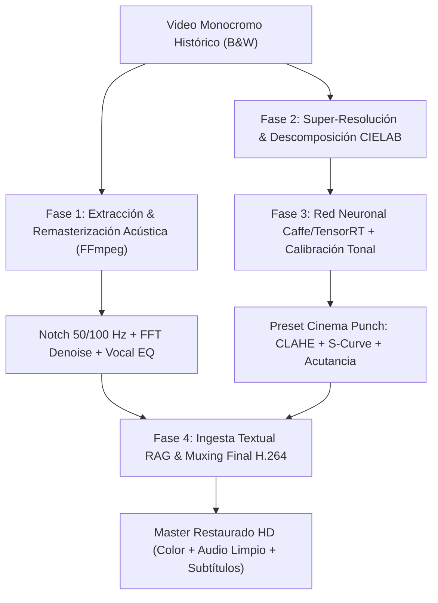

# JarBees Historical Media Restoration & Color Engineering Skill

Este skill dota a **JarBees** de la capacidad integral de procesar, restaurar, colorear mediante redes neuronales calibradas, remasterizar acústicamente y subtitular material fílmico histórico monocromo (kinescopios, celuloide de 16mm/35mm y grabaciones magnéticas analógicas), integrando el conocimiento extraído al motor documental RAG de PostgreSQL.

---

## 1. Fundamentos y Flujo de Trabajo (Pipeline de 4 Fases)



---

## 2. Fase 1: Remasterización Acústica Profesional

Las grabaciones históricas británicas y europeas (como la BBC de 1959) suelen tener contaminación por zumbido de la red eléctrica de 50 Hz y sus armónicos (100 Hz), además de soplido de cinta y compresión dinámica analógica.

### Cadena de Filtros de Audio en FFmpeg:
```bash
ffmpeg -y -i input_film.mp4 -vn \
  -af "highpass=f=75,bandreject=f=50:w=4,bandreject=f=100:w=4,afftdn=nf=-23:tn=1,equalizer=f=2800:width_type=o:width=1.5:g=3.5,equalizer=f=5500:width_type=o:width=1.5:g=4.0,loudnorm=I=-16:TP=-1.5:LRA=11" \
  -c:a aac -b:a 192k audio_remastered.m4a
```

* **`bandreject=f=50:w=4` y `bandreject=f=100:w=4`**: Elimina de raíz el hum de corriente alterna de 50 Hz sin perjudicar la voz humana grave (corte ultra estrecho $Q > 12$).
* **`afftdn=nf=-23:tn=1`**: Supresor adaptativo de soplido por FFT (Fast Fourier Transform).
* **`equalizer=f=2800... g=3.5` y `f=5500... g=4.0`**: Realce de formantes consonánticos y presencia vocal en frecuencias de inteligibilidad.
* **`loudnorm`**: Normalización dinámica EBU R128 para balance broadcast contemporáneo.

---

## 3. Fase 2 & 3: Colorización Neuronal y Calibración Estética (CIELAB)

Las redes neuronales de colorización por defecto (como el modelo ECCV 2016 de Berkeley) suelen sobre-saturar la piel hacia tonos rojizos intensos ($a^* > 145$). JarBees implementa un **módulo de transferencia de momentos estadísticos** en el espacio CIELAB.

### Algoritmo de Calibración Tonal JarBees:
1. **Predicción de crominancia básica ($a^*, b^*$):** Inferencia con la red neuronal sobre luminancia normalizada $L \in [0, 100]$.
2. **Mapeo a la paleta objetivo:**
   $$\hat{a} = (a - \mu_{a,\text{pred}}) \cdot \frac{\sigma_{a,\text{target}}}{\sigma_{a,\text{pred}} + \epsilon} + \mu_{a,\text{target}}$$
   $$\hat{b} = (b - \mu_{b,\text{pred}}) \cdot \frac{\sigma_{b,\text{target}}}{\sigma_{b,\text{pred}} + \epsilon} + \mu_{b,\text{target}}$$
   * **Targets de referencia estética (Paleta cálida y sobria):**
     * $\mu_a = 132.5, \sigma_a = 5.7$
     * $\mu_b = 133.3, \sigma_b = 8.4$
3. **Anclaje de Blancos Puros (White Specular Anchor):**  
   Para evitar que el cuello de la camisa o el cabello canoso se tiñan de amarillo o magenta:
   $$\text{white\_mask} = \text{clip}\left(\frac{L - 195}{60}, 0, 1\right)$$
   $$a_{\text{final}} = \hat{a} \cdot (1 - 0.85 \cdot \text{white\_mask}) + 128 \cdot (0.85 \cdot \text{white\_mask})$$

---

## 4. Preset "Cinema Punch & Acutance"

Para evitar el aspecto "lechoso" o lavado de las digitalizaciones antiguas (donde los negros suelen estar en valor 51):

1. **Expansión del Rango Dinámico con Curva S:**
   $$L_{\text{punch}} = \text{clip}\left( \left(\frac{\text{CLAHE}(L)}{255}\right)^{1.30} \times 255, 0, 255 \right)$$
   Lleva los negros a $0 - 5$, logrando un ratio de contraste de más de $110:1$ hasta $195:1$.
2. **CLAHE (Contrast Limited Adaptive Histogram Equalization):**
   * `clipLimit = 2.2`, `tileGridSize = (8, 8)` sobre el canal $L$.
   * Acentúa el microcontraste en arrugas, monturas de gafas y texturas de telas.
3. **Máscara de Enfoque (Unsharp Masking):**
   * $\text{Sharp} = 1.40 \cdot I_{\text{merged}} - 0.40 \cdot \text{Gaussian}(I, \sigma=2.5)$.
4. **Filtro Bilateral de Croma:**
   * Suavizado gaussiano en canales $U, V$ para erradicar el parpadeo de color analógico.

---

## 5. Ingesta Textual y Subtitulado en el Ecosistema RAG

Siguiendo las reglas de persistencia incremental:
1. **Subtítulos ANSI Windows-1252:**
   * Archivos `.srt` exportados obligatoriamente en codificación ANSI (Windows-1252 / `latin1`), nunca UTF-8, reemplazando caracteres tipográficos especiales.
2. **Base de Datos PostgreSQL (Prisma):**
   * Ingesta vinculada del audio original (`language: 'en'`) y la traducción restaurada (`language: 'es'`, `translatedFromId`).
   * Vectorización de chunks con `bge-m3:latest` (1024D) desde Ollama local.

