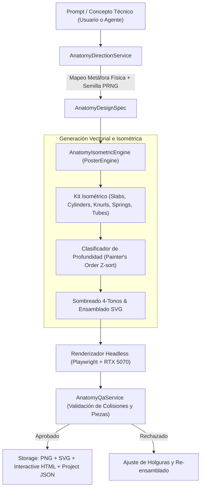

# 📐 Plan de Implementación: JarBees Anatomy & Isometric Graphic Studio

> **Documento:** Plan de Arquitectura e Implementación Técnica  
> **Fecha:** 12 de Octubre, 2026  
> **Estado:** Listo para revisión de equipo  
> **Inspiración:** Skill `wheresryan22/anatomy` de Claude Code & JarBees Procedural Graphic Studio  

---

## 1. Resumen Ejecutivo y Motivación

El objetivo de este plan es incorporar la filosofía, matemáticas y capacidades de la skill **Anatomy** al subsistema de generación gráfica de JarBees ([`PROCEDURAL_STUDIO_ARCHITECTURE.md`](file:///c:/Projects/productos_crud_bkd/docs/PROCEDURAL_STUDIO_ARCHITECTURE.md)).

Mientras que los modelos de difusión neuronal (Midjourney, Flux, SD) fallan sistemáticamente en la creación de infografías técnicas con precisión milimétrica, jerarquías mecánicas limpias y textos nítidos, la arquitectura **Anatomy** introduce un paradigma determinista y vectorial:
> **"The object is the explanation" (El objeto físico es la explicación):**  
> Todo concepto abstracto (colas de mensajes, microservicios, caché, render targets) se materializa como una máquina física analógica detallada (plóter gantry, banco de pruebas con resortes, diales de precisión, consolas retro, gabinetes seccionados).

Aprovechando la infraestructura ya validada en JarBees —motor Playwright con GPU dedicada **NVIDIA GeForce RTX 5070**, evaluación desacoplada en [`PosterQualityAssuranceService`](file:///c:/Projects/productos_crud_bkd/src/jarvis/tools/poster/qa/poster-qa.service.ts) y manifiestos `PosterProject`— este subsistema dotará a la plataforma de un generador de **diagramas técnicos e isométricos de altísima fidelidad**.

---

## 2. Taxonomía de Entregables (Salida Multi-Formato)

Cada solicitud procesada por el motor Anatomy generará simultáneamente cuatro artefactos:

| Formato | Tecnología | Propósito | Destino |
| :--- | :--- | :--- | :--- |
| **1. Imagen Rasterizada** | `.png` / `.webp` (2048×2048 o 4K) | Carátula, documentación, posts y redes. Renderizado en GPU con Playwright. | `storage/posters/${id}.png` |
| **2. Vectorial Editable** | `.svg` puro | Diseño en Figma / Illustrator, impresión en gran formato y nitidez infinita. | `storage/posters/${id}.svg` |
| **3. Componente Interactivo** | `.html` standalone (o React/Next) | Diagrama interactivo con resortes (*springs*), animación suave y lectura en vivo. | `storage/posters/${id}_interactive.html` |
| **4. Manifiesto del Proyecto** | `${id}_project.json` v1 | Trazabilidad exacta, parámetros de piezas, semilla y telemetría de QA. | `storage/posters/${id}_project.json` |

---

## 3. Arquitectura del Flujo de Datos

---

## 4. Componentes a Desarrollar en el Backend

### 4.1. Motor: `AnatomyIsometricEngine`
* **Ubicación:** `src/jarvis/tools/poster/engines/anatomy-isometric.engine.ts`
* **Implementa:** [`PosterEngine`](file:///c:/Projects/productos_crud_bkd/src/jarvis/tools/poster/engines/poster-engine.interface.ts)
* **Responsabilidades:**
  1. Transformar una especificación `AnatomyDesignSpec` en geometría isométrica estricta (azimut 45°/35°, elevación 30°/44°).
  2. Implementar el algoritmo de orden de pintor (*Painter's order*) dividiendo ensambles envolventes en capas anterior/posterior.
  3. Aplicar paletas de sombreado técnico de 4 tonos (*highlight, light, shade, shadow*).
  4. Generar la tarjeta marco (*frame card*) con identificador `Fig n`, título superior, indicación de interacción y lectura de datos en vivo.

### 4.2. Primitivas Paramétricas: `AnatomyKit`
* **Ubicación:** `src/jarvis/tools/poster/assets/anatomy/`
* **Módulos del Kit:**
  * `primitives.ts`: Generadores de polígonos isométricos (`slabOf`, `cylinder`, `chamfer`, `extrudePrism`).
  * `hardware.ts`: Tornillos, pernos moleteados (`knurls`), arandelas, ranuras y reglas milimetradas (`ticks`).
  * `piping.ts`: Tubos curvos, codos y arneses con cálculo de radios de curvatura.
  * `kinematics.ts`: Muelles comprimibles (`coil`), émbolos deslizantes y agujas de dial.

### 4.3. Servicio de Dirección de Metáforas: `AnatomyDirectionService`
* **Ubicación:** `src/jarvis/tools/poster/art-direction/anatomy-direction.service.ts`
* **Biblioteca de Metáforas Base:**
  * **Banco de Calibración / Test Rig:** Para conceptos de tolerancia, límites de carga o estrés de APIs.
  * **Plóter Gantry:** Para distribución de tareas, procesamiento por lotes o pools de recursos.
  * **Cerradura de Pines / Cilindro:** Para autenticación, hashing o validación de tokens.
  * **Gabinete Arcade con Cutaway:** Para sistemas embebidos, flujos cliente-servidor o arquitecturas de videojuegos.
  * **Gabinete de Cajones y Gavetas:** Para almacenamiento distribuido, bases de datos o asignación de memoria.

### 4.4. Extensión de Calidad: `AnatomyQaService`
* **Integración:** Extender [`PosterQualityAssuranceService`](file:///c:/Projects/productos_crud_bkd/src/jarvis/tools/poster/qa/poster-qa.service.ts) con las 4 pruebas de Anatomy:
  1. **Tolerancia Angular:** Ángulos isométricos de planos x/y en proyección verdadera (30° respecto a la horizontal).
  2. **Densidad Mecánica:** Conteo mínimo de componentes (Nivel *Figure*: 40–80 piezas; Nivel *Hero*: 80–150 piezas).
  3. **Auditoría de Holguras y Terminales:** Verificar que ningún tubo o cable termine en el vacío y que los elementos pasantes tengan collares/bujes de montaje.
  4. **Contraste de Leyenda:** Validación WCAG AA para la tarjeta de rotulación y datos técnicos.

---

## 5. Fases de Implementación (Roadmap)

### Fase 1: Especificación y Kit de Geometría Isométrica (Día 1)
- [ ] Definir interfaces de datos: `AnatomyDesignSpec`, `IsometricPart`, `AssemblyTree`.
- [ ] Implementar funciones matemáticas de proyección isométrica en `src/jarvis/tools/poster/assets/anatomy/projection.ts`.
- [ ] Construir catálogo básico de piezas: base con patas de goma, rieles graduados, micrómetro y tornillos.

### Fase 2: Implementación del Motor `AnatomyIsometricEngine` (Día 2)
- [ ] Crear clase `AnatomyIsometricEngine` implementando `PosterEngine`.
- [ ] Integrar el orden de pintor Z con cálculo de profundidad geométrica.
- [ ] Integrar exportación a SVG y renderizado rasterizado con Playwright (usando la GPU RTX 5070 ya diagnosticada).

### Fase 3: Mapeo de Conceptos & Presets de Máquinas (Día 3)
- [ ] Implementar `AnatomyDirectionService` con catálogo de máquinas arquetípicas.
- [ ] Soporte para modo interactivo standalone (`.html`) con física de resortes (*calm eased motion*).
- [ ] Generación automática de tarjeta descriptiva y telemetría en `_project.json`.

### Fase 4: QA Automatizado y Endpoints de API (Día 4)
- [ ] Registrar nuevo motor en [`PosterService`](file:///c:/Projects/productos_crud_bkd/src/jarvis/tools/poster/poster.service.ts) (`engine: 'anatomy-isometric'`).
- [ ] Habilitar selector de motor en [`poster.controller.ts`](file:///c:/Projects/productos_crud_bkd/src/jarvis/tools/poster/poster.controller.ts).
- [ ] Incorporar checks de auditoría geométrica en [`poster-qa.service.ts`](file:///c:/Projects/productos_crud_bkd/src/jarvis/tools/poster/qa/poster-qa.service.ts).

---

## 6. Criterios de Aceptación para la Revisión

1. **Determinismo:** Con la misma semilla y prompt técnico, el SVG y PNG deben ser idénticos pixel por pixel.
2. **Claridad Visual:** El diagrama debe ser comprensible a 1× de escala y revelar micro-detalles precisos (tornillería, biseles, escalas) a 4× de aumento.
3. **Desacoplamiento:** Funciona de forma 100% autónoma en el servidor sin dependencias externas de APIs de terceros (coste $0 por generación).
4. **Respeto a la GPU:** Renderizado de la escena en Playwright en menos de 1.5 segundos con aceleración Direct3D11 activa.
