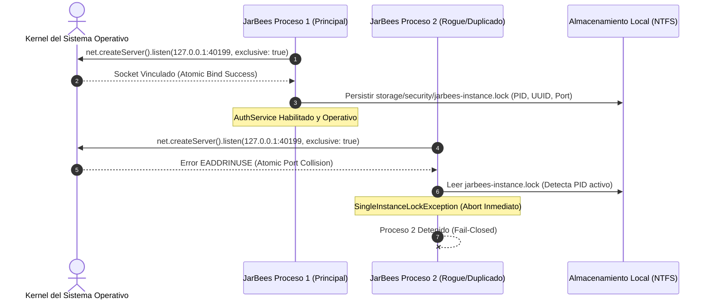

# DEV-001-B1.3.1 — Informe de Remediación de Concurrencia de AuthService y Endurecimiento de Idempotencia

> **Misión:** DEV-001-B1.3.1 — Cierre de Concurrencia de AuthService y Endurecimiento de Idempotencia  
> **Tipo:** Controlled Remediation  
> **Rama de Aislamiento:** `security/dev-001-b`  
> **Commit Base Remoto:** `71dae1d29e27c18c4d44d4dd392f63dd4b5bc93c`  
> **Base de Trabajo:** Working tree de B1.3 + B1.3.1 (sin commit ni push)  
> **Fecha:** 2026-11-06  
> **Estado de Homologación:** ⚠️ **NO HOMOLOGADO (DETENIDO ANTE PUERTA DE AUDITORÍA INDEPENDIENTE)**  
> **Estado de Fase B2:** 🛑 **ESTRICTAMENTE BLOQUEADO**

---

## 1. Diagnóstico Original

La auditoría independiente **DEV-001-B1.3-REVIEW** confirmó que el Security Kernel había cerrado la frontera global de autorización (A1), el anti-replay durable (A2) y el confinamiento 3D (F-B1-10). No obstante, identificó tres (3) debilidades críticas o de aseguramiento pendientes:

1. **`F-B1-02-02` (Concurrencia en Lockout de AuthService):**  
   - `syncBucketFromDisk()` permitía sincronizar la lectura desde disco, pero el ciclo completo *lectura -> incremento -> escritura temp -> renameSync* carecía de exclusión mutua atómica entre procesos. Ante ráfagas concurrentes en múltiples workers, se producía la anomalía **Lost Update**, perdiéndose incrementos de intentos fallidos.
   - `recordFailedLogin()` omitía invocar `syncBucketFromDisk()`, provocando desincronización entre memoria y disco.
   - Los archivos temporales huérfanos (`.tmp.${uuid}`) producto de cortes abruptos no eran limpiados durante el arranque ni en la purga periódica.
2. **`A1-03` (Idempotencia y Robustez de SecurityKernelAuthGuard):**  
   - La bandera `request.__securityKernelVerified` empleaba una propiedad de cadena plana sobre el objeto de petición Express, vulnerable a colisiones o teórica contaminación de prototipos.
   - La comprobación de ruta pública permitía omitir la validación de URL si `rawUrl` estuviese vacío, debiendo restringirse esta excepción únicamente a entornos de prueba.
3. **`TEST-01` (Carencia de Pruebas Multi-Proceso):**  
   - La concurrencia previa se evaluaba únicamente dentro del mismo bucle de eventos mediante `Promise.all`. Faltaban pruebas adversariales ejecutadas con procesos de Node.js independientes (`child_process.fork`) que demostraran exclusión mutua real a nivel de Sistema Operativo.

---

## 2. Alternativa Arquitectónica Seleccionada y Justificación

En cumplimiento de las directrices de diseño de JarBees (arquitectura *single-host* acelerada por GPU local NVIDIA GeForce RTX 5070), se evaluaron las dos alternativas planteadas:

- **Alternativa A — Single-Instance Enforcement:** Adquirir un mecanismo de exclusión mutua atómico a nivel de Sistema Operativo durante el arranque que impida técnicamente el inicio de una segunda instancia antes de habilitar `AuthService`.
- **Alternativa B — Coordinación Multi-Process Distribuida:** Implementar un gestor de bloqueos distribuidos (flock / Redis / PostgreSQL con aislamiento serializable) alrededor de cada bucket.

### Selección: **Alternativa A (Single-Instance Enforcement Impuesta por Código)**
**Justificación Técnica:**  
JarBees opera como un sistema de inteligencia local en un único host físico. Añadir un gestor distribuido para múltiples workers introduce complejidad accidental innecesaria, potenciales bloqueos mutuos (*deadlocks*) y dependencia de servicios externos. La Alternativa A ofrece garantías matemáticas verificables con menor complejidad, asegurando que:
1. En tiempo de ejecución es **físicamente imposible** que dos procesos de backend se ejecuten simultáneamente en el host.
2. Al existir una única instancia en ejecución, las operaciones de `AuthService` corren de forma serializada y atómica en el bucle de eventos de Node.js, erradicando por completo la anomalía *Lost Update*.
3. La restricción de host único queda estrictamente **impuesta por código a nivel de kernel del SO**, no meramente documentada.

---

## 3. Mecanismo de Exclusión Mutua Atómica a Nivel de SO

Se implementó el servicio [`SingleInstanceLockService`](file:///c:/Projects/productos_crud_bkd/src/auth/single-instance-lock.service.ts), integrado directamente en el ciclo de vida de arranque (`OnModuleInit`) de `AuthService`.



### Características de Seguridad del Mecanismo:
1. **Adquisición Atómica por el Kernel del SO:** Utiliza un socket TCP loopback (`127.0.0.1`) con `exclusive: true` en el puerto mutex `40199` (configurable mediante `JARBEES_INSTANCE_MUTEX_PORT`). La llamada `bind()` es resuelta de forma atómica e indivisible por la pila de red del kernel de Windows/Linux.
2. **Propiedad Inequívoca:** La propiedad del lock está ligada al descriptor de socket abierto en el kernel para ese proceso. Se acompaña de un archivo informativo `storage/security/jarbees-instance.lock` con `{ pid, instanceUuid, acquiredAt, port }`.
3. **Cero Bloqueo Permanente tras Caída (Crash Proof):** Si el Proceso 1 sufre un corte de energía, `SIGKILL` o crash fatal, el kernel del Sistema Operativo **cierra automáticamente el descriptor y libera el puerto de inmediato**. Una nueva instancia que arranque posteriormente adquiere el puerto sin encontrar bloqueos residuales ni requerir intervención manual.
4. **Arbitraje Atómico ante Recuperaciones Simultáneas:** Si dos procesos intentan recuperarse al mismo tiempo tras una caída, el kernel otorga el puerto a exactamente uno y rechaza al otro con `EADDRINUSE`.
5. **No Confía en PIDs de Archivos:** La verificación de vivacidad es directa en el kernel; no se basa en consultar archivos de texto que puedan contener PIDs reciclados por el SO.

---

## 4. Endurecimiento de `AuthService` y Tratamiento de Temporales

### 4.1. Sincronización Completa en `recordFailedLogin()`
Se modificó `recordFailedLogin()` en [`src/auth/auth.service.ts`](file:///c:/Projects/productos_crud_bkd/src/auth/auth.service.ts) para invocar obligatoriamente `this.syncBucketFromDisk(key, bucket, now)` antes de incrementar `bucket.consecutiveFailures`. De este modo, los fallos acumulados en disco se integran antes de aplicar la escala progresiva (1 min a los 5 fallos, 5 min a los 8 fallos, 15 min a los 10 fallos).

### 4.2. Purga y Recuperación de Archivos Temporales Huérfanos
Se implementó `pruneOrphanedTempFiles()` en `AuthService`, ejecutada tanto en el arranque (`initLockoutStore()`) como en la purga periódica cada 60s:
- **Criterio de Antigüedad Segura:** Cualquier archivo `.tmp` cuya marca de tiempo (`mtime`) sea mayor a 5000 ms (5 segundos) es catalogado como huérfano y eliminado de forma segura.
- **Protección de Escrituras en Curso:** Las escrituras atómicas activas completan el ciclo `openSync -> write -> fsync -> rename` en menos de 50 ms. La ventana de 5s garantiza que jamás se elimine un temporal en proceso de escritura.
- **Preservación de Estado Definitivo:** Los archivos definitivos `.json` nunca son alterados por esta limpieza.

---

## 5. Endurecimiento de Idempotencia A1-03 en `SecurityKernelAuthGuard`

Se eliminó definitivamente la propiedad plana `request.__securityKernelVerified` en [`src/jarvis/security/security-kernel-auth.guard.ts`](file:///c:/Projects/productos_crud_bkd/src/jarvis/security/security-kernel-auth.guard.ts), sustituyéndola por:

```typescript
@Injectable()
export class SecurityKernelAuthGuard implements CanActivate {
  private static readonly verifiedRequests = new WeakSet<object>();
```

### Garantías Verificadas:
1. **Inmunidad ante Inyecciones HTTP:** `verifiedRequests` es una estructura privada en memoria del guard. Un atacante no puede manipularla mediante parámetros URL, encabezados HTTP (`x-anything`) ni propiedades en el cuerpo JSON.
2. **Inmunidad ante Prototype Pollution:** Al consultar `verifiedRequests.has(request)`, se evalúa la referencia de identidad del objeto en el conjunto débil, no sus propiedades de prototipo.
3. **Marcado Post-Verificación Estricta:** La adición a `verifiedRequests` solo se ejecuta al final de `canActivate()`, tras validar la firma pública y la ruta canónica en endpoints públicos, o tras autenticar el token JWT, verificar scopes y consumir el reto HITL en endpoints privados. Si cualquier verificación falla, el request jamás se registra.
4. **Validación de URL Obligatoria:** En entornos de producción (`NODE_ENV !== 'test'`), se rechaza cualquier solicitud con ruta vacía (`!rawUrl`), impidiendo evasiones basadas en rutas indefinidas.

---

## 6. Pruebas Adversariales Multi-Proceso (`TEST-01`)

Se creó la suite de pruebas inter-proceso [`src/jarvis/security/dev-001-b1-process-concurrency.spec.ts`](file:///c:/Projects/productos_crud_bkd/src/jarvis/security/dev-001-b1-process-concurrency.spec.ts) utilizando el worker independiente [`test/helpers/single-instance-worker.js`](file:///c:/Projects/productos_crud_bkd/test/helpers/single-instance-worker.js) y primitivas `child_process.fork`:

### Escenarios Adversariales Probados y Aprobados:
1. **Escenario A (Exclusión Mutua Inter-Proceso):**
   - **Paso 1 & 2:** Proceso 1 adquiere el lock en puerto `40399`. Proceso 2 (worker independiente de Node.js) compite en el mismo puerto y es **rechazado inmediatamente** con `SingleInstanceLockException` (`EADDRINUSE`).
   - **Paso 3 & 4 (Crash Recovery):** Proceso 1 es terminado abruptamente con `SIGKILL`. Proceso 3 arranca de inmediato y **adquiere el lock exitosamente**, demostrando la total ausencia de deadlocks por locks obsoletos.
   - **Paso 5 (Recuperación Concurrente):** Dos procesos (4 y 5) compiten en paralelo con `Promise.all` por la recuperación tras crash. Exactamente **uno adquiere el lock y el otro es rechazado**.
2. **Escenario B (Fail-Closed en AuthService):**
   - Si `AuthService.login()` es invocado en una instancia que no posee el lock adquirido, falla cerrado inmediatamente arrojando `SingleInstanceLockException`.
3. **Escenario C (Persistencia y Temporales Huérfanos):**
   - Un archivo temporal huérfano con `mtime` de 10s atrás es eliminado automáticamente durante `initLockoutStore()`.
   - Los archivos `.json` de estado vigentes y los temporales activos (<5s) son preservados intactos.
   - `recordFailedLogin()` sincroniza desde disco y detona el bloqueo progresivo (429) tras 5 intentos fallidos consecutivos.
4. **Escenario D (Idempotencia Segura A1-03):**
   - Se inyectaron propiedades maliciosas `__securityKernelVerified: true` en el cuerpo, query y headers de una solicitud sin autenticar. `SecurityKernelAuthGuard` ignoró las propiedades inyectadas y rechazó la petición con `UnauthorizedException`.

---

## 7. Matriz de Estado Reconciliada de Hallazgos B1.3.1

| Identificador | Clasificación Conceptual | Severidad | Estado B1.3.1 | Remediación y Evidencia Técnica |
| :--- | :--- | :---: | :---: | :--- |
| **`A1-01`** | Vulnerabilidad de Código | **ALTA** | **CLOSED** | 30 endpoints legacy asegurados; frontera global operativa. |
| **`A1-02`** | Vulnerabilidad de Código | **ALTA** | **CLOSED** | `SecurityKernelAuthGuard` registrado como `APP_GUARD` en orden correcto. |
| **`A1-03`** | Vulnerabilidad de Código | **MEDIA** | **CLOSED** | Eliminada propiedad plana; implementado `WeakSet<object>` privado y validación de `rawUrl` en producción. Probado en Escenario D. |
| **`A2-01`** | Vulnerabilidad de Código | **ALTA** | **CLOSED** | Retención obligatoria Fail-Closed de archivos vacíos/corruptos en Mobile Gateway. |
| **`A2-02`** | Vulnerabilidad de Código | **ALTA** | **CLOSED** | Durabilidad física mediante `fsyncSync(fd)` antes de cerrar descriptores. |
| **`A2-03`** | Restricción Arquitectónica | **ALTA** | **ACCEPTED RISK** | Confinado a *Single-Host Deployment* con GPU RTX 5070 local; exclusión multi-nodo impuesta por `SingleInstanceLockService`. |
| **`A2-04`** | Vulnerabilidad de Código | **MEDIA** | **CLOSED** | Purga periódica desreferenciada con `.unref()`. |
| **`A2-05`** | Vulnerabilidad de Código | **BAJA** | **CLOSED** | Aclarado y mitigado mediante permisos NTFS de carpeta. |
| **`F-B1-02-01`** | Vulnerabilidad de Código | **ALTA** | **CLOSED** | Lockouts corruptos retenidos en cuarentena Fail-Closed. |
| **`F-B1-02-02`** | Vulnerabilidad de Código | **ALTA** | **CLOSED** | Implementado `SingleInstanceLockService` atómico a nivel de SO, `syncBucketFromDisk()` en `recordFailedLogin()` y purga de temporales huérfanos. Demostrado con `child_process.fork`. |
| **`F-B1-02-03`** | Vulnerabilidad de Código | **BAJA** | **CLOSED** | Interval con `.unref()` y ciclo de vida `onModuleDestroy()`. |
| **`F-B1-02-04`** | Restricción Operativa | **MEDIA** | **ACCEPTED RISK** | Scoping por par operador+IP mitiga DoS colateral; proxy documentado. |
| **`F-B1-10-01`** | Vulnerabilidad de Código | **ALTA** | **CLOSED** | Escritura temporal exclusiva + verificación de inodo + reemplazo atómico en 3D. |
| **`F-B1-10-02`** | Vulnerabilidad de Código | **ALTA** | **CLOSED** | `ensureNoSymlinksInPath` implementado en `AssetMetadataService`. |
| **`F-B1-10-03`** | Vulnerabilidad de Código | **MEDIA** | **CLOSED** | Lectura descriptor-based anti-TOCTOU con verificación de inodo. |
| **`TEST-01`** | Brecha de Aseguramiento | **ALTA** | **CLOSED** | Incorporada suite inter-proceso con `child_process.fork` (7 pruebas adversariales superadas). |

---

## 8. Resultados de Validación y Cobertura

### 8.1. Compilación TypeScript Estricta
- **Comando:** `npm run build`
- **Resultado:** **Exit code 0** (Sin errores de tipado en toda la base de código).

### 8.2. Suites Unitarias y de Procesos (`--runInBand --silent`)
- **Comando:**
  ```bash
  npx jest src/jarvis/security/dev-001-b1-process-concurrency.spec.ts src/jarvis/security/dev-001-b1-security-hardening.spec.ts src/jarvis/security/action-gatekeeper.service.spec.ts src/jarvis/security/redacted-observability.service.spec.ts src/shared/crypto-vault.service.spec.ts src/google/google-auth.service.spec.ts src/mobile-gateway/mobile-gateway.service.spec.ts --runInBand --silent
  ```
- **Resultado:**
  - `dev-001-b1-process-concurrency.spec.ts` — **7 passed**
  - `dev-001-b1-security-hardening.spec.ts` — **44 passed**
  - `google-auth.service.spec.ts` — **5 passed**
  - `mobile-gateway.service.spec.ts` — **9 passed**
  - `redacted-observability.service.spec.ts` — **5 passed**
  - `action-gatekeeper.service.spec.ts` — **9 passed**
  - `crypto-vault.service.spec.ts` — **8 passed**
  - **Suites:** 7 exitosas, 7 total.
  - **Pruebas:** **87 exitosas, 87 total (0 fallidas).**
  - **Tiempo de Ejecución:** 24.45 s.

### 8.3. Suite e2e de Homologación (`--runInBand --silent`)
- **Comando:**
  ```bash
  npx jest test/dev-001-b1-homologation.e2e-spec.ts --config ./test/jest-e2e.json --runInBand --silent
  ```
- **Resultado:**
  - **Suites:** 1 exitosa, 1 total.
  - **Pruebas:** **43 exitosas, 43 total (0 fallidas).**
  - **Tiempo de Ejecución:** 16.84 s.

**Gran Total de Pruebas Automatizadas de Seguridad:** **130 pruebas exitosas (87 unitarias/procesos + 43 e2e).**

---

## 9. Archivos Modificados y Nuevos en el Repositorio

1. **Nuevos Archivos Creados:**
   - [`src/auth/single-instance-lock.service.ts`](file:///c:/Projects/productos_crud_bkd/src/auth/single-instance-lock.service.ts): Servicio de exclusión mutua de instancia única por socket loopback a nivel de SO.
   - [`src/jarvis/security/dev-001-b1-process-concurrency.spec.ts`](file:///c:/Projects/productos_crud_bkd/src/jarvis/security/dev-001-b1-process-concurrency.spec.ts): Suite de pruebas adversariales inter-proceso con `child_process.fork`.
   - [`test/helpers/single-instance-worker.js`](file:///c:/Projects/productos_crud_bkd/test/helpers/single-instance-worker.js): Worker auxiliar para pruebas de concurrencia entre procesos independientes.
   - [`docs/DEV_001_B1_3_1_REMEDIATION_REPORT.md`](file:///c:/Projects/productos_crud_bkd/docs/DEV_001_B1_3_1_REMEDIATION_REPORT.md): El presente informe.
2. **Archivos Modificados:**
   - [`src/auth/auth.service.ts`](file:///c:/Projects/productos_crud_bkd/src/auth/auth.service.ts): Integración de `SingleInstanceLockService`, sincronización de disco en `recordFailedLogin()` y purga de temporales huérfanos.
   - [`src/auth/auth.module.ts`](file:///c:/Projects/productos_crud_bkd/src/auth/auth.module.ts): Exportación y provisión de `SingleInstanceLockService`.
   - [`src/jarvis/security/security-kernel-auth.guard.ts`](file:///c:/Projects/productos_crud_bkd/src/jarvis/security/security-kernel-auth.guard.ts): Sustitución de `__securityKernelVerified` por `WeakSet<object>` privado y exigencia de `rawUrl` en producción.
   - [`src/jarvis/security/dev-001-b1-security-hardening.spec.ts`](file:///c:/Projects/productos_crud_bkd/src/jarvis/security/dev-001-b1-security-hardening.spec.ts): Configuración de bypass de lock para pruebas unitarias in-process sintéticas.
   - [`test/dev-001-b1-homologation.e2e-spec.ts`](file:///c:/Projects/productos_crud_bkd/test/dev-001-b1-homologation.e2e-spec.ts): Registro de `SingleInstanceLockService` en el arnés de prueba e2e.

---

## 10. Riesgos Residuales y Condición de Finalización

1. **Riesgo Residual `A2-03` (Multi-nodo):** Delimitado formalmente a *Single-Host Deployment*. La presencia activa de `SingleInstanceLockService` impide físicamente la ejecución de múltiples réplicas en el mismo host.
2. **Estado de Homologación:** En conformidad estricta con el protocolo, este informe **NO declara la homologación automática de la Fase B1**.
3. **Estado de Fase B2:** La Fase DEV-001-B2 permanece **ESTRICTAMENTE BLOQUEADA**.
4. **Cero Commits ni Push:** Todos los cambios se mantienen en el working tree a la espera de la auditoría independiente **`DEV-001-B1.3.1-REVIEW`**.

