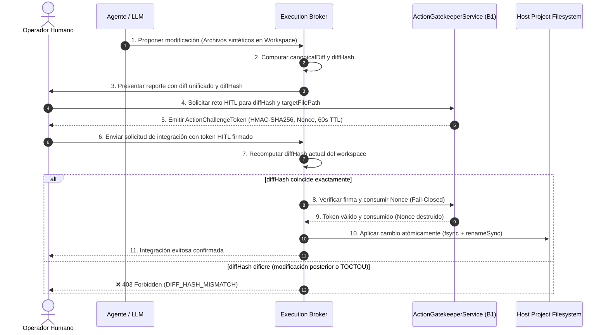

# DEV-001-B2.0.1 — Diseño del Modelo de Autorización Criptográfica Human-In-The-Loop (HITL)

**Misión:** DEV-001-B2.0.1  
**Fecha:** 2026-11-06  
**Modo:** STRICT READ-ONLY / AUDITORÍA DE ARQUITECTURA  
**Rama de Referencia:** `security/dev-001-b`  
**Commit de Referencia:** `c459087` (con `2d6bf29`)  
**Dependencia:** DEV-001-B2.0 (Design Preliminar)  
**Estado:** Documento de Diseño y Validación Técnica (Sin cambios en código)

---

## 1. Principio de Inmutabilidad de la Autorización Humana

En la arquitectura de JarBees, **una aprobación humana jamás es un permiso genérico**. No existe la noción de *"el operador autorizó al agente a modificar el proyecto"*. 

La autorización humana es un contrato matemático de validez temporal efímera, vinculado de forma criptográfica indisoluble a una **mutación exacta de código y a un destino exacto**:

> **Si un solo byte del diff propuesto cambia después de que el operador lo revisó, la autorización queda automáticamente invalidada y la operación es rechazada con `403 Forbidden` (*Fail-Closed*).**

---

## 2. Parámetros Vinculados Criptográficamente en el Token

Cada autorización HITL emitida por el `ActionGatekeeperService` (B1) para operaciones de modificación de código o acciones sensibles de B2 debe encapsular los siguientes 7 factores:

```typescript
export interface HitlCodeIntegrationPayload {
  actorId: string;             // 1. Identidad verificada del operador (ej: 'ignacio.operator')
  actionType: string;          // 2. Operación estricta ('CODE_INTEGRATE_DIFF' | 'ENGINEERING_APPROVE_MISSION')
  workspaceId: string;         // 3. Identificador único del workspace efímero de origen
  targetBranch: string;        // 4. Rama destino exacta (ej: 'security/dev-001-b')
  targetFilePath: string;      // 5. Ruta canónica del archivo destino en el proyecto
  diffHash: string;            // 6. Hash SHA-256 canónico del diff unificado
  targetBaseCommitSha: string; // 7. Commit base sobre el cual se calculó el diff
}
```

### 2.1. Cálculo Determinista del `diffHash`
Para evitar discrepancias causadas por saltos de línea de Windows (`CRLF`) vs Unix (`LF`) o espacios en blanco finales, el diff se normaliza antes del cálculo del hash:

$$\text{canonicalDiff} = \text{diffText.replace}(/\r\n/g, '\n').\text{trim}()$$
$$\text{diffHash} = \text{crypto.createHash}('sha256').\text{update}(\text{canonicalDiff}, 'utf8').\text{digest}('hex')$$

---

## 3. Protocolo de 5 Pasos para Integración Segura de Cambios



---

## 4. Garantías de Seguridad del Protocolo

### 4.1. Neutralización de Ataques TOCTOU (Time-of-Check to Time-of-Use)
Si el agente, un subproceso concurrente o un archivo modificado en disco altera el contenido entre el momento en que el operador leyó el diff (Paso 3) y el momento en que el Broker ejecuta la integración (Paso 7), el Broker recomputa el hash del archivo actual en el workspace:
$$\text{currentDiffHash} \neq \text{token.payload.diffHash}$$
El Broker aborta inmediatamente la operación antes de tocar el sistema de archivos del proyecto.

### 4.2. Destrucción Inmediata del Nonce (Garantía de Uso Único)
En el Paso 8, `ActionGatekeeperService` elimina el `nonce` de su almacén activo de memoria:
```typescript
this.activeNonces.delete(nonce);
```
Si el operador o un intermediario intenta reutilizar el mismo token para una segunda aplicación o en otro archivo, la petición colisiona con:
```
403 Forbidden: "Action challenge token has already been consumed or has expired."
```

### 4.3. Caducidad Estricta de 60 Segundos
El token posee un tiempo de vida máximo (TTL) de 60.000 ms. Si el operador se demora más de un minuto en confirmar la operación, el token expira automáticamente y debe generarse una nueva solicitud con un diff fresco.

---

## 5. Especificación del Endpoint del Broker para Integraciones

```typescript
export interface ApplyDiffRequestDto {
  workspaceId: string;
  targetFilePath: string;
  humanApprovalToken: string;
  expectedDiffHash: string;
}

export interface ApplyDiffResponseDto {
  success: boolean;
  targetFilePath: string;
  appliedCommitOrTimestamp: string;
  diffHashVerified: string;
  auditRecordId: string;
}
```

### Lógica de Validación en el Execution Broker:
```typescript
async applyDiffToProject(dto: ApplyDiffRequestDto, actorId: string): Promise<ApplyDiffResponseDto> {
  // 1. Validar que la ruta de destino esté dentro del proyecto y no contenga symlinks
  const canonicalTarget = resolveConfinedProjectPath(dto.targetFilePath);
  ensureNoSymlinksInPath(canonicalTarget);

  // 2. Extraer el diff real actual del workspace
  const currentDiff = this.extractUnifiedDiff(dto.workspaceId, dto.targetFilePath);
  const currentDiffHash = computeCanonicalDiffHash(currentDiff);

  // 3. Verificar paridad exacta con el hash esperado por el cliente
  if (currentDiffHash !== dto.expectedDiffHash) {
    throw new ForbiddenException(
      `Operación abortada (TOCTOU): El diff actual (${currentDiffHash.slice(0, 8)}...) no coincide con el diff revisado por el operador (${dto.expectedDiffHash.slice(0, 8)}...).`
    );
  }

  // 4. Validar y consumir el token HITL en el Security Kernel (B1)
  const expectedPayload = {
    workspaceId: dto.workspaceId,
    targetFilePath: dto.targetFilePath,
    diffHash: currentDiffHash,
  };

  this.actionGatekeeper.verifyAndConsumeChallenge(
    dto.humanApprovalToken,
    'CODE_INTEGRATE_DIFF',
    dto.workspaceId,
    expectedPayload,
    actorId,
  );

  // 5. Aplicar escritura atómica confinada
  await this.atomicWriteToProject(canonicalTarget, currentDiff);

  // 6. Registrar en auditoría inmutable
  const auditRecord = await this.auditService.log('hitl.diff_applied', {
    actorId,
    targetFilePath: dto.targetFilePath,
    diffHash: currentDiffHash,
  });

  return {
    success: true,
    targetFilePath: dto.targetFilePath,
    appliedCommitOrTimestamp: new Date().toISOString(),
    diffHashVerified: currentDiffHash,
    auditRecordId: auditRecord.id,
  };
}
```

---

## 6. Conclusión del Modelo HITL

Este modelo elimina por completo la discrecionalidad del agente. El agente no puede modificar ni una sola línea de código en el proyecto anfitrión sin que:
1. Un humano haya leído el diff unificado textual.
2. Un token criptográfico firmado avale el hash exacto de ese diff.
3. El sistema verifique en el instante de la escritura que ni un solo byte ha cambiado.

