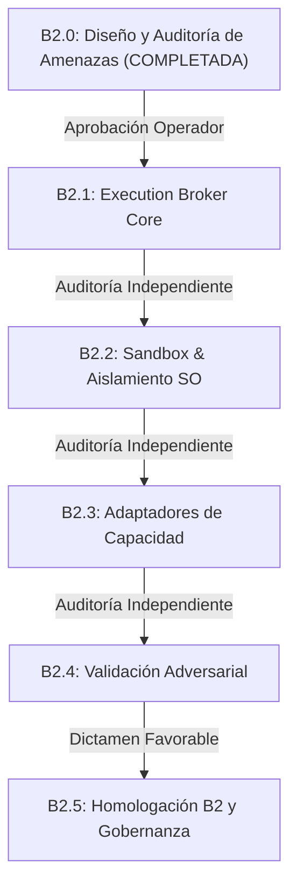

# DEV-001-B2.0 — Plan de Ruta de Implementación del Entorno de Ejecución (Execution Environment Roadmap)

**Misión:** DEV-001-B2.0  
**Fecha:** 2026-11-06  
**Modo:** STRICT READ-ONLY / AUDITORÍA DE ARQUITECTURA  
**Rama de Referencia:** `security/dev-001-b`  
**Commit de Referencia:** `c459087` (con `2d6bf29`)  
**Dependencia:** Homologación DEV-001-B1 bajo restricciones operacionales  
**Estado:** Documento de Diseño Arquitectónico (Sin cambios en código)  
**Veredicto de Diseño:** 🟢 **DESIGN READY**

---

## 1. Principio Rector del Avance de Fase

> [!IMPORTANT]
> **Regla de No-Progresión Automática:**  
> Ningún bloque habilita automáticamente el siguiente. La conclusión de una etapa técnica exige una auditoría independiente de solo lectura y la aprobación expresa del operador humano antes de iniciar la siguiente.  
> **La Fase DEV-001-B2 NO está homologada ni implementada en este informe.**

---

## 2. Estructura de Fases y Criterios de Aceptación

---

### Fase B2.0 — Auditoría de Arquitectura y Diseño (Estado: COMPLETADA)
- **Alcance:** Inventario completo de capacidades, modelo de amenazas, evaluación del hardware anfitrión y diseño formal del broker.
- **Entregables Producidos:**
  1. `docs/DEV_001_B2_0_CAPABILITY_INVENTORY.md`
  2. `docs/DEV_001_B2_0_THREAT_MODEL.md`
  3. `docs/DEV_001_B2_0_EXECUTION_BROKER_DESIGN.md`
  4. `docs/DEV_001_B2_0_SANDBOX_EVALUATION.md`
  5. `docs/DEV_001_B2_0_IMPLEMENTATION_ROADMAP.md`
- **Criterio de Aceptación:** Documentación exhaustiva, modo estrictamente de solo lectura, cero código modificado, veredicto emitido.

---

### Fase B2.1 — Núcleo del Execution Broker y Contratos Criptográficos
- **Objetivo:** Construir el punto único de entrada (`ExecutionBrokerService`) para recibir, validar y autorizar solicitudes de ejecución sin conectar aún herramientas peligrosas.
- **Alcance Técnico:**
  - Definición de tipos e interfaces de `ExecutionRequest`, `ExecutionResponse`, `CapabilityRegistry`.
  - Integración nativa con `ActionGatekeeperService` (B1) para validación de tokens HMAC-SHA256 y consumo de nonces de un solo uso.
  - Validación canónica estricta de rutas (`realpathSync`, comprobación anti-symlinks en todos los niveles).
  - Cortafuegos de red en el broker: resolución previa de DNS y bloqueo tajante de rangos privados (`127.0.0.0/8`, `10.0.0.0/8`, `192.168.0.0/16`, `169.254.0.0/16`, loopback y multicast).
  - Registro inmutable de auditoría con encadenamiento SHA-256 (`storage/security/execution-audit/`).
- **Criterios de Aceptación:**
  - Toda solicitud sin registrar en el `CapabilityRegistry` es rechazada con `403 Forbidden`.
  - Toda solicitud sensible sin token HITL firmado es rechazada con `403 Forbidden`.
  - Intentos de SSRF a `127.0.0.1` o IPs privadas son bloqueados de forma determinista antes de emitir tráfico.
  - Pruebas unitarias completas con `--runInBand --silent` aprobadas al 100%.

---

### Fase B2.2 — Infraestructura de Sandbox y Primitivas de Aislamiento de SO
- **Objetivo:** Implementar el arnés de ejecución confinado en el host utilizando primitivas de kernel de Windows.
- **Alcance Técnico:**
  - Adaptador nativo de Windows Job Objects (`win32-job-object` o wrappers C++ nativos/PowerShell compilado).
  - Aplicación de banderas críticas: `JOB_OBJECT_LIMIT_KILL_ON_JOB_CLOSE`, límites de memoria física (RAM máx 256 MB), cuota de CPU rate control (máx 50%) y límite de procesos activos (máx 5).
  - Ejecución bajo token restringido (Low Integrity / sin privilegios de Administrador).
  - Ciclo de vida efímero de workspaces: creación en `os.tmpdir()` con UUID único, permisos restrictivos NTFS (0o700) y purga atómica garantizada en `finally`.
- **Criterios de Aceptación:**
  - Fork bombs o bucles infinitos no pueden tumbar el host ni consumir más de 256 MB.
  - Al vencer el timeout, el árbol completo de procesos se extingue sin dejar procesos zombi (`taskkill` verificado).
  - El proceso confinado no puede escribir en claves de inicio de Registro ni en archivos fuera de su carpeta temporal.

---

### Fase B2.3 — Adaptadores de Capacidad con Privilegios Mínimos
- **Objetivo:** Conectar de forma segura las capacidades de negocio preexistentes a través del Broker y Sandbox.
- **Alcance Técnico:**
  - **Adaptador Filesystem:** Operaciones `read_file`, `write_file`, `list_directory` confinadas exclusivamente al workspace de la misión activa.
  - **Adaptador de Pruebas:** Migración de `IsolatedTestRunnerService` para ejecutarse dentro del Job Object con red deshabilitada a nivel de OS.
  - **Adaptador 3D/Media:** Conexión de `BlenderService` bajo cuota de proceso con acceso confinado a `storage/assets/`.
  - **Adaptador de Navegación Aislada:** Conexión de `BrowserToolService` con paso obligado a través del cortafuegos de salida del Broker; eliminación definitiva de flags `--no-sandbox` en navegadores.
- **Criterios de Aceptación:**
  - Los servicios preexistentes (`SafeExecService`, `IsolatedTestRunnerService`) dejan de invocar `child_process` directo en el host y pasan obligatoriamente por el Broker.
  - Cero variables de entorno de producción o secretos expuestos a los procesos hijos.

---

### Fase B2.4 — Batería de Validación Adversarial y Pruebas de Intrusión
- **Objetivo:** Someter el entorno completo a pruebas de ataque y abuso automatizadas antes de cualquier consideración de despliegue.
- **Casos de Prueba Adversariales Obligatorios:**
  1. *Prompt Injection Adversarial:* Inyección de directivas destructivas desde documentos RAG y páginas web simuladas.
  2. *Intento de Escape de Sandbox:* Scripts que intentan acceder a `.env`, archivos del sistema operativo y puertos locales (`4000`, `40199`).
  3. *Ataque de Consumo de Recursos:* Intentos de saturación de CPU, asignación masiva de buffers y generación masiva de subprocesos.
  4. *Ataque de Repetición y Sustitución de Tokens:* Manipulación de payloads firmados y reenvío de tokens ya consumidos.
  5. *Ataque de Symlinks / NTFS Junctions:* Creación de enlaces simbólicos maliciosos dentro del workspace temporal.
- **Criterios de Aceptación:**
  - 100% de los intentos adversariales rechazados o contenidos sin impacto en el host.
  - Auditoría independiente de solo lectura con dictamen técnico favorable.

---

### Fase B2.5 — Homologación Formal B2 y Gobernanza de Autonomía
- **Objetivo:** Declaración formal de homologación de Fase B2 y definición del marco de operación del agente autónomo.
- **Criterios de Aceptación:**
  - Aprobación formal del operador humano.
  - Integración en rama `security/dev-001-b`.
  - Registro de capacidades autorizadas y límites operativos en `CHANGELOG.md`.

---

## 3. Decisiones Arquitectónicas Pendientes para el Operador

Antes de emitir autorización para la apertura de la Fase **DEV-001-B2.1**, se somete a consideración del operador las siguientes tres decisiones fundamentales:

### Decisión 1: Tecnología Primaria de Sandboxing
- **Opción A (Recomendada):** Implementar el sandbox de Fase B2.2 mediante **Windows Job Objects + Tokens Restringidos**. Ventajas: cero dependencias externas, cero elevación de privilegios, disponibilidad inmediata en el host actual, latencia inferior a 10 ms y compatibilidad nativa con la GPU RTX 5070.
- **Opción B:** Provisionar una distribución Linux en **WSL2** y operar el sandbox dentro de un contenedor Linux. Ventajas: espacios de nombres POSIX y cortafuegos `iptables` estricto; Desventajas: requiere instalar paquetes en el host, mayor complejidad y mantenimiento de dos entornos.

### Decisión 2: Política de Salida a Internet para el Agente
- **Opción A (Máxima Seguridad):** Modo **Offline / Local-First Hermético**. El agente no puede realizar peticiones a Internet de forma autónoma. Solo opera con documentos locales y modelos en GPU.
- **Opción B (Acceso Confinado con Lista Blanca):** El agente puede consultar únicamente una lista blanca de dominios pre-aprobados (ej: APIs de documentación, repositorios científicos), con bloqueo tajante de IPs privadas y sin descarga de ejecutables.

### Decisión 3: Integración de Cambios en Código Fuente
- **Opción A (Human-in-the-Loop Obligatorio):** Ninguna modificación generada por el agente en un workspace puede aplicarse al repositorio del proyecto sin que el operador humano revise el diff y suministre un token HITL firmado.
- **Opción B (Autonomía Asistida en Ramas Temporales):** El agente puede integrar cambios automáticamente en ramas de prueba efímeras (`scratch/*`), reservando la aprobación humana para la promoción a ramas de desarrollo.

---

## 4. Veredicto Final de la Misión DEV-001-B2.0

> ### VEREDICTO OBLIGATORIO: 🟢 DESIGN READY
>
> 1. El inventario de capacidades identificó de forma exhaustiva los puntos de ejecución real y sus rutas de invocación.
> 2. El modelo de amenazas delimita claramente los límites de confianza y los vectores de ataque (Prompt Injection, SSRF, DoS, Path Traversal, Privilege Escalation).
> 3. La arquitectura del `Execution Broker` desacopla completamente el Intelligence Plane de la autoridad de ejecución, apoyándose en la base criptográfica de B1.
> 4. La evaluación de aislamiento técnico está sólidamente justificada sobre la configuración de hardware (i7-12700, 32GB RAM, RTX 5070) y software (Windows 10 Pro) real del anfitrión.
> 5. Se preservó el modo estrictamente de solo lectura: **cero archivos de código modificados, cero dependencias instaladas y ninguna capacidad autónoma habilitada**.
>
> **La Fase DEV-001-B2 permanece BLOQUEADA hasta que el operador determine las decisiones arquitectónicas y autorice formalmente la apertura de la Fase B2.1.**

