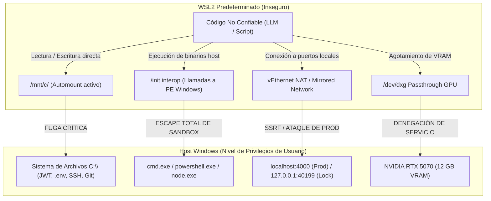
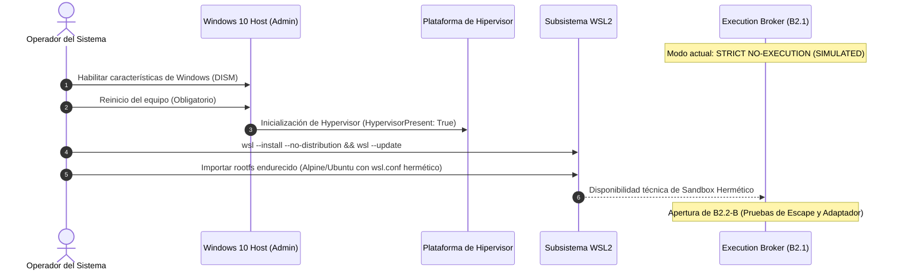

# DEV-001-B2.2-A: Auditoría de Factibilidad y Aislamiento de Sandbox WSL2
**Fecha:** 2026-11-06  
**Fase:** DEV-001-B2 (Frontera de Ejecución y Aislamiento)  
**Modalidad:** ESTRICTAMENTE READ-ONLY  
**Evaluador:** Auditor de Seguridad Independiente  
**Dictamen Técnico:** ⚠️ **BLOQUEADO OPERATIVAMENTE / NO INSTALADO EN EL HOST — REQUIERE ELEVACIÓN Y REINICIO**

---

## 1. Resumen Ejecutivo y Dictamen

La misión **DEV-001-B2.2-A** tuvo como objetivo inspeccionar la viabilidad real y las garantías de aislamiento de **WSL2 (Windows Subsystem for Linux 2)** en el host de JarBees, como candidato para alojar el entorno de ejecución de código no confiable (*untrusted code execution*).

### Dictamen de la Auditoría
1. **WSL2 no está operativo en el host:** La inspección del sistema operativo Windows 10 Pro (Build 19041) determinó que la plataforma de virtualización subyacente está inactiva (`HypervisorPresent: False`), el servicio `LxssManager` no existe en el sistema y no hay distribuciones Linux registradas.
2. **El binario `wsl.exe` es un stub de instalación:** Invocaciones a `wsl -l -v` o `wsl.exe` retornan el menú de instalación del sistema.
3. **El procesador sí cuenta con soporte de hardware:** El CPU Intel Core i7-12700 (12 núcleos, 20 hilos) tiene la virtualización por hardware (Intel VT-x) habilitada en el BIOS/firmware (`VirtualizationFirmwareEnabled: True`).
4. **Riesgo crítico de la configuración predeterminada de WSL2:** Si WSL2 se instala con la configuración estándar de Microsoft, **no ofrece aislamiento suficiente**: por defecto monta todo el disco del host en `/mnt/c/`, permite invocar binarios ejecutables de Windows desde Linux (`interop`) y comparte la red local.

> [!IMPORTANT]
> **Conclusión Inmediata:**  
> JarBees **no puede ejecutar código en WSL2 actualmente** sin una intervención administrativa previa en el host (activación de características de Windows y reinicio del equipo).  
> El **Execution Broker implementado en B2.1 DEBE PERMANECER en modo `STRICT NO-EXECUTION`** (`status: 'SIMULATED'`), garantizando que la aplicación continúe operando con total estabilidad y sin exponer el host.

---

## 2. Inventario de Hardware y Virtualización del Host

La inspección de solo lectura arrojó los siguientes parámetros reales del entorno:

| Parámetro | Valor Detectado | Evaluación de Seguridad |
| :--- | :--- | :--- |
| **Sistema Operativo** | Windows 10 Pro (10.0.19041 Build 19041) | Compatible con WSL2 tras actualización |
| **Procesador (CPU)** | 12th Gen Intel(R) Core(TM) i7-12700 (12C / 20T) | Rendimiento óptimo para aislamiento |
| **Virtualización en Firmware** | `VirtualizationFirmwareEnabled: True` | VT-x activo en placa base / BIOS |
| **Presencia de Hipervisor** | `HypervisorPresent: False` | **Hipervisor inactivo (Hyper-V apagado)** |
| **Memoria RAM Total** | 34,107,723,776 bytes (~32 GB) | Margen amplio para cuotas cgroups (2 GB) |
| **GPU Dedicada** | NVIDIA GeForce RTX 5070 (12 GB VRAM) | Driver 617.42, CUDA 13.4 UMD activo |
| **Servicio `LxssManager`** | No registrado / Inexistente | Característica WSL deshabilitada |
| **Distribuciones WSL** | 0 instaladas (`HKCU:\...\Lxss` ausente) | Entorno Linux inexistente |
| **Configuración `.wslconfig`** | Inexistente en `%USERPROFILE%` | Sin límites globales de RAM/CPU de VM |
| **Runtimes de Contenedores** | Ni Docker ni Podman presentes | No hay alternativas de contenedor OCI locales |

---

## 3. Modelo de Amenazas: Vector de Escape en WSL2 Predeterminado

Si se pretendiera habilitar WSL2 para ejecutar código generado por el LLM o código no confiable sin un endurecimiento riguroso, el entorno presentaría **cinco vectores directos de escape del sandbox**:



### Detalle de los Vectores de Ataque:

1. **Escape por Montaje Automático (`/mnt/c/`)**:
   - Por defecto, el subsistema de Microsoft monta las unidades NTFS de Windows bajo `/mnt/c/`.
   - Cualquier script ejecutado en WSL tiene acceso de lectura y escritura a las carpetas del usuario de Windows (`/mnt/c/Users/xiphos-pc1/`), exponiendo variables de entorno, claves secretas, repositorios y archivos del sistema.
2. **Escape por Interoperabilidad de Binarios (`interop`)**:
   - WSL registra un manejador en el kernel (`binfmt_misc`) que permite ejecutar binarios de Windows directamente desde la consola Linux.
   - Un atacante o código arbitrario puede invocar `/mnt/c/Windows/System32/powershell.exe` o `cmd.exe`, saltando instantáneamente la frontera del kernel de Linux para ejecutarse en el contexto del usuario de Windows.
3. **Pivoteo de Red y SSRF**:
   - El adaptador de red virtual de WSL2 se conecta al host Windows a través de un puente de red interno.
   - Código malicioso podría atacar directamente los servicios locales de JarBees en `localhost:4000` (servidor de producción) o `127.0.0.1:40199` (socket de exclusión mutua), o explorar la intranet corporativa.
4. **Acceso a Sesión Gráfica y Portapapeles (WSLg)**:
   - En versiones recientes de WSL, se exponen sockets Wayland y X11 que permiten la interacción con la interfaz de usuario de Windows y el portapapeles del sistema operativo.
5. **Agotamiento de Memoria de Video (VRAM) en la GPU**:
   - El módulo `/dev/dxg` permite aceleración por hardware con la NVIDIA RTX 5070.
   - Sin embargo, los drivers WDDM no aplican cuotas de VRAM estrictas a nivel de cgroups v2; un script infinito de asignación de tensores en PyTorch podría consumir los 12 GB de VRAM, provocando el crasheo del subsistema gráfico del host.

---

## 4. Arquitectura del Sandbox Hermético (Los 6 Controles Obligatorios)

Para que WSL2 pueda ser homologado como sandbox seguro para JarBees, **debe implementarse una distribución dedicada y aislada**, regida obligatoriamente por los siguientes 6 controles de contención:

### Control 1: Supresión Total de Montajes del Host (`automount = false`)
En la configuración `/etc/wsl.conf` de la distribución sandbox:
```ini
[automount]
enabled = false
mountFsTab = false
```
*Garantía:* El sistema de archivos `C:\` de Windows jamás se monta dentro de la máquina virtual. El entorno Linux opera exclusivamente sobre un disco virtual ext4 independiente.

### Control 2: Desactivación Terminante de Interoperabilidad (`interop = false`)
```ini
[interop]
enabled = false
appendWindowsPath = false
```
*Garantía:* Desactiva el soporte de `binfmt_misc`. Es técnicamente imposible lanzar ejecutables `.exe` de Windows desde el sandbox. Las variables de entorno de Windows no se heredan en el `PATH` de Linux.

### Control 3: Aislamiento de Red mediante Network Namespaces (Air-Gap)
El código debe ejecutarse dentro de un espacio de nombres de red (*network namespace*) sin interfaz de salida a internet ni ruta al host:
```bash
# Creación de namespace hermético
ip netns add jarbees-sandbox
ip netns exec jarbees-sandbox ip link set lo up
# Cero interfaces eth0 o veth conectadas hacia el exterior
```
*Garantía:* Conectividad de red saliente 100% nula. Imposibilidad de contactar el host, bases de datos o servicios externos (SSRF neutralizado por diseño).

### Control 4: Gobernanza Estricta de Recursos mediante Cgroups v2
Alojamiento del proceso en un grupo de control con límites duros:
```ini
# /sys/fs/cgroup/jarbees-sandbox/
memory.max = 2147483648       # Máximo 2 GB de RAM física
memory.swap.max = 0           # Cero swap en disco
cpu.max = 200000 100000       # Límite máximo de 2 núcleos de CPU (200% de cuota)
pids.max = 64                 # Prevención de fork-bombs
```
*Garantía:* Protección absoluta contra saturación de CPU, fugas de memoria o colapso del host.

### Control 5: Filesystem Efímero en RAM (Overlayfs / Tmpfs)
Cada ejecución debe montar un árbol de directorios de solo lectura (`lowerdir`) con una capa de escritura descartable en memoria (`tmpfs` como `upperdir`):
- Al finalizar la ejecución del comando, el punto de montaje se destruye y la memoria se libera.
- Cero persistencia de archivos, scripts temporales o residuos entre misiones.

### Control 6: Gobernanza de Cómputo GPU y Watchdog
- Acceso a `/dev/dxg` restringido exclusivamente a tareas que exijan inferencia o procesamiento visual validado.
- Watchdog de tiempo límite estricto (timeout de 30-60 segundos por operación) con terminación forzada (`SIGKILL`) si el proceso retiene la memoria de la GPU.

---

## 5. Ruta de Habilitación Operativa (Roadmap de Infraestructura)

Para que el operador pueda habilitar esta capacidad en el momento oportuno, se requiere la siguiente secuencia técnica:



### Comandos de Habilitación para el Operador (Requiere privilegios de Administrador):
```powershell
# 1. Habilitar la plataforma de máquina virtual y el subsistema WSL (PowerShell como Administrador)
dism.exe /online /enable-feature /featurename:VirtualMachinePlatform /all /norestart
dism.exe /online /enable-feature /featurename:Microsoft-Windows-Subsystem-Linux /all /norestart

# 2. Reiniciar el equipo para activar el hipervisor de Windows

# 3. Tras el reinicio, actualizar el kernel de WSL2
wsl.exe --update
```

---

## 6. Recomendación y Próximos Pasos

1. **Preservar el modo `STRICT NO-EXECUTION` en el Broker:**  
   Dado que el entorno de ejecución no está instalado en el host, el Execution Broker B2.1 cumple exactamente su propósito: el plano de decisión evalúa, audita y valida con tokens HITL, pero **no despacha llamadas al sistema operativo** (`executionDispatched: false`).
2. **No forzar la instalación inmediata sin autorización:**  
   La habilitación de WSL2 requiere elevación y reinicio del equipo, lo que interrumpiría la sesión de trabajo actual.
3. **Transición a DEV-001-B2.2-B (Diseño Formal del Sandbox):**  
   Con los hallazgos de esta auditoría, el siguiente paso debe ser documentar la especificación técnica de aprovisionamiento del contenedor hermético (`docs/DEV_001_B2_2_B_SANDBOX_DESIGN.md`), de modo que cuando el operador decida habilitar la característica en Windows, la imagen de ejecución cuente con el 100% de los controles anti-escape verificados por diseño.

