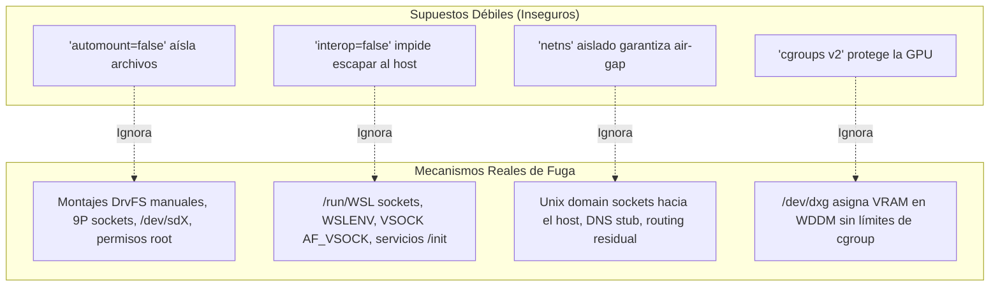
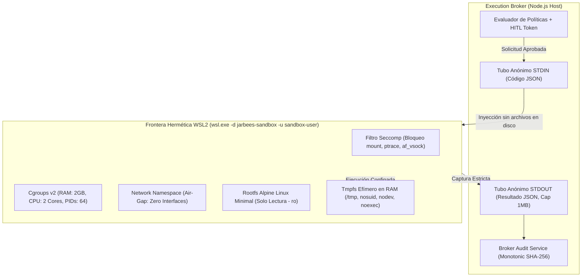

# DEV-001-B2.2-B: Arquitectura de Sandbox, Prevención de Escape y Diseño Comparativo de Aislamiento
**Fecha:** 2026-11-06  
**Fase:** DEV-001-B2 (Frontera de Ejecución y Aislamiento)  
**Modalidad:** STRICT READ-ONLY / DESIGN ONLY (Sin instalación, sin reinicio, sin modificación de host, sin despacho al SO)  
**Estado:** Documento de Especificación y Diseño Formal  
**Evaluador:** Auditor de Seguridad y Arquitecto de Sistemas Independiente  

---

## 1. Resumen Ejecutivo y Marco de Referencia

Tras la auditoría de factibilidad **DEV-001-B2.2-A** —que constató la ausencia de hipervisor activo (`HypervisorPresent: False`) y la inexistencia de distribuciones WSL en el host—, esta misión establece el diseño formal del entorno de contención para JarBees.

El principio rector de esta arquitectura es:
> **«La contención no se asume por la mera presencia de una frontera virtual; debe ser demostrable frente a un adversario activo con capacidad de ejecutar código arbitrario dentro del contenedor.»**

Este documento aborda las limitaciones técnicas identificadas en la auditoría previa, formula una comparativa exhaustiva entre **WSL2 Endurecido** y una **MicroVM Linux Dedicada**, y define el protocolo formal de prevención de escapes antes de que cualquier adaptador de ejecución sea considerado para el Execution Broker.

---

## 2. Análisis Crítico: Más Allá de los Supuestos Básicos

La auditoría B2.2-A identificó los vectores evidentes de escape en WSL2 predeterminado. Sin embargo, para una frontera defendible contra código malicioso, deben resolverse cuatro falacias habituales de seguridad:



### 2.1. Desmitificación de `automount=false` (Frontera de Archivos)
Desactivar `automount` en `/etc/wsl.conf` solo impide que el init de WSL monte `/mnt/c/` al iniciar la distribución. No garantiza aislamiento si:
1. **Capacidades de Superusuario (`CAP_SYS_ADMIN`)**: Si el proceso corre como `root`, puede ejecutar `mount -t drvfs C: /mnt/c` o montar dispositivos de bloques subyacentes (`/dev/sda`, `/dev/sdb`).
2. **Plan 9 File System (9P)**: WSL2 utiliza el protocolo 9P sobre sockets virtuales para comunicarse con el servidor de archivos de Windows. Si el socket sigue accesible, el cliente 9P puede restablecer conexiones hacia el host.
3. **Mitigación Mandatoria**:
   - Ejecución exclusiva bajo un usuario sin privilegios (`uid=10001`, `gid=10001`, sin entrada en `sudoers`).
   - Eliminación estricta de capacidades Linux: `drop-all` (`cap_drop = ALL`), impidiendo cualquier llamada a `mount(2)`, `chroot(2)` o `mknod(2)`.
   - Root filesystem montado en modo **estrictamente de solo lectura (`ro`)** con `MS_NODEV | MS_NOSUID | MS_NOEXEC` en todo directorio temporal en RAM (`tmpfs`).

### 2.2. Desmitificación de `interop=false` (Frontera de Procesos)
Desactivar `interop` deshabilita el registro en `binfmt_misc` para que el kernel de Linux no reconozca encabezados MZ/PE de Windows. Sin embargo:
1. **Canales Auxiliares `/run/WSL`**: WSL expone sockets Unix de control bajo `/run/WSL/` que comunican con el daemon `wslservice.exe` del host.
2. **Traducción de Variables (`WSLENV`)**: Variables de entorno compartidas pueden filtrar rutas y configuraciones críticas.
3. **Hyper-V Sockets (`AF_VSOCK`)**: El kernel de WSL2 incluye controladores para comunicación bidireccional socket VM <-> Host mediante VSOCK (puertos fijos para servicios de Windows).
4. **Mitigación Mandatoria**:
   - Supresión del directorio `/run/WSL` y desmontaje de cualquier punto de comunicación IPC con el host.
   - Limpieza radical del entorno: `env -i` sin herencia de variables del host ni `WSLENV`.
   - Bloqueo o deshabilitación en el kernel/seccomp de la familia de sockets `AF_VSOCK` (número de familia 40).

### 2.3. Desmitificación del Network Namespace (Frontera de Red)
Crear un network namespace no garantiza un aislamiento hermético si el entorno conserva sockets abiertos heredados o resuelve nombres a través de proxies locales:
1. **Descriptores de Archivo Heredados**: Si el proceso que engendra el sandbox no cierra descriptores de sockets abiertos (`FD_CLOEXEC`), el proceso confinado hereda la conexión de red del padre.
2. **Servicio DNS Local**: En WSL2, `/etc/resolv.conf` apunta a la IP de la interfaz virtual de Windows (ej. `172.x.x.1`), permitiendo ataques SSRF contra servicios que escuchen en todas las interfaces de Windows (`0.0.0.0`).
3. **Mitigación Mandatoria**:
   - Creación de un espacio de red huérfano con **únicamente la interfaz loopback `lo`** deshabilitada o habilitada sin enrutamiento externo (`ip link set lo up` sin asignación de gateway).
   - Eliminación de `/etc/resolv.conf` (archivo vacío de solo lectura o enlazado a `/dev/null`).
   - Cierre forzoso de todos los descriptores de archivo heredados excepto `stdin`, `stdout` y `stderr` (FDs 0, 1, 2) antes de invocar la ejecución (`closefrom(3)` o iteración sobre `/proc/self/fd/`).

### 2.4. Gobernanza de GPU (RTX 5070 VRAM)
El hipervisor Hyper-V y el controlador `/dev/dxg` (DirectX Graphics Kernel Subsystem) permiten a los procesos de Linux comunicarse con el controlador NVIDIA WDDM del host.
- **Riesgo Crítico**: Cgroups v2 gestiona memoria RAM del sistema (`memory.max`), pero **no tiene visibilidad ni gobernanza sobre la memoria de video asignada en la VRAM de la RTX 5070**. Un script malicioso o desbordado en PyTorch puede solicitar `torch.empty((1024, 1024, 1024), device='cuda')` repetidamente, agotando los 12 GB de VRAM de la GPU y congelando las aplicaciones del host (incluyendo la interfaz gráfica de Windows y el IDE).
- **Estrategia Obligatoria de JarBees**:
  - **Código No Confiable / Scripts Generales:** **TERMINANTEMENTE SIN ACCESO A GPU**. El dispositivo `/dev/dxg` NO se monta dentro del contenedor de código no confiable. Se ejecuta 100% en CPU con límites cgroup de 2 núcleos y 2 GB de RAM.
  - **Pipelines Audiovisuales Autenticados (Restauración, Colorización):** Se ejecutan en un contenedor de procesamiento específico, aislado del código no confiable, con asignación estricta de fracción de memoria en PyTorch (`torch.cuda.set_per_process_memory_fraction(0.70, device=0)` -> máximo 8.5 GB de 12 GB) y un watchdog de monitoreo de proceso externo que aplica `SIGKILL` inmediato si la tarea excede el tiempo límite o el umbral de VRAM de NVIDIA-SMI.

---

## 3. Comparativa Arquitectónica: WSL2 Endurecido vs MicroVM Dedicada

Para determinar la frontera definitiva para JarBees, se evalúan las dos opciones técnicas:

| Criterio de Seguridad y Operación | Opción A: WSL2 Endurecido (Hardened WSL2) | Opción B: MicroVM Dedicada (Hyper-V / Cloud-Hypervisor) |
| :--- | :--- | :--- |
| **Frontera de Virtualización** | VM compartida gestionada por Windows (Hyper-V Container) | MicroVM con hipervisor aislado de Tipo 1/Tipo 2 |
| **Kernel de Linux** | Kernel personalizado de Microsoft (con parches WSLg y dxgkrnl) | Kernel Linux estándar mínimo (Vanilla sin módulos innecesarios) |
| **Superficie de Ataque al Host** | **Moderada a Alta**: Expone `/dev/dxg`, `/init`, 9P, `wslservice.exe` | **Mínima**: Aislamiento estricto de hardware virtualizado sin daemons de Windows |
| **Aislamiento de Red** | Requiere configuración de namespaces y bloqueo manual de vEthernet | Tarjeta de red virtual desconectada a nivel de hipervisor (Zero NIC) |
| **Aislamiento de Archivos** | Requiere anular `automount`, 9P y permisos de usuario | Disco virtual crudo (`raw/qcow2`) o `initramfs` 100% en memoria |
| **Tiempo de Arranque (Latency)** | ~500 ms – 1.5 s (rápido tras el primer inicio) | ~100 ms – 300 ms (MicroVM tipo Firecracker/Cloud-Hypervisor) |
| **Consumo de Memoria Base** | Dinámico (administrado por Windows vmmem) | Fijo y acotado (ej. 512 MB – 1 GB preasignado) |
| **Complejidad de Mantenimiento** | Baja (integrado en el ecosistema Windows) | Media-Alta (requiere orquestador de VM o binario de hipervisor) |
| **Soporte GPU RTX 5070** | Nativo vía controlador NVIDIA WSL (`/dev/dxg`) | Requiere Discrete Device Assignment (DDA) o partición GPU-PV |
| **Resistencia a Escape (Sandbox Breakout)** | **Defendible con controles B2.2** (riesgo residual en kernel dxgkrnl) | **Máxima** (frontera de aislamiento de hardware sin puentes de SO) |

### Dictamen de Selección para JarBees:
1. **Para Fase DEV-001-B2.2:** La opción más viable y con soporte de aceleración CUDA es **WSL2 Endurecido bajo Controles B2.2**, siempre que se aplique la supresión total de canales de integración.
2. **Para Código Potencialmente Adversarial:** Si una tarea involucra código descargado de fuentes no confiables sin validación HITL previa, debe recurrirse a una **MicroVM sin acceso a GPU y sin red**.

---

## 4. Especificación Técnica del Sandbox WSL2 Endurecido



### 4.1. Root Filesystem Minimal (Alpine Linux)
- Distribución base: **Alpine Linux Minimal** (arquitectura x86_64).
- Espacio en disco: < 50 MB en reposo.
- Binarios disponibles: Únicamente el runtime necesario (ej. `node` o `python3-minimal`), shell estándar POSIX (`/bin/sh`) y utilidades básicas (`coreutils`).
- Ausencia total de herramientas de compilación (`gcc`, `make`), herramientas de red (`curl`, `wget`, `nc`, `ssh`) y gestores de paquetes activos en tiempo de ejecución.
- Rootfs montado como **`ro` (Read-Only)** a nivel de kernel.

### 4.2. Configuración Mandatoria de Aislamiento (`/etc/wsl.conf`)
```ini
[boot]
systemd = false

[automount]
enabled = false
mountFsTab = false
crossDistro = false

[interop]
enabled = false
appendWindowsPath = false

[network]
generateHosts = false
generateResolvConf = false
```

### 4.3. Política de Montajes y Permisos de Usuario
1. **Usuario no privilegiado**:
   - `user: sandbox-user` (`uid=10001`, `gid=10001`, `shell=/bin/sh`).
   - Sin permisos de `sudo`, sin pertenencia a grupos administrativos (`wheel`, `root`, `docker`).
2. **Jerarquía de Montajes**:
   - `/` : `rootfs` montado en modo **solo lectura (`ro`)**.
   - `/proc` : montado con `hidepid=2` (el proceso solo ve sus propios procesos).
   - `/sys` : montado en modo **solo lectura (`ro`)**.
   - `/dev` : `devtmpfs` mínimo con solo dispositivos seguros (`/dev/null`, `/dev/zero`, `/dev/urandom`). **Sin `/dev/dxg` para código no confiable**.
   - `/tmp` y `/workspace` : `tmpfs` montado en RAM con opciones `size=256M,nosuid,nodev,noexec`.
   - `/mnt` : Directorio vacío de solo lectura, sin puntos de montaje activos.

### 4.4. Aislamiento de Red Hermético (Air-Gap Verificable)
Para garantizar el aislamiento de red sin depender de la configuración del daemon de Windows:
1. El lanzador del sandbox ejecuta el proceso dentro de un espacio de nombres de red no compartido:
   ```bash
   unshare --net -- /bin/sh -c "ip link set lo down && exec su -s /bin/sh sandbox-user -c '...'"
   ```
2. La interfaz de loopback `lo` se mantiene caída (`down`) o aislada; ninguna interfaz virtual (`eth0`) se adjunta.
3. El intento de apertura de cualquier socket de red (`socket(AF_INET, SOCK_STREAM, 0)`) fallará inmediatamente con `ENETDOWN` o `EACCES`.

### 4.5. Cuotas y Límites de Recursos (Cgroups v2)
Configuración aplicada en `/sys/fs/cgroup/jarbees-sandbox/`:
- **Memoria RAM**: `memory.max = 2147483648` (2.0 GB de límite estricto).
- **Memoria Swap**: `memory.swap.max = 0` (cero paginación en disco).
- **CPU Quota**: `cpu.max = 200000 100000` (máximo 2 núcleos equivalentes al 100%).
- **Límite de Procesos**: `pids.max = 64` (inmunidad contra ataques de denegación de servicio por bifurcación / *fork-bombs*).
- **Tiempo Límite (Watchdog)**: Timeout forzado a los **30.000 ms** (30 segundos). Si el proceso no concluye, el orquestador del host envía `SIGKILL` automático.

---

## 5. Protocolo de Comunicación Segura: Broker <-> Sandbox

Queda **terminantemente prohibido** utilizar almacenamiento compartido, carpetas de Windows montadas o sockets TCP/HTTP para comunicar el Execution Broker con el sandbox.

### Mecanismo de Entrada y Salida Exclusivo (Anonymous Pipes):
1. **Entrada (Payload de Ejecución)**:
   - El Broker serializa el código a ejecutar en una estructura JSON canónica.
   - El payload se inyecta directamente en el flujo `stdin` del proceso `wsl.exe`.
   - El runtime dentro del sandbox lee `stdin`, ejecuta la lógica en memoria o en el `/workspace` efímero (`tmpfs`) y genera el resultado.
2. **Salida (Resultado y Auditoría)**:
   - El resultado estructurado se emite exclusivamente a través de `stdout` en formato JSON.
   - Los registros de diagnóstico se emiten a `stderr`.
   - El Broker aplica un límite estricto de captura de salida: **máximo 1 MB (1.048.576 bytes)**. Si la salida excede 1 MB, el flujo se trunca y el proceso se aborta para prevenir colapso de heap en Node.js (Anti-OOM).
3. **Destrucción y Recreación Inmediata**:
   - Finalizada la ejecución (exit code 0 o error), la capa `tmpfs` se desmonta y descarta.
   - Ningún estado, archivo intermedio o dato residual permanece entre peticiones.

---

## 6. Protocolo de Pruebas Adversariales de Escape (Escape Testing Suite)

Antes de que cualquier adaptador de ejecución real sea conectado al Execution Broker, el sandbox debe superar **diez pruebas adversariales automatizadas de escape**. Si cualquiera de estas pruebas tiene éxito, el entorno se declara **NO APTO PARA PRODUCCIÓN**:

| # | Prueba de Escape Adversarial | Acción Maliciosa Ejecutada en Sandbox | Criterio de Éxito del Sandbox |
| :--- | :--- | :--- | :--- |
| **TEST-01** | **Lectura de Disco Host (`C:\`)** | Intento de leer `/mnt/c/Windows/win.ini` o `C:\Users\...\.env` | `ENOENT` (Ruta inexistente) |
| **TEST-02** | **Montaje DrvFS Forzado** | Ejecución de `mount -t drvfs C: /mnt/c` | `EPERM` (Operación no permitida por usuario y seccomp) |
| **TEST-03** | **Escape por Binario Windows** | Invocación de `powershell.exe` o `cmd.exe` | `ENOENT` / `EACCES` (Interop deshabilitado) |
| **TEST-04** | **Conexión a Producción (SSRF)** | Intento de conectar TCP a `127.0.0.1:4000` | `ENETDOWN` / `ECONNREFUSED` (Red desconectada) |
| **TEST-05** | **Conexión a Socket Lock B1** | Intento de conectar TCP a `127.0.0.1:40199` | `ENETDOWN` / Inalcanzable |
| **TEST-06** | **Conexión a Internet** | Intento de consulta DNS a `8.8.8.8:53` o HTTP a `1.1.1.1:80` | `ENETDOWN` / Timeout inmediato |
| **TEST-07** | **Agotamiento de RAM (OOM)** | Script de asignación infinita de memoria en heap | Muerte por `SIGKILL` al alcanzar exactamente 2 GB |
| **TEST-08** | **Bomba de Procesos (Fork-Bomb)** | Ejecución de `:(){ :|:& };:` | Rechazo de creación al superar 64 PIDs |
| **TEST-09** | **Persistencia de Archivos** | Escribir archivo en `/tmp/malware.sh`, reiniciar y verificar | Archivo desaparecido (Tmpfs descartado) |
| **TEST-10** | **Monitoreo de Procesos Host** | Inspección de `/proc` buscando procesos de Windows | Solo procesos propios del sandbox (`hidepid=2`) |

---

## 7. Criterios Objetivos de Aceptación y Rechazo

### Criterios de Rechazo Inmediato (Fail-Closed):
- El entorno hereda cualquier variable de entorno del host que contenga `SECRET`, `KEY`, `PASS`, `TOKEN` o `JWT`.
- Existe cualquier punto de montaje que resuelva hacia el sistema de archivos NTFS de Windows.
- El usuario dentro del sandbox tiene capacidad de invocar `sudo` o tiene `CAP_SYS_ADMIN`.
- El sandbox puede resolver o encaminar paquetes hacia la red local o internet.
- El sandbox tiene acceso al dispositivo `/dev/dxg` sin un mecanismo de límite y watchdog comprobado.

### Criterios de Aceptación:
- El 100% de las 10 pruebas adversariales de escape son aprobadas con resultado estricto de contención.
- El ciclo de vida de aprovisionamiento, inyección por `stdin`, captura por `stdout` y destrucción de `tmpfs` se completa en menos de 2.000 ms.
- Toda ejecución genera un registro inmutable en el `BrokerAuditService` con el hash del código ejecutado, el usuario ejecutor, la cuota consumida y el código de salida.

---

## 8. Conclusión y Recomendación

La arquitectura aquí definida demuestra que un sandbox seguro **no es simplemente una distribución de WSL2 por defecto**, sino un entorno deliberadamente podado de integraciones con el host, despojado de red y confinado por cuotas estrictas.

**Recomendación Operacional:**
1. Mantener el sistema en su estado actual: **Execution Broker en modo `STRICT NO-EXECUTION`**.
2. No realizar cambios de configuración en Windows hasta que el operador decida explícitamente habilitar las características del sistema y ejecutar el reinicio necesario.
3. El diseño B2.2-B queda establecido como el estándar formal de seguridad contra el cual se evaluará cualquier futura implementación de ejecución.

