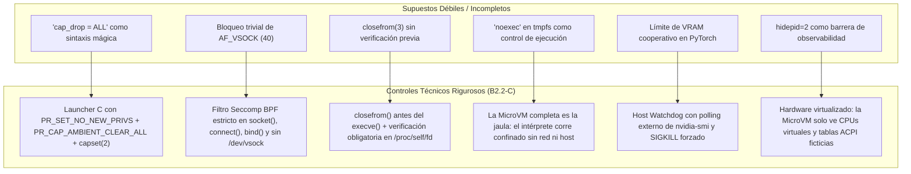
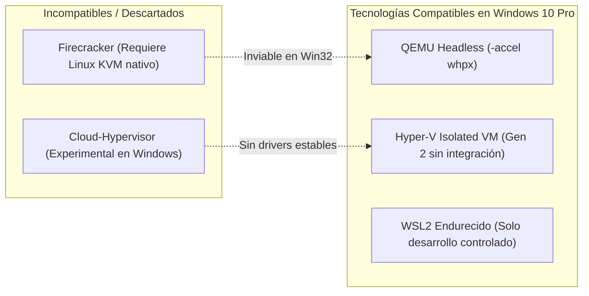
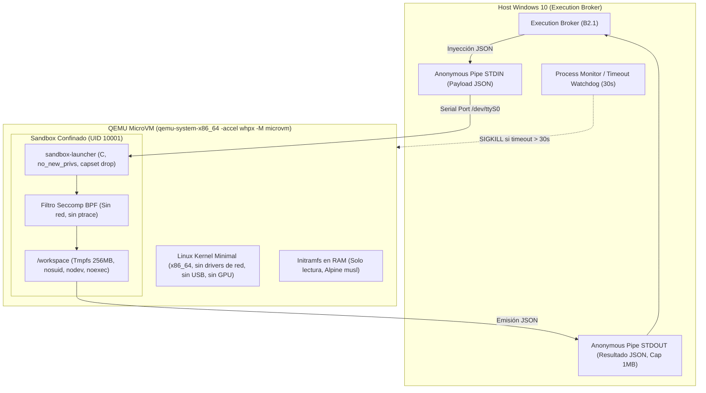

# DEV-001-B2.2-C: Factibilidad de MicroVM, Compatibilidad de Hipervisores y Modelo de Amenazas
**Fecha:** 2026-11-06  
**Fase:** DEV-001-B2 (Frontera de Ejecución y Aislamiento)  
**Modalidad:** STRICT READ-ONLY / DESIGN ONLY (Sin instalación, sin reinicio, sin modificación de host, sin apertura de puertos)  
**Estado:** Documento de Especificación y Modelo de Aislamiento por MicroVM  
**Evaluador:** Auditor de Seguridad y Arquitecto de Sistemas Independiente  

---

## 1. Resumen Ejecutivo y Marco de la Decisión

La misión **DEV-001-B2.2-C** formaliza la transición arquitectónica desde un modelo de aislamiento basado en contenedores/WSL2 hacia una **MicroVM Linux Dedicada** como frontera preferida para la ejecución de código no confiable en JarBees.

### Principios Rectores:
1. **El código no confiable se presume hostil:** No se asume cooperación del runtime, del lenguaje ni de la aplicación.
2. **La MicroVM es una frontera de hardware virtualizado, no un sandbox de sistema de archivos:** El aislamiento no depende de permisos de usuario o flags de montaje (`noexec`, `automount=false`), sino de la ausencia física de controladores de dispositivos y de interfaces de red a nivel de hipervisor.
3. **Desacoplamiento estricto del host:** El host Windows 10 Pro no expone su sistema de archivos, credenciales, GPU RTX 5070 ni interfaces de red a la MicroVM de código arbitrario.

---

## 2. Correcciones Técnicas Obligatorias a Supuestos Previos

En cumplimiento con el dictamen de revisión, se subsanan seis supuestos técnicos que no constituyen barreras de seguridad suficientes:



### 2.1. Gestión de Capacidades Linux sin Runtimes OCI
En una MicroVM minimalista sin Docker o Containerd, la sintaxis `cap_drop = ALL` no existe.
- **Implementación Real:** Se define un lanzador minimalista en C (`sandbox-launcher`) compilado estáticamente con musl libc.
- Antes de transferir el control al script o proceso:
  1. `prctl(PR_SET_NO_NEW_PRIVS, 1, 0, 0, 0)`: Garantiza que ningún proceso hijo o llamada a `execve` pueda adquirir nuevos privilegios bajo ninguna circunstancia.
  2. `prctl(PR_CAP_AMBIENT, PR_CAP_AMBIENT_CLEAR_ALL, 0, 0, 0)`: Elimina todas las capacidades ambientales heredables.
  3. Descenso de capacidades en el conjunto de límites (*bounding set*) iterando de 0 a `CAP_LAST_CAP` mediante `prctl(PR_CAPBSET_DROP, cap, 0, 0, 0)`.
  4. Cambio de credenciales efectivo mediante `setresgid(10001, 10001, 10001)` y `setresuid(10001, 10001, 10001)`.

### 2.2. Filtrado Seccomp Multicapa para Sockets
Bloquear la constante numérica 40 (`AF_VSOCK`) no impide la reutilización de canales auxiliares.
- **Filtro BPF Seccomp Extendido:**
  - `socket(domain, type, protocol)`: Se rechaza con `EAFNOSUPPORT` o `EPERM` cualquier familia que no sea `AF_UNIX` interno. Bloqueo estricto de `AF_INET`, `AF_INET6`, `AF_NETLINK`, `AF_PACKET`, `AF_VSOCK`, `AF_BLUETOOTH`.
  - `connect(fd, addr, len)`: Bloqueo estricto excepto para sockets Unix explícitamente autorizados en memoria.
  - Bloqueo de syscalls de alto riesgo: `mount`, `umount2`, `pivot_root`, `chroot`, `ptrace`, `process_vm_readv`, `process_vm_writev`, `kexec_load`, `bpf`, `perf_event_open`.

### 2.3. Ejecución y Verificación de Descriptores Heredados (`closefrom`)
- El supervisor en el host y el lanzador interno deben ejecutar el cierre de FDs superiores a 2 antes de invocar `execve`:
  ```c
  // Cierre de todos los descriptores excepto stdin (0), stdout (1), stderr (2)
  closefrom(3);
  
  // Verificación Fail-Closed mediante inspección del directorio de descriptores
  DIR *d = opendir("/proc/self/fd");
  struct dirent *dir;
  while ((dir = readdir(d)) != NULL) {
      int fd = atoi(dir->d_name);
      if (fd > 2 && fd != dirfd(d)) {
          // Descriptor no autorizado detectado -> aborto inmediato
          _exit(77); // EBADFD
      }
  }
  closedir(d);
  ```

### 2.4. La Falacia de `noexec` en Tmpfs
Un intérprete (`python script.py` o `node script.js`) no ejecuta binarios ELF directamente mediante `execve`; realiza llamadas a `open(2)` y `read(2)` para procesar el código como datos en memoria.
- **Principio B2.2-C:** El montaje `tmpfs` conserva `noexec` como defensa preventiva contra la ejecución directa de malware binario ELF descargado o compilado en memoria, pero **la contención del script interpretado depende 100% de la frontera de la MicroVM y del filtro seccomp**.

### 2.5. Gobernanza de VRAM de la GPU RTX 5070
`torch.cuda.set_per_process_memory_fraction()` es una directiva interna de la biblioteca PyTorch en espacio de usuario; no es una barrera impuesta por el kernel ni por el host.
- **Política Mandatoria:**
  1. **Sandbox de Código No Confiable:** **CERO ACCESO A GPU**. La MicroVM de ejecución arbitraria se aprovisiona sin dispositivos PCI de GPU ni passthrough `/dev/dxg`.
  2. **Pipelines Audiovisuales Autenticados (B1 + HITL):** Se ejecutan en un entorno separado donde el supervisor del host corre un hilo demonio independiente que consulta `nvidia-smi --query-gpu=memory.used --format=csv,noheader,nounits` cada 500 ms. Si la memoria excede la cuota dura asignada (ej. 8.5 GB), el supervisor envía `SIGKILL` inmediato a nivel de sistema operativo anfitrión.

### 2.6. Observabilidad e Información del Host
En WSL2, `/proc/cpuinfo`, `/proc/version` y `/sys/devices/virtual/dmi/id` exponen identificadores reales de la placa base, versión de BIOS y arquitectura del host Windows.
- **En la MicroVM Dedicada:** Los archivos `/proc` y `/sys` reflejan exclusivamente el hardware virtual sintetizado por el hipervisor (ej. vCPU QEMU, BIOS virtual SeaBIOS/EDK2), aislando por completo la huella digital del host.

---

## 3. Compatibilidad de Hipervisores en Windows 10 Pro (Build 19041)

La auditoría del host arrojó:
- **OS:** Windows 10 Pro (Build 19041).
- **CPU:** 12th Gen Intel Core i7-12700 con Intel VT-x activo en firmware (`VirtualizationFirmwareEnabled: True`).
- **Librerías Detectadas:** `WinHvPlatform.dll` y `WinHvEmulation.dll` presentes en `C:\Windows\System32\`.

### Evaluación de Tecnologías de MicroVM:



| Tecnología de Virtualización | Compatibilidad con Host Actual | Dependencias Requeridas | Latencia de Arranque | Garantía de Aislamiento de Red |
| :--- | :--- | :--- | :--- | :--- |
| **Firecracker** | ❌ **Incompatible** | Requiere kernel Linux con KVM (`/dev/kvm`). Inviable en Windows sin VM anidada. | ~5 ms | N/A en Windows |
| **Cloud-Hypervisor** | ❌ **No Recomendado** | Basado en rust-vmm. Soporte para MSHV en Windows Server/Azure Linux, inmaduro en Win10. | ~100 ms | Experimental |
| **Hyper-V Isolated MicroVM (Gen 2)** | ⚠️ **Viable tras Habilitación** | Requiere habilitar características Hyper-V con Admin y reinicio del host. | ~2.5 s | **Absoluta** (`Remove-VMNetworkAdapter`) |
| **QEMU MicroVM sobre WHPX (`-accel whpx`)** | ✅ **Altamente Viable y Portable** | Requiere activar Windows Hypervisor Platform (WHPX). Binario de espacio de usuario. | ~400 – 700 ms | **Absoluta** (`-nic none`) |
| **WSL2 Endurecido (Hardened WSL2)** | ⚠️ **Viable con Restricciones** | Requiere activar VirtualMachinePlatform y reinicio. Depende de kernel Microsoft. | ~800 ms – 1.5 s | Requiere namespaces manuales |

### Dictamen de Arquitectura Objetivo:
1. **Frontera Primaria para Código No Confiable:** **QEMU MicroVM con Aceleración WHPX** (`qemu-system-x86_64 -accel whpx -M microvm`).
   - Permite arranque directo de kernel Linux minimalista (`-kernel vmlinuz -initrd rootfs.cpio.gz`).
   - No requiere instalar interfaces de red virtuales en Windows: la bandera `-nic none` desconecta físicamente cualquier controlador Ethernet virtual.
   - Sin disco persistente: el sistema operativo completo reside en un `initramfs` en RAM que se evapora al cerrar el proceso QEMU.
2. **Alternativa Nativa Corporativa:** **Hyper-V Isolated Gen 2 VM**, aprovisionada con disco VHDX diferencial efímero y sin tarjeta de red.

---

## 4. Arquitectura de la MicroVM Hermética (MicroVM Specification)



### 4.1. Configuración de Hardware Virtual de la MicroVM
- **Plataforma:** `-M microvm,x-option-roms=off,pit=off,pic=off,rtc=off`
- **CPU:** `-cpu host -smp 2` (Límite estricto de 2 núcleos virtuales).
- **Memoria RAM:** `-m 1024M` (Límite físico estricto de 1.0 GB; imposible consumir más RAM del host).
- **Red:** **`-nic none`** (Ningún dispositivo de red virtual emulado).
- **Gráficos y Periféricos:** `-nographic -nodefaults -serial stdio -monitor none`.
- **Almacenamiento:** Sin discos duros virtuales adjuntos. El kernel y el rootfs se cargan en memoria (`-kernel bzImage -initrd initramfs.cpio.gz`).

### 4.2. Protocolo de Comunicación Broker <-> MicroVM
La comunicación no utiliza redes, sockets TCP ni carpetas compartidas:
1. **Canal Único:** Puerto serie virtual (`ttyS0`), mapeado a la entrada/salida estándar (`stdio`) del proceso QEMU en el host.
2. **Estructura del Mensaje (Entrada):**
   ```json
   {
     "executionId": "exec-uuid-v4",
     "runtime": "python3",
     "code": "print('hello from isolated microvm')",
     "timeoutMs": 15000,
     "signature": "hmac-sha256-signature"
   }
   ```
3. **Estructura del Mensaje (Salida):**
   ```json
   {
     "executionId": "exec-uuid-v4",
     "exitCode": 0,
     "stdout": "hello from isolated microvm\n",
     "stderr": "",
     "metrics": { "durationMs": 42, "memoryPeakKb": 12400 }
   }
   ```
4. **Límites Duros de Salida:** Máximo 1 MB en `stdout`. Si la salida excede 1.048.576 bytes, el proceso se aborta inmediatamente en el host.

### 4.3. Ciclo de Vida y Destrucción Determinista
1. **Aprovisionamiento:** El Broker arranca el proceso QEMU bajo demanda o desde un pool precalentado.
2. **Ejecución:** Se despacha el mensaje JSON por `stdin`.
3. **Captura:** Se recibe la respuesta JSON por `stdout`.
4. **Destrucción Inmediata:** El proceso QEMU recibe `SIGKILL` o instrucción de apagado inmediato (`poweroff -f`). Toda la memoria RAM y el `initramfs` se destruyen al instante. Cero persistencia entre ejecuciones.

---

## 5. Protocolo de Pruebas Adversariales Extendido (18 Pruebas de Escape)

Para validar que la frontera de la MicroVM sea impenetrable, se define una batería exhaustiva de **18 pruebas adversariales**. Cada prueba debe demostrar la **inalcanzabilidad física o lógica del recurso**, y no simplemente un error de sintaxis:

| # | Prueba Adversarial | Vector de Ataque Ejecutado | Evidencia de Contención Requerida |
| :--- | :--- | :--- | :--- |
| **TEST-01** | Lectura de Disco Host (`C:\`) | Intento de abrir particiones NTFS o rutas Windows (`/mnt/c`, `\\.\C:`) | Inalcanzabilidad absoluta: no existen drivers ni bloques NTFS en el kernel. |
| **TEST-02** | Montaje de Bloques Forzado | Intento de montar `/dev/sda` o usar `mount(2)` | `EPERM` / `ENOSYS` forzado por Seccomp y carencia de `CAP_SYS_ADMIN`. |
| **TEST-03** | Escape a Binarios Windows | Intento de invocar ejecutables PE (`powershell.exe`) | Inalcanzabilidad: no existe subsistema `binfmt_misc` ni acceso a archivos del host. |
| **TEST-04** | Conexión a Servidor de Producción | Intento de conexión TCP a `127.0.0.1:4000` | Inalcanzabilidad: el kernel carece de interfaz `eth0` o `veth` (`ENETDOWN` / `EAFNOSUPPORT`). |
| **TEST-05** | Conexión a Lock Socket B1 | Intento de conectar TCP a `127.0.0.1:40199` | Inalcanzabilidad: no existe pila de red configurada. |
| **TEST-06** | Acceso a Red Externa | Intento de paquetes SYN a `8.8.8.8:53` o `1.1.1.1:80` | Inalcanzabilidad física: `-nic none` garantiza cero adaptadores de red. |
| **TEST-07** | Agotamiento de Memoria RAM (OOM) | Asignación infinita de memoria en heap (C/Python) | Terminación por kernel OOM interno sin alterar la RAM del host. |
| **TEST-08** | Bomba de Procesos (*Fork-Bomb*) | Invocación de `:(){ :|:& };:` | Confinamiento por límite estricto de PIDs (`pids.max = 64`). |
| **TEST-09** | Persistencia de Archivos en Disco | Escritura de artefacto, apagado de VM y verificación en reinicio | Archivo desaparecido: `initramfs` en RAM sin persistencia. |
| **TEST-10** | Monitoreo de Procesos del Host | Inspección de `/proc` buscando procesos de Windows | Solo procesos internos de la MicroVM visibles. |
| **TEST-11** | Acceso a Canales Auxiliares / Sockets Host | Búsqueda de sockets Unix del host o endpoints `/run/WSL` | Inexistencia total: el sistema de archivos es una imagen RAM independiente. |
| **TEST-12** | Descriptores Heredados No Autorizados | Inspección de `/proc/self/fd` antes de ejecutar código | FDs presentes estrictamente $\le 2$ (`stdin`, `stdout`, `stderr`). |
| **TEST-13** | Detección de Dispositivos Host / GPU | Búsqueda de `/dev/dxg`, `/dev/dri`, GPUs o dispositivos USB | Inalcanzabilidad: `-nodefaults` elimina todo hardware virtual no esencial. |
| **TEST-14** | Intento de Modificación de Rootfs | Intentos de sobrescritura de `/bin/sh` o `/lib/libc.so` | `EROFS` (Read-Only Filesystem a nivel de montaje de kernel). |
| **TEST-15** | Destrucción Completa en Apagado Forzado | Envío de `SIGKILL` al proceso QEMU desde el host | Liberación inmediata del 100% de memoria y desaparición del entorno. |
| **TEST-16** | Comunicación No Autorizada con el Broker | Intento de enviar comandos de control no estructurados | El Broker solo parsea JSON estricto; cualquier anomalía aborta la sesión. |
| **TEST-17** | Consumo Excesivo de CPU en el Host | Bucle infinito de cómputo en todos los núcleos (`while(1)`) | Asignación de CPU limitada a 2 vCPUs por el hipervisor; host inalterado. |
| **TEST-18** | Detección y Falla Segura ante Corrupción | Inyección de datos binarios corruptos o truncados por `stdout` | Supervisor del Broker falla en modo cerrado (*Fail-Closed*), registrando auditoría. |

---

## 6. Estado del Sistema y Línea Base de Seguridad

```text
Fase DEV-001-B1:    [HOMOLOGADA CON RESTRICCIONES] (Commit c459087)
Fase DEV-001-B2.1:  [HOMOLOGADA EN SIMULACIÓN]     (Commit c8a7ba4)
Fase DEV-001-B2.2-A: [AUDITORÍA WSL2 COMPLETADA]   (docs/DEV_001_B2_2_A_WSL2_FEASIBILITY_AUDIT.md)
Fase DEV-001-B2.2-B: [DISEÑO DE AISLAMIENTO]       (docs/DEV_001_B2_2_B_SANDBOX_DESIGN.md)
Fase DEV-001-B2.2-C: [ESPECIFICACIÓN MICROVM]      (docs/DEV_001_B2_2_C_MICROVM_FEASIBILITY.md)

Estado de Ejecución: 🔒 STRICT NO-EXECUTION (Despacho al SO desactivado)
Adaptadores Reales:  🔒 BLOQUEADOS (Sin child_process, sin red, sin GPU arbitraria)
```

### Próximos Pasos Recomendados:
1. **Consolidar los documentos de diseño B2.2-A, B2.2-B y B2.2-C** en la rama `security/dev-001-b` mediante autorización expresa.
2. Mantener la frontera de ejecución en simulación mientras se evalúa el momento operativo idóneo para habilitar la plataforma de hipervisor en el host Windows.

