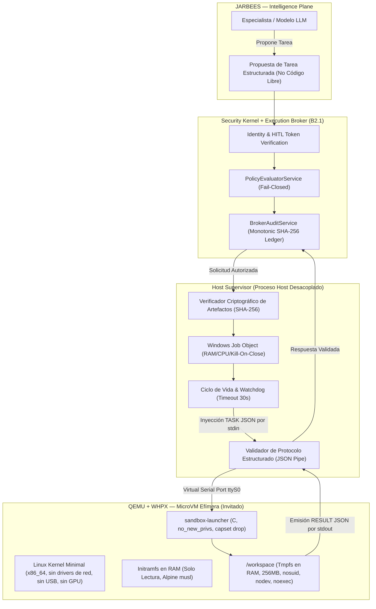
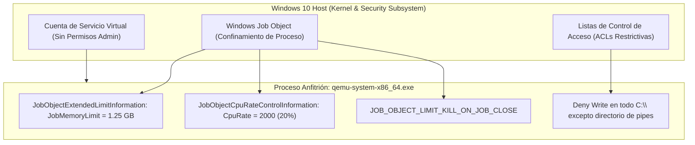
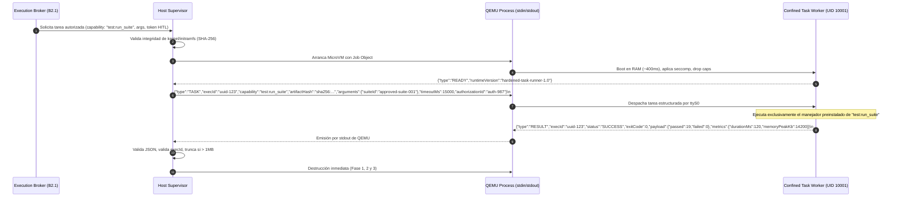
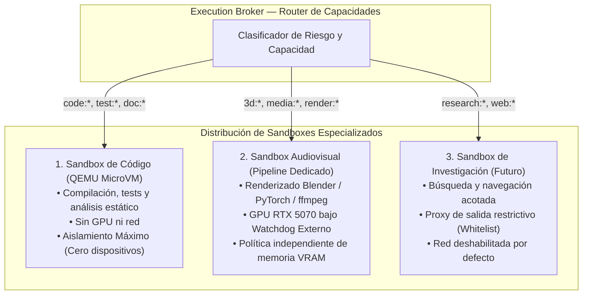

# DEV-001-B2.2-D: Especificación de Seguridad QEMU/WHPX y Host Supervisor
**Fecha:** 2026-11-06  
**Fase:** DEV-001-B2 (Frontera de Ejecución y Aislamiento)  
**Modalidad:** STRICT READ-ONLY / DESIGN ONLY (Sin instalación, sin reinicio, sin modificación de host, sin apertura de puertos)  
**Estado:** Especificación Técnica de Arquitectura Candidata (Actualizada con Refinamientos de Seguridad)  
**Evaluador:** Auditor de Seguridad y Arquitecto de Sistemas Independiente  

---

## 1. Resumen Ejecutivo y Marco Arquitectónico

La misión **DEV-001-B2.2-D** define la especificación rigurosa para la arquitectura candidata principal: **QEMU con aceleración Windows Hypervisor Platform (WHPX)**, coordinada por un **Host Supervisor** desacoplado de la inteligencia de JarBees.

El principio fundacional de esta fase establece:
> **«El hipervisor aísla al invitado del host; el Host Supervisor confina al hipervisor frente al sistema operativo anfitrión. La seguridad no descansa únicamente en la frontera de virtualización, sino en la contención mutua entre el proceso anfitrión y la máquina virtual.»**



---

## 2. Validación de Estado y Realidad Operativa de WHPX

Para evitar supuestos prematuros de disponibilidad:
1. **Diferencia entre Presencia de DLL y Operatividad del Hipervisor:**
   - La existencia de `C:\Windows\System32\WinHvPlatform.dll` en Windows 10 Pro (Build 19041) demuestra que la biblioteca de enlace dinámico de Microsoft está instalada.
   - Sin embargo, la auditoría **B2.2-A** constató que `HypervisorPresent: False`.
   - **Conclusión Técnica:** WHPX **NO ESTÁ OPERATIVO** actualmente. Requiere la activación de la característica opcional `VirtualMachinePlatform` / `HypervisorPlatform` mediante DISM y el reinicio posterior del host.
2. **Postura de Seguridad:** La arquitectura QEMU/WHPX se diseña como la especificación de referencia, pero **su activación permanece bloqueada hasta que el operador determine el momento de aprovisionamiento de la plataforma en el host**.

---

## 3. Matriz de Dispositivos de QEMU: Lista Positiva vs Lista Prohibida

Para evitar superficies de ataque ocultas en el hipervisor, se descartan los valores predeterminados de QEMU (`-nodefaults` no es suficiente por sí solo) y se impone una **lista positiva explícita de hardware virtualizado**:

| Dispositivo / Subsistema | Estado en QEMU | Justificación Técnica de Seguridad |
| :--- | :--- | :--- |
| **Controlador de Red (NIC)** | ⛔ **TERMINANTEMENTE PROHIBIDO (`-nic none`)** | Cero adaptadores de red virtuales (sin e1000, virtio-net, rtl8139). |
| **GPU / Aceleración Gráfica** | ⛔ **TERMINANTEMENTE PROHIBIDO (`-vga none -nographic`)** | Cero passthrough de `/dev/dxg`, cero emulación VGA/Cirrus/QXL. |
| **Controlador USB (UHCI/EHCI/XHCI)** | ⛔ **TERMINANTEMENTE PROHIBIDO** | Ausencia total de buses USB. Inmune a bugs de emulación USB. |
| **Subsistema de Audio (AC97/HDA)** | ⛔ **TERMINANTEMENTE PROHIBIDO** | Sin emulación de tarjetas de sonido. |
| **Monitor de Gestión QMP / HMP** | ⛔ **DESHABILITADO (`-monitor none`)** | El invitado no puede interactuar con la consola interna de QEMU. |
| **QEMU Guest Agent (`qemu-ga`)** | ⛔ **TERMINANTEMENTE PROHIBIDO** | Sin canal de gestión ni ejecución remota en el invitado. |
| **Memoria Compartida (`ivshmem`)** | ⛔ **TERMINANTEMENTE PROHIBIDO** | Cero segmentos de RAM compartidos entre host e invitado. |
| **Sockets Virtuales (`vhost-vsock`)** | ⛔ **TERMINANTEMENTE PROHIBIDO** | Sin comunicación por canales VSOCK hacia daemons del host. |
| **Puerto Serie Virtual (16550A UART)** | ✅ **PERMITIDO EXCLUSIVO (`-serial stdio`)** | Único canal de I/O: flujo de caracteres estructurado mapeado a pipes anónimos del host. |
| **CPU Virtual x86-64** | ✅ **PERMITIDO (`-cpu host -smp 2`)** | 2 núcleos lógicos expuestos al invitado. |
| **Controlador de Reloj e Interrupciones** | ✅ **PERMITIDO MÍNIMO (`microvm`)** | Temporizador mínimo sintetizado por la arquitectura `microvm`. |

---

## 4. Configuración Determinista de Invocación de QEMU

La invocación de QEMU debe ser **completamente determinista**, sin herencia de variables de entorno ni opciones implícitas de arquitectura de PC tradicional:

```powershell
# Comando canónico de invocación generado exclusivamente por el Host Supervisor:
qemu-system-x86_64.exe `
  -accel whpx `
  -M microvm,x-option-roms=off,pit=off,pic=off,rtc=off `
  -cpu host `
  -smp 2 `
  -m 1024M `
  -no-user-config `
  -nodefaults `
  -nographic `
  -vga none `
  -nic none `
  -monitor none `
  -serial stdio `
  -kernel "C:\ProgramData\JarBees\sandbox\kernels\vmlinuz-6.6-hardened" `
  -initrd "C:\ProgramData\JarBees\sandbox\images\initramfs-alpine-hardened.cpio.gz" `
  -append "console=ttyS0 quiet loglevel=0 panic=1 oops=panic init=/init"
```

### Justificación de Parámetros de Seguridad:
- `-no-user-config`: Ignora cualquier archivo de configuración de QEMU global o de usuario en el host.
- `-M microvm`: Deshabilita toda la emulación de placa madre PCI/ACPI tradicional de PC; reduce la base de código de emulación activa en más de un 80%.
- `panic=1 oops=panic`: Ante cualquier excepción o pánico de kernel en el invitado, el sistema se reinicia/apaga en 1 segundo, cerrando el proceso.
- `loglevel=0 quiet`: Suprime el volcado masivo de mensajes de kernel por el puerto serie para evitar saturación de pipes y ataques de timing.

---

## 5. Distinción Rigurosa de Límites de Recursos: Invitado vs Host

Para garantizar una gobernanza de recursos exacta y no confundir cuotas virtuales con límites físicos del host, se establece la siguiente matriz de control dual:

| Recurso | Nivel del Invitado (VM Linux) | Nivel del Host Anfitrión (Windows) | Mecanismo de Control |
| :--- | :--- | :--- | :--- |
| **Memoria RAM** | **1.024 MB (1.0 GB)** asignados a la VM | **1.280 MB (1.25 GB)** límite duro del proceso | Parámetro `-m 1024M` en QEMU; `JobMemoryLimit` en Windows Job Object. Absorbe overhead de QEMU sin permitir fugas. |
| **CPU / Cómputo** | **2 vCPUs lógicas** expuestas al kernel invitado | **CpuRate = 2000 (20%)** de la capacidad del host | Parámetro `-smp 2`; `JobObjectCpuRateControlInformation` en Windows. Impide que un bucle infinito sature el procesador anfitrión. |
| **Límite de Procesos** | **Máximo 64 PIDs** en cgroups v2 (`pids.max`) | **ActiveProcessLimit = 1** en el Job Object | Cgroups v2 dentro de la VM previene fork-bombs; el Job Object impide que QEMU engendre procesos hijos en Windows. |
| **Volumen de Salida** | Buffer interno de ttyS0 | **Máximo 1.048.576 bytes (1 MB)** acumulados | Host Supervisor corta el pipe de lectura si excede 1 MB, abortando la sesión. |
| **Tiempo de Ejecución** | Timeout interno solicitado | **Watchdog externo de 30.000 ms** (30 segundos) | Temporizador independiente en el Host Supervisor que ejecuta `TerminateJobObject()` ante expiración. |

---

## 6. Modelo de Seguridad del Proceso QEMU en el Host Windows

El proceso `qemu-system-x86_64.exe` es un binario que corre en el espacio de usuario de Windows. Para impedir que una eventual vulnerabilidad en el hipervisor comprometa el sistema anfitrión:



### 6.1. Confinamiento mediante Windows Job Object
El Host Supervisor crea un objeto de trabajo anónimo (`CreateJobObjectW`) antes de lanzar el proceso de QEMU y aplica:
1. `JOB_OBJECT_LIMIT_JOB_MEMORY`: Límite duro de memoria virtual de **1.280 MB (1.25 GB)**. Si QEMU intenta exceder este consumo, el kernel de Windows termina el proceso instantáneamente.
2. `JOB_OBJECT_LIMIT_CPU_RATE`: Tasa máxima de CPU del 20% (máximo 2 hilos del Core i7-12700).
3. `JOB_OBJECT_LIMIT_KILL_ON_JOB_CLOSE`: Si el Host Supervisor se interrumpe, crashea o es terminado, el kernel de Windows termina automáticamente a QEMU, impidiendo la existencia de procesos huérfanos.
4. `JOB_OBJECT_LIMIT_ACTIVE_PROCESS`: Máximo 1 proceso en el Job Object (`ActiveProcessLimit = 1`). QEMU no puede engendrar procesos hijos en Windows.

### 6.2. Permisos y Listas de Control de Acceso (ACLs)
- **Cuenta de Ejecución:** QEMU no debe ejecutarse bajo la cuenta interactiva del usuario con privilegios de administrador. Se ejecutará bajo un token restringido (`CreateRestrictedToken`) despojado de `SE_DEBUG_NAME`, `SE_LOAD_DRIVER_NAME`, `SE_SECURITY_NAME`.
- **Integridad de Binarios:** Las carpetas que contienen el binario de QEMU, el kernel `vmlinuz` y el `initramfs` se configuran con permisos de **solo lectura para el token del proceso** y solo modificables por el Administrador de Windows.

---

## 7. Verificación Criptográfica de Artefactos de Arranque

Antes de cualquier invocación de QEMU, el Host Supervisor realiza una **verificación criptográfica estricta en memoria** para impedir la manipulación o sustitución de los artefactos del sandbox:

```typescript
export interface SandboxImageManifest {
  readonly version: string;
  readonly kernelPath: string;
  readonly kernelSha256: string;
  readonly initramfsPath: string;
  readonly initramfsSha256: string;
  readonly qemuBinarySha256: string;
}

// Validación obligatoria en Host Supervisor antes de spawn():
export function verifySandboxIntegrity(manifest: SandboxImageManifest): boolean {
  const kernelHash = computeFileSha256(manifest.kernelPath);
  if (kernelHash !== manifest.kernelSha256) {
    throw new SecurityIntegrityException("Kernel digest mismatch (posible alteración)");
  }

  const initramfsHash = computeFileSha256(manifest.initramfsPath);
  if (initramfsHash !== manifest.initramfsSha256) {
    throw new SecurityIntegrityException("Initramfs digest mismatch (posible alteración)");
  }

  return true;
}
```

*Política Fail-Closed:* Si cualquiera de los hashes calculados difiere en un solo bit del manifiesto firmado, el Host Supervisor **aborta el arranque inmediatamente**, registra la alerta en el `BrokerAuditService` y rechaza la ejecución.

---

## 8. Protocolo Estructurado de Tareas (Cero Código Arbitrario Libre)

Queda **terminantemente prohibido** exponer una interfaz genérica de ejecución de código libre (`{ "type": "EXECUTE", "code": "..." }`) o una consola interactiva (shell TTY).

El protocolo de comunicación a través del puerto serie virtual utiliza exclusivamente **mensajes estructurados basados en capacidades preinstaladas y validadas por el Broker**:



### Reglas del Protocolo de Tareas:
1. **El Invitado no Elige el Programa:** El entorno invitado contiene ejecutores fijos para capacidades específicas (`test:run_suite`, `code:lint`, `doc:compile`). No existe un intérprete universal expuesto a cadenas arbitrarias de entrada.
2. **Vinculación con Tokens HITL y Manifiestos:** La solicitud incluye `artifactHash` y `authorizationId`. Si el payload de argumentos no coincide con el reto criptográfico previamente homologado por el Broker, el supervisor aborta antes de enviar el mensaje.
3. **Unidireccionalidad y Destrucción por Tarea:** Cada MicroVM procesa **una sola tarea estructurada y se destruye**. Cero reutilización de máquinas virtuales.

---

## 9. Ciclo de Vida y Garantías Reales de Destrucción

Para no prometer propiedades físicas indemostrables (como el borrado inmediato a nivel de celdas de silicio de la RAM), el modelo de destrucción se fundamenta en **cinco garantías operacionales verificables**:

```text
+-----------------------------------------------------------------------------------+
| 1. Finalización forzosa del proceso QEMU y todos sus descendientes en Windows     |
|    mediante TerminateJobObject(hJob, 0).                                          |
+-----------------------------------------------------------------------------------+
                                          │
                                          ▼
+-----------------------------------------------------------------------------------+
| 2. Cierre inmediato y desreferenciación de todos los canales de comunicación     |
|    (pipes anónimos de stdin, stdout y stderr).                                    |
+-----------------------------------------------------------------------------------+
                                          │
                                          ▼
+-----------------------------------------------------------------------------------+
| 3. Descarte del espacio de memoria virtual del invitado: vCPUs detenidas y        |
|    tablas de páginas de memoria virtual de QEMU desmapeadas del host.             |
+-----------------------------------------------------------------------------------+
                                          │
                                          ▼
+-----------------------------------------------------------------------------------+
| 4. Eliminación inmediata de cualquier directorio o archivo temporal creado en     |
|    el host para registrar la salida transitoria.                                  |
+-----------------------------------------------------------------------------------+
                                          │
                                          ▼
+-----------------------------------------------------------------------------------+
| 5. Ausencia total de persistencia recuperable por ejecuciones posteriores:        |
|    la siguiente MicroVM arranca desde un initramfs prístino verificado en RAM.    |
+-----------------------------------------------------------------------------------+
```

---

## 10. Especialización de Sandboxes: Distribución Multi-Entorno

Para impedir que una capacidad de análisis o compilación comparta privilegios con una operación audiovisual que exige GPU, se establece una **arquitectura de sandboxes especializados e independientes**:



1. **Sandbox de Código (Aislamiento Máximo):**
   - Entorno: QEMU MicroVM sin GPU y sin red.
   - Propósito: Ejecutar pruebas unitarias, compilaciones TypeScript/C y verificación de sintaxis.
   - Seguridad: Sin acceso a la RTX 5070, sin adaptadores de red, rootfs en RAM de solo lectura.
2. **Sandbox Audiovisual (Procesamiento de Medios):**
   - Entorno: Contenedor o proceso confinado específico con acceso controlado a la RTX 5070.
   - Propósito: Renderizado 3D de Blender, inferencia de modelos audiovisuales y transcodificación ffmpeg.
   - Seguridad: Regulado por el **Watchdog Externo de VRAM del Host** (polling de `nvidia-smi` cada 500 ms con `SIGKILL` si excede cuota asignada). No comparte entorno con código de programación no confiable.
3. **Sandbox de Investigación (Acceso a Fuentes Externas - Futuro):**
   - Entorno: MicroVM con interfaz de red enrutada exclusivamente a través de un proxy HTTP de inspección con lista blanca de dominios.
   - Seguridad: Deshabilitado en la fase actual. Cualquier intento de tráfico saliente es rechazado por el evaluador de políticas en *fail-closed*.

---

## 11. Plan de Verificación de las 18 Pruebas Adversariales

| ID | Prueba Adversarial | Metodología de Inyección | Criterio de Aceptación Definitivo |
| :--- | :--- | :--- | :--- |
| **TEST-01** | Lectura de Disco Host (`C:\`) | Tarea busca particiones NTFS y rutas Windows. | Cero llamadas al filesystem del host; inalcanzabilidad física (sin drivers NTFS). |
| **TEST-02** | Montaje Forzado de Bloques | Invocación de `mount(2)` en runtime C. | Rechazo con `EPERM` por Seccomp y carencia de `CAP_SYS_ADMIN`. |
| **TEST-03** | Invocación de Binarios Windows | Intento de invocar `powershell.exe`. | Inexistencia total del subsistema `binfmt_misc` y de rutas del host. |
| **TEST-04** | Conexión a Servidor de Producción | `socket(AF_INET, SOCK_STREAM)` a `127.0.0.1:4000`. | `EAFNOSUPPORT` en `socket()` o `ENETUNREACH` sin interfaces de red. |
| **TEST-05** | Conexión a Lock Socket B1 | Conexión TCP a `127.0.0.1:40199`. | Inalcanzabilidad física: `-nic none` garantiza cero adaptadores de red. |
| **TEST-06** | Acceso a Red Externa / DNS | Paquete UDP a `8.8.8.8:53`. | Fallo inmediato en creación de socket sin interfaz de salida. |
| **TEST-07** | Agotamiento de Memoria RAM (OOM) | `malloc(1GB)` infinito en bucle C. | Kernel OOM killer interno o Job Object mata a QEMU a los 1.25 GB; host intacto. |
| **TEST-08** | Bomba de Bifurcación (*Fork-Bomb*) | Invocación de fork-bomb en bash. | Rechazo estricto al superar 64 procesos (`pids.max = 64`). |
| **TEST-09** | Persistencia entre Sesiones | Escribir archivo, reiniciar MicroVM y verificar. | El archivo desaparece por completo (entorno 100% en RAM). |
| **TEST-10** | Monitoreo de Procesos del Host | `readdir("/proc")` buscando PIDs anfitriones. | Únicamente PIDs 1, 2 y el worker confinado son visibles. |
| **TEST-11** | Búsqueda de Sockets de Integración | Búsqueda de `/run/WSL`, sockets 9P o pipes. | Cero sockets o canales auxiliares existentes en el rootfs. |
| **TEST-12** | Descriptores Heredados No Autorizados | Lectura de `/proc/self/fd` antes de ejecutar. | Exactamente 3 descriptores presentes: FDs 0, 1 y 2. Falla segura si $> 2$. |
| **TEST-13** | Inspección de GPU y Dispositivos Host | Búsqueda de `/dev/dxg`, `/dev/dri`, GPUs, USBs. | Ausencia total de dispositivos PCI; `-nodefaults` verified. |
| **TEST-14** | Intento de Mutación de Rootfs | Escritura en `/init` o binarios del sistema. | `EROFS` (Read-Only Filesystem a nivel de kernel). |
| **TEST-15** | Destrucción Completa en Terminación | `TerminateJobObject()` desde el Host Supervisor. | Destrucción instantánea de QEMU y liberación de 100% de RAM del host. |
| **TEST-16** | Inyección de Comandos No Estructurados | Envío de código libre no estructurado o secuencias ANSI. | El supervisor rechaza con `InvalidProtocolPayloadException`. |
| **TEST-17** | Consumo Excesivo de CPU en el Host | Bucle infinito `while(1)` consumiendo 100% CPU. | Capped estrictamente al 20% (CpuRate = 2000) en el Job Object; host inalterado. |
| **TEST-18** | Resiliencia ante Corrupción o Caída | Simulación de pánico de kernel o aborto abrupto. | El Host Supervisor detecta salida no-cero, limpia y falla en modo cerrado. |
