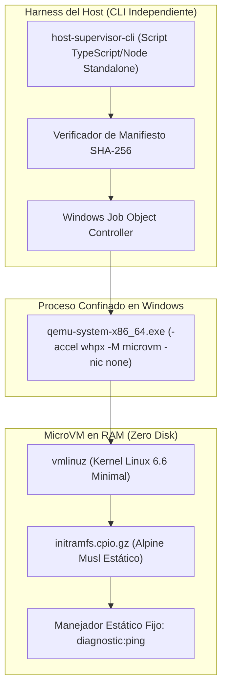

# DEV-001-B2.2-E: Preparación del Prototipo y Criterios de Aceptación de Seguridad
**Fecha:** 2026-11-06  
**Fase:** DEV-001-B2 (Frontera de Ejecución y Aislamiento)  
**Modalidad:** STRICT READ-ONLY / DESIGN ONLY (Sin instalación, sin reinicio, sin modificación de host, sin apertura de puertos)  
**Estado:** Puerta de Seguridad y Criterios de Aceptación del Prototipo  
**Evaluador:** Auditor de Seguridad y Arquitecto de Sistemas Independiente  

---

## 1. Propósito y Filosofía del Prototipo Aislado

La misión **DEV-001-B2.2-E** define la última puerta de diseño de la fase DEV-001-B2 antes de cualquier consideración de pruebas prácticas.

El principio de diseño del primer prototipo se resume en:
> **«El primer prototipo de sandbox debe ser deliberadamente aburrido: arrancar, procesar una única tarea fija e inocua, devolver un resultado estructurado, destruirse completamente y dejar evidencia criptográfica verificable. Si consigue hacer eso sin abrir una sola puerta innecesaria al host, tendremos una base defendible para todo lo que venga después.»**

Este prototipo se concebirá como una **herramienta de prueba manual y aislada**, 100% desacoplada del backend NestJS de JarBees, del Execution Broker y de cualquier modelo de lenguaje o agente autónomo.

---

## 2. Componentes y Arquitectura del Prototipo

El prototipo se compone exclusivamente de cuatro piezas minimalistas y verificables:



### Detalle de los Cuatro Componentes:
1. **Host Supervisor CLI (`tools/security/sandbox-supervisor-cli.ts`)**:
   - Proceso independiente ejecutado manualmente por el operador desde PowerShell estándar.
   - Crea el Windows Job Object (`JobMemoryLimit = 1.25 GB`, `CpuRate = 2000`, `KILL_ON_JOB_CLOSE`, y `ActiveProcessLimit = 1` como condición objetivo condicionada a validación de compatibilidad con la versión de QEMU).
   - Verifica los hashes SHA-256 del kernel y del `initramfs` antes de invocar a QEMU.
   - Inyecta la tarea estructurada mediante pipes anónimos de `stdin` y captura `stdout` con tope de 1 MB.
   - Coordina la terminación forzosa y la verificación de destrucción de recursos.
2. **Kernel Linux Minimal (`vmlinuz-6.6-hardened`)**:
   - Kernel Linux x86-64 compilado específicamente sin controladores de red, sin subsistema USB, sin soporte de GPU ni controladores de bloques NTFS.
   - Tamaño estimado: < 12 MB.
3. **Initramfs en RAM (`initramfs-alpine-hardened.cpio.gz`)**:
   - Imagen comprimida que reside íntegramente en la memoria virtual del invitado.
   - Contiene únicamente las bibliotecas mínimas de musl libc y el binario en C `sandbox-launcher`.
   - Tamaño estimado: < 25 MB.
4. **Manejador de Tarea Única Fija (`diagnostic:ping`)**:
   - El invitado **no contiene un intérprete general de código** (`eval()`, `bash -c`, `python -c` deshabilitados).
   - Contiene exclusivamente la lógica para procesar la capacidad diagnóstica inocua:
     - **Entrada esperada:**
       ```json
       {
         "type": "TASK",
         "execId": "proto-test-001",
         "capability": "diagnostic:ping",
         "artifactHash": "sha256:e3b0c44298fc1c149afbf4c8996fb92427ae41e4649b934ca495991b7852b855",
         "arguments": {
           "echoToken": "jarbees-security-canary-42",
           "timestamp": 1794084500000
         },
         "timeoutMs": 10000,
         "authorizationId": "manual-operator-auth-01"
       }
       ```
     - **Salida emitida:**
       ```json
       {
         "type": "RESULT",
         "execId": "proto-test-001",
         "status": "SUCCESS",
         "exitCode": 0,
         "payload": {
           "pong": true,
           "echoToken": "jarbees-security-canary-42",
           "sandboxKernel": "6.6-hardened",
           "uptimeMs": 38
         },
         "metrics": {
           "durationMs": 45,
           "memoryPeakKb": 11840
         }
       }
       ```

---

## 3. Condiciones Previas Requeridas en el Host (Prerequisites)

Antes de que este prototipo pueda ejecutarse de forma práctica, el host debe cumplir estrictamente las siguientes **tres condiciones operativas previas**:

1. **Habilitación de la Plataforma de Virtualización por el Operador:**
   - Ejecución por parte del operador (con privilegios de Administrador) de:
     ```powershell
     dism.exe /online /enable-feature /featurename:VirtualMachinePlatform /all /norestart
     ```
2. **Reinicio Físico del Host Windows:**
   - Reinicio del equipo para permitir que el kernel de Windows inicialice la plataforma del hipervisor (`HypervisorPresent = True`).
3. **Binarios de QEMU Aislados en Directorio Restringido:**
   - Binario oficial `qemu-system-x86_64.exe` (versión 8.2+ o 9.x) dispuesto en una carpeta de herramientas local (ej. `tools/bin/qemu/`) con permisos de solo lectura para el usuario estándar y sin elevación administrativa.

---

## 4. Garantías de Desconexión y Fronteras de Seguridad

El diseño del prototipo garantiza que no exista ningún riesgo de compromiso del sistema mediante las siguientes **cinco desconexiones absolutas**:

```mermaid
flowchart LR
    subgraph BACKEND["Backend JarBees (Producción / NestJS)"]
        APP["AppModule / Controladores HTTP"]
        BROKER["ExecutionBrokerService (STRICT NO-EXECUTION)"]
    end

    subgraph PROTOTIPO["Prototipo Aislado de Investigación"]
        HARNESS["standalone-cli-test.ts"]
        QEMU_VM["QEMU MicroVM (diagnostic:ping)"]
    end

    BACKEND -.->|DESCONEXIÓN TOTAL (Cero imports, cero llamadas)| PROTOTIPO
    BROKER -.->|Retorna SIMULATED / DENIED| APP
```

1. **Desconexión Total de NestJS:** Cero importaciones del arnés del prototipo en `AppModule` ni en ningún controlador o servicio de JarBees.
2. **Desconexión Total del Execution Broker:** El `ExecutionBrokerService` (B2.1) continúa operando en modo `STRICT NO-EXECUTION`, retornando siempre `SIMULATED` o `DENIED`. No se conecta ningún adaptador de despacho.
3. **Desconexión Física de Red:** Parámetro `-nic none` garantiza cero conectividad de red interna o externa.
4. **Desconexión de GPU:** Cero acceso al dispositivo `/dev/dxg` o a la NVIDIA RTX 5070.
5. **Desconexión de Almacenamiento:** Cero montajes del disco duro host (`C:\`). El entorno corre 100% en RAM efímera.

---

## 5. Criterios de Aceptación y Rechazo para Graduación

Para que el prototipo sea considerado exitoso y homologable en una futura fase B2.3, debe satisfacer rigurosamente los siguientes **criterios objetivos de evaluación**:

### Criterios de Rechazo Inmediato (Fail-Closed):
- El proceso QEMU intenta abrir cualquier socket de red o consultar DNS.
- El proceso QEMU engendra un proceso hijo no autorizado en Windows (o viola el límite verificado del Job Object).
- La memoria virtual de QEMU excede los 1.280 MB en el host Windows.
- La ejecución tarda más de 1.500 ms en completar el ciclo total (arranque, ping y destrucción).
- Queda cualquier archivo temporal huérfano en disco tras la finalización.
- Se detecta cualquier intento de ejecutar comandos no estructurados fuera del esquema JSON de `diagnostic:ping`.

### Criterios de Aceptación Definitivos (Precisiones H-05 a H-08):
1. **Comportamiento Determinista de Ping:** La respuesta JSON devuelta por `stdout` coincide con el esquema exacto y el `echoToken` inyectado.
2. **Aprobación de la Batería Adversarial de 18 Tests:** Superación de los 18 casos de prueba documentados en B2.2-D §11 evaluando el conjunto canónico de 19 aserciones independientes (incluyendo TEST-11A, TEST-11B y TEST-18).
3. **Destrucción Comprobada en 3 Fases y No Persistencia Lógica:** Confirmación mediante `WaitForSingleObject` de que el proceso QEMU ha finalizado, el Job Object ha liberado la memoria asociada y no existe persistencia lógica entre sesiones (G-1 a G-5). Se asume expresamente que la recuperación forense a nivel físico de celdas de silicio de la RAM queda fuera de las garantías certificadas.
4. **Registro de Auditoría Monotónico:** Emisión de un registro estructurado con el hash SHA-256 de los artefactos, el tiempo transcurrido y el código de salida.
5. **Falla Segura ante Expiración de Tiempo:** Inyección de un timeout artificial (100 ms) que demuestre que el Host Supervisor termina a QEMU forzosamente mediante `TerminateJobObject()` sin bloquear el sistema anfitrión.

---

## 6. Estado Consolidado del Módulo DEV-001

Con la presente especificación, el bloque de investigación y arquitectura de aislamiento queda formalmente concluido:

```text
DEV-001-B1:    [HOMOLOGADA CON RESTRICCIONES]   (Commit c459087)
DEV-001-B2.1:  [HOMOLOGADA EN SIMULACIÓN]       (Commit c8a7ba4)
DEV-001-B2.2-A: [AUDITORÍA WSL2 COMPLETADA]     (docs/DEV_001_B2_2_A_WSL2_FEASIBILITY_AUDIT.md)
DEV-001-B2.2-B: [DISEÑO DE AISLAMIENTO]         (docs/DEV_001_B2_2_B_SANDBOX_DESIGN.md)
DEV-001-B2.2-C: [ESPECIFICACIÓN MICROVM]        (docs/DEV_001_B2_2_C_MICROVM_FEASIBILITY.md)
DEV-001-B2.2-D: [ESPECIFICACIÓN QEMU/WHPX]      (docs/DEV_001_B2_2_D_QEMU_WHPX_SUPERVISOR_SPEC.md)
DEV-001-B2.2-E: [PREPARACIÓN DEL PROTOTIPO]     (docs/DEV_001_B2_2_E_PROTOTYPE_READINESS.md)

Frontera de Ejecución: 🔒 STRICT NO-EXECUTION (Despacho al SO desconectado)
Adaptadores Reales:    🔒 BLOQUEADOS
Implementación Práctica: PENDIENTE DE HABILITACIÓN DE HIPERVISOR POR EL OPERADOR
```

