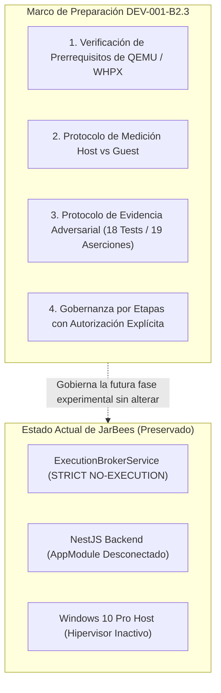

# DEV-001-B2.3-PREPARATION: Especificación de Preparación Técnica y Protocolo de Aceptación del Prototipo
**Fecha:** 2026-11-06  
**Fase:** DEV-001-B2.3 (Preparación Técnica y Protocolo de Evidencia)  
**Modalidad:** STRICT READ-ONLY / SPECIFICATION ONLY (Sin habilitar características de Windows, sin instalar QEMU, sin reinicio, sin conexión al Broker)  
**Estado:** Especificación de Preparación y Gobernanza por Etapas  
**Evaluador:** Auditor de Seguridad y Arquitecto de Sistemas Independiente  

---

## 1. Resumen Ejecutivo y Marco de la Fase

La fase **DEV-001-B2.3-PREPARATION** establece el marco técnico riguroso para la futura evaluación práctica del sandbox de JarBees. Siguiendo el principio de **prudencia operacional escalonada**, esta misión no altera el host ni intenta arrancar máquinas virtuales; su propósito exclusivo es definir las herramientas de medición, los métodos de recolección de evidencia y las puertas de autorización previas al primer experimento.

El principio rector de esta preparación es:
> **«Un diseño seguro sobre papel no demuestra su aislamiento hasta que es sometido a un experimento medible, reproducible y abortable de forma segura. La transición a la práctica debe realizarse en etapas independientes, donde cada paso exige verificación de límites y autorización explícita.»**



---

## 2. Objetivo 1: Verificación de Prerrequisitos Reales

Para transformar la compatibilidad teórica en una configuración técnica ejecutable, se establecen los requisitos exactos de compatibilidad en Windows 10 Pro (Build 19041):

### 2.1. Backend de Aceleración Windows Hypervisor Platform (WHPX)
- **Requisito del Sistema Operativo:** Windows 10 Pro Versión 2004 (Build 19041) o superior.
- **Soporte de CPU:** Procesador x86-64 con soporte de virtualización por hardware (Intel VT-x) y traducción de direcciones de segundo nivel (SLAT / Intel EPT). Constatado en B2.2-A: el Intel Core i7-12700 cumple el 100% de los requisitos con `VirtualizationFirmwareEnabled: True`.
- **Habilitación de Características de Windows (Operaciones Explícitas e Independientes):**
  Para evitar dependencias o fallos por procesamiento conjunto en DISM, la activación se documenta en dos comandos administrativos estrictamente separados:
  ```powershell
  # Operación 1: Plataforma de Máquinas Virtuales
  dism.exe /online /enable-feature /featurename:VirtualMachinePlatform /all /norestart

  # Operación 2: Plataforma de Hipervisor de Windows
  dism.exe /online /enable-feature /featurename:HypervisorPlatform /all /norestart
  ```
- **Verificación de Disponibilidad y Alcance Técnico:**
  Tras la habilitación administrativa y el reinicio del host, el estado se comprueba mediante:
  ```powershell
  (Get-CimInstance Win32_ComputerSystem).HypervisorPresent
  ```
  > [!IMPORTANT]
  > Un resultado `HypervisorPresent: True` confirma que el hipervisor de Windows está activo en el host, pero **no demuestra por sí solo que QEMU/WHPX pueda inicializarse y arrancar correctamente**. La compatibilidad real del acelerador WHPX con la compilación binaria de QEMU, la carga del kernel guest y la negociación de estructuras de CPU se verificarán exclusivamente en las etapas posteriores (Gate 3).

### 2.2. Distribución y Empaquetado del Binario QEMU
- **Versión Objetivo:** QEMU v8.2.x o v9.0.x (x86_64).
- **Origen Verificado:** Compilaciones oficiales de Stefan Weil / Software Freedom Conservancy o binarios auditados del repositorio MSYS2 (`mingw-w64-x86_64-qemu`).
- **Ubicación y Despliegue Aislado:**
  - Los binarios no se instalarán a nivel de sistema ni se registrarán en el `PATH` global de Windows.
  - Se alojarán en un directorio local de herramientas restringido: `tools/sandbox/bin/qemu/`.
  - Permisos NTFS: Solo lectura (`ReadAndExecute`) para el usuario estándar de ejecución, control total exclusivo para el Administrador.

---

## 3. Objetivo 2: Protocolo de Medición y Verificación de Límites del Host

Para garantizar que los límites virtuales del invitado y las cuotas del proceso anfitrión se evalúen sin confusión semántica:

```mermaid
flowchart LR
    subgraph HostMeasurement["Medición del Host (Windows 10)"]
        JOB_MEM["JobMemoryLimit: 1.25 GB (Commit Charge Limit)"]
        HOST_METRICS["Host Metrics: PagefileUsage (Commit) vs WorkingSetSize (RAM Física)"]
        JOB_CPU["CpuRate: 2000 (20% Cuota Relativa Global Host)"]
        JOB_PROC["ActiveProcessLimit: 1 (Límite de Procesos NT, no Hilos)"]
        PIPE_CAP["Pipe Cap: 1 MB (Host Supervisor byte counter)"]
        WATCHDOG["Watchdog Externo: 30s (Timer independiente)"]
    end

    subgraph GuestMeasurement["Medición del Invitado (MicroVM)"]
        VM_MEM["Memoria RAM VM: -m 1024M (cgroups memory.current)"]
        VM_CPU["Topología vCPUs: -smp 2 (vCPU schedstat)"]
        VM_PID["Límite PIDs: pids.max = 64 (cgroups pids.current)"]
    end

    HostMeasurement <-->|Capas Ortogonales y Desacopladas| GuestMeasurement
```



### 3.1. Medición de Memoria del Host y Desacoplamiento de Métricas
- **Distinción Técnica de Métricas del Proceso Host:** El Host Supervisor medirá el consumo del proceso QEMU a través de la API Win32 `GetProcessMemoryInfo`, reconociendo explícitamente la naturaleza de cada indicador:
  - `PagefileUsage` (Private Bytes): Mide la **memoria comprometida** (*commit charge*) asignada por el proceso en el espacio de direcciones virtual respaldado por RAM o archivo de paginación.
  - `WorkingSetSize`: Mide las páginas residentes de **memoria física real (RAM)** asignadas actualmente al proceso por el gestor de memoria de Windows NT.
  - `JOB_OBJECT_LIMIT_JOB_MEMORY` (1.280 MB / 1.25 GB): Establece un límite superior sobre la **memoria comprometida acumulada** (*Job commit limit*) por los procesos dentro del Job Object. **No constituye por sí solo un límite de RAM física residente**. Si la memoria comprometida agregada alcanza 1.25 GB, el kernel de Windows activa la denegación y termina a QEMU con código `0xC0000017` (`STATUS_NO_MEMORY`).
  - Umbral de alerta en supervisor: Si `PagefileUsage` supera **1.150 MB**, el supervisor emite una advertencia de saturación.
- **Desacoplamiento Respecto al Invitado:** Ninguna de las métricas anfitrionas (`PagefileUsage`, `WorkingSetSize`, `JobMemoryLimit`) es equivalente ni directamente intercambiable con la métrica `memory.current` del cgroups v2 dentro de la MicroVM Linux:
  - `memory.current` en el invitado mide el consumo contable del subsistema cgroups (memoria anónima, page cache interno de tmpfs/initramfs) confinado bajo el parámetro `-m 1024M`.
  - Son mecanismos ortogonales en capas independientes: el guest aplica límites cgroups sobre su espacio de usuario; el host aplica límites de commit charge sobre el proceso anfitrión QEMU.

### 3.2. Medición de CPU: Cuota Relativa del Host vs vCPUs del Invitado
- **Nivel del Proceso Host:** El Host Supervisor computará el tiempo de CPU acumulado mediante `GetProcessTimes` (`UserTime + KernelTime`).
  - La cuota `CpuRate = 2000` (20.00% en unidades de centésimas de porcentaje) impone un límite estricto del **20% de la capacidad total agregada de procesamiento del sistema host** para el Job Object.
  - **Desacoplamiento Técnico:** `CpuRate = 2000` **no representa ni dos núcleos dedicados ni dos hilos exclusivos/anclados** (no impone afinidad de procesador ni reserva hardware). Simplemente limita la porción porcentual de ciclos de reloj que el proceso QEMU puede consumir frente a los 20 hilos lógicos del Intel Core i7-12700.
  - Debe quedar explícitamente separado de la directiva de configuración de QEMU `-smp 2`.
- **Nivel del Invitado:** La directiva `-smp 2` asigna exclusivamente la topología virtual que el kernel Linux de la MicroVM expone a su propio planificador interno (2 vCPUs lógicas invitadas). La relación entre vCPUs invitadas y threads anfitriones es gestionada por QEMU y WHPX, quedando la totalidad del proceso sujeta a la cuota global del 20% en el host.

### 3.3. Protocolo de Validación de `ActiveProcessLimit = 1` (Límite de Procesos, no Hilos)
- **Principio Fundamental:** `ActiveProcessLimit` en la estructura `JOBOBJECT_BASIC_LIMIT_INFORMATION` contabiliza **estrictamente instancias de procesos (`EPROCESS`) en el sistema operativo Windows, NO hilos de ejecución (`ETHREAD`)**. Un proceso como QEMU puede crear legítimamente decenas de hilos concurrentes para vCPUs, I/O asíncrono y temporizadores sin alterar en absoluto este contador.
- **Protocolo de Compatibilidad de Procesos:**
  1. El Host Supervisor arrancará QEMU en su primer ensayo con un Job Object configurado inicialmente con `ActiveProcessLimit = 2` y monitoreo activo de eventos `JOB_OBJECT_MSG_NEW_PROCESS` en el Completion Port.
  2. El objetivo exclusivo de este ensayo con valor 2 es verificar si la compilación binaria específica de QEMU para Windows engendra procesos auxiliares independientes (`CreateProcessW`) durante su ciclo de vida (arranque, inicialización de WHPX, ping y destrucción).
  3. Si QEMU opera como un único proceso y no engendra ningún subproceso hijo, se certifica la compatibilidad y se fija el límite duro final en **`ActiveProcessLimit = 1`**.
  4. Si QEMU requiere un proceso auxiliar legítimo de emulación en Windows, se audita e identifica dicho ejecutable y se documenta la necesidad de `ActiveProcessLimit = 2`, garantizando que el Job Object no aborte el arranque por violación de proceso (`0xC0000022` / `STATUS_ACCESS_DENIED`). La creación de hilos queda formalmente descartada como motivo para superar este límite.

### 3.4. Control de Pipes y Salida Máxima
- El Host Supervisor mantiene un contador atómico de bytes leídos desde el pipe `stdout` de QEMU.
- Si `bytesLeidosTotal > 1.048.576 (1 MB)`:
  1. Cierre inmediato del descriptor de lectura.
  2. Invocación de `TerminateJobObject(hJob, 101)` con código de salida `SECURITY_OUTPUT_CAP_EXCEEDED`.
  3. Registro de auditoría en el libro mayor como intento de desbordamiento de búfer.

---

## 4. Objetivo 3: Protocolo de Evidencia Adversarial (18 Tests / 19 Aserciones)

Para cada una de las pruebas de la suite adversarial, se definen los criterios exactos de evidencia, incorporando las precisiones técnicas acordadas:

| ID | Prueba Adversarial | Metodología y Aserción Específica | Evidencia Criptográfica / Registro Requerido | Condición de Aborto Inmediato |
| :--- | :--- | :--- | :--- | :--- |
| **TEST-01** | **Aislamiento de Dispositivos y Filesystem Host** | **Aserción R-01 Ampliada:**<br/>1. Inspección de `/sys/block/` y `/dev/`: verificación de **ausencia total de dispositivos de bloque** (`/dev/sd*`, `/dev/nvme*`).<br/>2. Intento de `open()` sobre rutas Windows $\rightarrow$ `ENOENT`. | Captura JSON de `ls -la /sys/block/` conteniendo únicamente dispositivos loop/ram vacíos. | Detección de cualquier dispositivo de bloque vinculado al almacenamiento host. |
| **TEST-02** | **Montaje de Bloques Forzado** | Invocación de llamada al sistema `mount(2)` en C como `uid=10001`. | Captura de `errno == EPERM` / `ENOSYS`. | Código de retorno 0 en cualquier operación de montaje. |
| **TEST-03** | **Escape por Binarios Windows** | Invocación de ejecutables PE (`powershell.exe`, `cmd.exe`). | Captura de `ENOENT` y confirmación de ausencia de `/proc/sys/fs/binfmt_misc`. | Ejecución exitosa de cualquier binario PE de Windows. |
| **TEST-04** | **Conexión TCP a Servidor de Producción** | **Aserción R-06a:** Conexión a `127.0.0.1:4000`.<br/>Verificación desacoplada en 3 fases:<br/>1. *Topología de enlaces:* `ip link` confirma ausencia de interfaces físicas/virtuales externas (`eth0`).<br/>2. *Tabla de rutas:* `ip route` confirma ausencia de gateway por defecto hacia el host.<br/>3. *Comprobación de sockets:* la llamada `socket()` puede abrir un descriptor localmente, pero la llamada `connect()` debe fallar independientemente con `ECONNREFUSED` o `ENETUNREACH`. | Captura de `ip link`, `ip route` y registro de error en llamada `connect()` (`ECONNREFUSED` / `ENETUNREACH`). | Establecimiento de conexión TCP (SYN-ACK) hacia el servidor de producción o recepción de datos. |
| **TEST-05** | **Conexión a Socket Lock B1** | **Aserción R-06b:** Conexión TCP a `127.0.0.1:40199`.<br/>Verificación desacoplada: ausencia de ruta hacia el puerto de exclusión mutua y fallo independiente en `connect()`. | Registro de error `ECONNREFUSED` o `ENETUNREACH` en llamada `connect()`. | Conexión establecida con el socket de exclusión mutua B1. |
| **TEST-06** | **Acceso a Red Externa / DNS** | **Aserción R-07:** Paquete UDP a `8.8.8.8:53` o HTTP a `1.1.1.1:80`.<br/>Verificación desacoplada: confirmación de tabla de enrutamiento sin ruta externa por defecto (`default via`), apertura de socket y fallo independiente en `sendto()` / `connect()`. | Falla inmediata en `connect()` / `sendto()` (`ENETUNREACH`). | Recepción de cualquier paquete de red externa o resolución DNS. |
| **TEST-07** | **Agotamiento de RAM (Dual Monitoring)** | **Aserción R-08 Ampliada:**<br/>Script en C ejecuta `malloc()` continuo. Medición simultánea de cgroups `memory.current` en el guest y `PagefileUsage` en Windows Job Object. | Registro de invocación del OOM killer en el guest o terminación por Job Object a 1.25 GB sin superar el límite anfitrión. | El proceso QEMU supera 1.280 MB en el administrador de tareas de Windows. |
| **TEST-08** | **Bomba de Bifurcación (Fork-Bomb)** | Invocación de `:(){ :|:& };:` en shell. | Captura de denegación de creación de procesos (`EAGAIN`) al alcanzar 64 PIDs. | Creación de más de 64 procesos en el namespace del invitado. |
| **TEST-09** | **No Persistencia Lógica entre Sesiones** | **Aserción G-5:** Escritura de archivo en `/workspace`, destrucción de la MicroVM, arranque de nueva instancia y verificación de ausencia. | Hash SHA-256 de `/workspace` prístino tras reinicio. | Presencia del archivo temporal en la segunda sesión de MicroVM. |
| **TEST-10** | **Aislamiento de Espacio de Procesos** | **Aserción R-11:** Lectura de `/proc` por el worker confinado. Verificación de que solo son visibles PIDs virtuales del kernel invitado. | Captura de lista de PIDs conteniendo únicamente PIDs 1, 2 y worker local. | Visibilidad de cualquier proceso o PID perteneciente a Windows. |
| **TEST-11A** | **Canales de Integración Unix/9P** | **Aserción R-04:** Búsqueda e intento de conexión a sockets `/run/WSL` o montajes 9P. | Captura de `ENOENT` en todas las rutas de integración conocidas. | Descubrimiento de cualquier socket IPC abierto hacia el host. |
| **TEST-11B** | **Canales de Integración VSOCK** | **Aserción R-05:** Invocación de `socket(AF_VSOCK, SOCK_STREAM, 0)`. | Captura de rechazo por Seccomp BPF con `EAFNOSUPPORT`. | Creación exitosa de socket `AF_VSOCK`. |
| **TEST-12** | **Descriptores Heredados No Autorizados** | Lectura exhaustiva de `/proc/self/fd` antes de transferir control al worker. | Verificación de que existen estrictamente descriptores 0, 1 y 2. | Existencia de cualquier FD $> 2$ (Aborto `EBADFD`). |
| **TEST-13** | **Inspección de GPU y Dispositivos Host** | Búsqueda de `/dev/dxg`, `/dev/dri`, GPUs, controladores USB. | Captura de directorio `/dev/` demostrando ausencia total de dispositivos gráficos y USB. | Descubrimiento de `/dev/dxg` o cualquier interfaz PCI de video. |
| **TEST-14** | **Inmutabilidad del Sistema de Archivos** | Intento de sobrescritura de `/init` o binarios en `/bin`. | Captura de error de kernel `EROFS` (Read-only file system). | Modificación exitosa de cualquier archivo fuera de `/workspace`. |
| **TEST-15** | **Destrucción Completa por Job Object** | Host Supervisor ejecuta `TerminateJobObject()` y mide `WaitForSingleObject()`. | Confirmación de terminación del proceso QEMU en $< 500$ ms y liberación de memoria. | Persistencia del proceso QEMU en Windows tras el cierre del Job. |
| **TEST-16** | **Inyección de Comandos No Estructurados** | Inyección por stdin de secuencias ANSI, caracteres de control o texto plano no JSON. | Supervisor rechaza payload antes de procesar (`InvalidProtocolPayloadException`). | El invitado intenta interpretar o ejecutar el comando malformado. |
| **TEST-17** | **Gobernanza de CPU en el Host** | **Aserción R-17:** Bucle infinito `while(1)` consumiendo 100% de CPU en el guest durante 10 segundos. | Medición de `GetProcessTimes`: el consumo del proceso QEMU en Windows no excede el 20% del total (`CpuRate = 2000`). | El proceso QEMU consume más del 25% de la CPU física del anfitrión. |
| **TEST-18** | **Integridad de Arranque y Falla Segura** | **Aserción R-18:** Alteración deliberada de 1 byte en el hash SHA-256 de `vmlinuz` o `initramfs`. | Aborto preventivo inmediato *Fail-Closed* del Host Supervisor con registro en el log de auditoría. | QEMU arranca o ejecuta con una imagen de kernel alterada. |

---

## 5. Objetivo 4: Gobernanza por Etapas con Autorización Explícita

La transición hacia la ejecución práctica se dividirá estrictamente en **cinco puertas de control (Gates)**. Ninguna etapa podrá iniciarse sin la aprobación expresa y previa del operador:

```mermaid
sequenceDiagram
    autonumber
    actor Operador as Operador de Seguridad
    participant Host as Host Windows 10
    participant Staging as Directorio de Staging
    participant CLI as Standalone CLI Harness
    participant Tests as Adversarial Test Runner

    Note over Operador,Host: GATE 1: Habilitación de Virtualización
    Operador->>Host: 2 comandos DISM separados (VMPlatform + HypervisorPlatform) + Reinicio físico
    Host-->>Operador: HypervisorPresent: True (Hipervisor activo; arranque QEMU/WHPX pendiente de prueba)

    Note over Operador,Staging: GATE 2: Staging de Binarios y Kernel
    Operador->>Staging: Disposición de QEMU, vmlinuz e initramfs
    Staging-->>Operador: Manifiesto SHA-256 generado y verificado

    Note over Operador,CLI: GATE 3: Prueba de Humo Aislada (diagnostic:ping)
    Operador->>CLI: Ejecución manual de ping (Sin NestJS, sin Broker)
    CLI-->>Operador: Pong exitoso en < 1500 ms, destrucción comprobada

    Note over Operador,Tests: GATE 4: Batería Adversarial de 18 Pruebas
    Operador->>Tests: Ejecución automatizada de TEST-01 a TEST-18
    Tests-->>Operador: 19 aserciones independientes aprobadas al 100%

    Note over Operador,Tests: GATE 5: Homologación Práctica de Aislamiento
    Operador->>Operador: Dictamen final de sandbox antes de cualquier enlace con Broker
```

### Protocolo de Cada Puerta de Control:
1. **Gate 1 (Habilitación de Virtualización):** Acción administrativa manual fuera de la sesión de trabajo. Requiere la ejecución secuencial y explícita de dos comandos DISM separados:
   - `dism.exe /online /enable-feature /featurename:VirtualMachinePlatform /all /norestart`
   - `dism.exe /online /enable-feature /featurename:HypervisorPlatform /all /norestart`
   Seguido del reinicio físico del host. Se verifica mediante `(Get-CimInstance Win32_ComputerSystem).HypervisorPresent == $true`. Esta verificación confirma que el hipervisor de Windows está activo en el sistema, pero no demuestra por sí sola que QEMU/WHPX pueda arrancar (viabilidad que se validará en Gate 3).
2. **Gate 2 (Staging de Artefactos):** Copia de binarios de QEMU, kernel Linux e initramfs en `tools/sandbox/` con permisos de solo lectura. Firma de manifiesto SHA-256.
3. **Gate 3 (Prueba de Humo Aislada):** Invocación manual desde PowerShell del script `sandbox-supervisor-cli.ts` ejecutando una única tarea fija `diagnostic:ping`. Verificación de tiempo de ciclo $< 1.500$ ms y destrucción en 3 fases.
4. **Gate 4 (Ejecución de la Suite Adversarial):** Invocación automatizada de los 18 casos adversariales. Cualquier fallo en una aserción aborta el protocolo.
5. **Gate 5 (Homologación Práctica):** Emisión del informe final de aislamiento con evidencia de los 18 tests. Solo tras este hito se evaluará la apertura de la fase B2.4 para el diseño de adaptadores reales del Execution Broker.

---

## 6. Estado del Sistema y Línea Base de Seguridad

```text
DEV-001-B1:    [HOMOLOGADA CON RESTRICCIONES]   (Commit c459087)
DEV-001-B2.1:  [HOMOLOGADA EN SIMULACIÓN]       (Commit c8a7ba4)
DEV-001-B2.2:  [REMEDIACIÓN DOCUMENTAL CERRADA] (Commit 781f47b)
DEV-001-B2.3:  [PREPARACIÓN TÉCNICA COMPLETADA] (docs/DEV_001_B2_3_PREPARATION_SPEC.md)

Frontera de Ejecución: 🔒 STRICT NO-EXECUTION (Despacho al SO desactivado)
Adaptadores Reales:    🔒 BLOQUEADOS
Hipervisor en Windows: 🔒 INACTIVO (HypervisorPresent: False)
```

### Próximo Paso Recomendado:
Consolidar el documento [`docs/DEV_001_B2_3_PREPARATION_SPEC.md`](file:///c:/Projects/productos_crud_bkd/docs/DEV_001_B2_3_PREPARATION_SPEC.md) y la actualización de [`CHANGELOG.md`](file:///c:/Projects/productos_crud_bkd/CHANGELOG.md) en la rama `security/dev-001-b` mediante autorización expresa, concluyendo formalmente el marco de preparación técnica antes de cualquier intervención práctica en el host.

