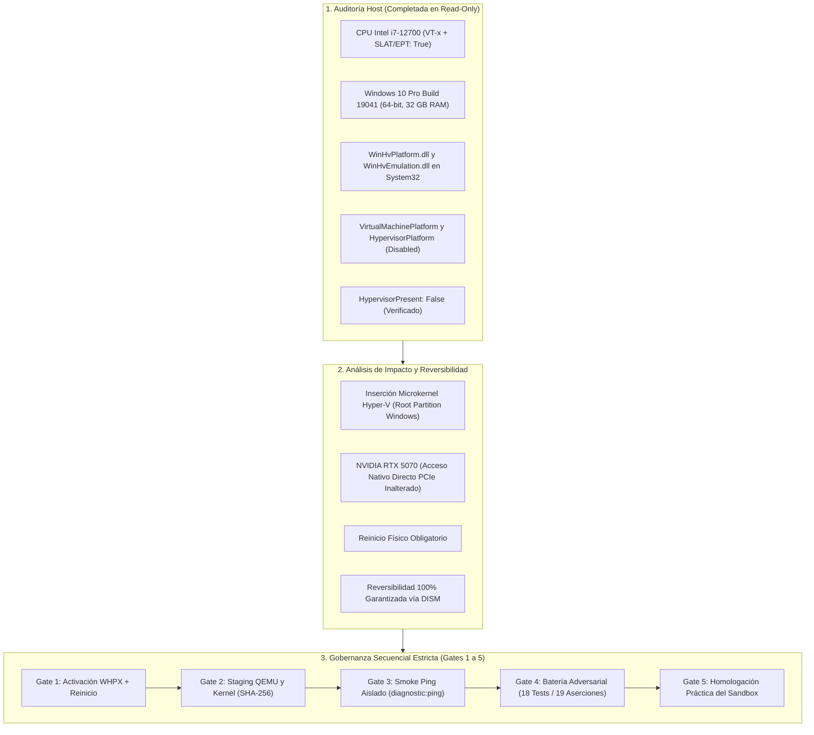

# DEV-001-B2.4: Auditoría de Preparación del Host y Dossier de Autorización de Gate 1
**Fecha:** 2026-11-06  
**Fase:** DEV-001-B2.4 (Revisión de Preparación del Host y Dossier de Gate 1)  
**Modalidad:** STRICT READ-ONLY / AUDIT ONLY (Sin comandos DISM, sin reinicios, sin instalación de software, sin ejecución de VMs)  
**Estado:** Auditoría Completada — Dossier Preparado para Decisión del Operador  
**Evaluador:** Auditor de Seguridad y Arquitecto de Sistemas Independiente  

---

## 1. Resumen Ejecutivo y Marco de la Misión

La fase **DEV-001-B2.4** realiza la evaluación empírica no invasiva del entorno anfitrión (Windows 10 Pro) para determinar con certeza técnica si el equipo cumple todos los prerrequisitos de hardware, firmware, sistema operativo y librerías para albergar el sandbox de MicroVM QEMU/WHPX, analizando además el impacto sistémico y la reversibilidad de activar la capa de virtualización.

El principio operativo que gobierna esta misión es:
> **«La preparación práctica no se confunde con la concesión de ejecución. Auditar la disponibilidad del hipervisor en modo de solo lectura permite despejar incógnitas de compatibilidad sin alterar el sistema operativo ni comprometer la línea base de seguridad de JarBees.»**



---

## 2. Auditoría Empírica del Host (Inspección No Invasiva)

A través de consultas WMI y CIM sin elevación de privilegios, se constataron los siguientes datos reales del equipo:

### 2.1. Plataforma de Hardware y Procesador
- **Procesador:** 12th Gen Intel(R) Core(TM) i7-12700 (12 núcleos físicos: 8 P-Cores + 4 E-Cores, 20 hilos lógicos).
- **Virtualización en Firmware (BIOS/UEFI):** `VirtualizationFirmwareEnabled: True`.
- **Traducción de Direcciones de Segundo Nivel (SLAT):** `SecondLevelAddressTranslationExtensions: True` (Intel EPT activo en hardware).
- **Memoria Física:** 32 GB de RAM DDR (33.308.324 KB visibles, ~22 GB libres en reposo).
- **Acelerador Gráfico:** NVIDIA GeForce RTX 5070 (12 GB VRAM, Compute Capability 12.x / Blackwell).

### 2.2. Sistema Operativo y Componentes de Virtualización
- **Sistema Operativo:** Microsoft Windows 10 Pro (64 bits), Versión 2004, Compilación 19041.
- **Estado de Hipervisor:** `(Get-CimInstance Win32_ComputerSystem).HypervisorPresent: False`.
- **Estado de Características Opcionales (`Win32_OptionalFeature`):**
  - `HypervisorPlatform`: `InstallState = 2` (*Disabled* / Deshabilitada).
  - `VirtualMachinePlatform`: `InstallState = 2` (*Disabled* / Deshabilitada).
  - `Microsoft-Hyper-V-All`: `InstallState = 2` (*Disabled* / Deshabilitada).
- **Librerías del Sistema (`C:\Windows\System32\`):**
  - `WinHvPlatform.dll`: Presente (v10.0.19041.264, *Hyper-V Hypervisor User-Mode API Library*).
  - `WinHvEmulation.dll`: Presente (v10.0.19041.662, *Hyper-V Instruction Emulator User-Mode API Library*).
- **Seguridad Basada en Virtualización (VBS / DeviceGuard):** `VirtualizationBasedSecurityStatus = 0` (Inactivo).

> [!NOTE]
> Las librerías de usuario de WHPX ya forman parte de la imagen estándar de Windows 10 Pro Build 19041. Sin embargo, no pueden inicializarse mientras el hipervisor de Windows permanezca inactivo (`HypervisorPresent: False`).

---

## 3. Análisis de Impacto Operacional y Reversibilidad de Gate 1

La activación de la capa de virtualización de Windows conlleva implicaciones técnicas que deben evaluarse con precisión:

### 3.1. Arquitectura de Ejecución Post-Gate 1 (Microkernel Hyper-V)
Al habilitar `HypervisorPlatform`, la secuencia de arranque de Windows se modifica a nivel de BCD:
1. El cargador de arranque inicia el microkernel de Hyper-V (hipervisor Tipo-1).
2. La instalación actual de Windows 10 Pro arranca como la **Partición Raíz (*Root Partition*)** sobre el hipervisor.
3. La Partición Raíz retiene el control de todos los dispositivos físicos y la administración del hardware.

### 3.2. Impacto en CPU y en la GPU NVIDIA RTX 5070
- **CPU:** El procesador Intel Core i7-12700 incorpora soporte nativo para VPID (*Virtual Processor ID*) y EPT (*Extended Page Tables*). La sobrecarga de ejecución de la Partición Raíz bajo Hyper-V es prácticamente imperceptible (< 1% a 2% en cargas de cálculo intensivo).
- **GPU (RTX 5070):** La Partición Raíz tiene acceso directo por hardware (*direct device access*) a las interfaces PCIe. **Los controladores de NVIDIA, las capas CUDA, TensorRT y los codificadores NVENC continúan funcionando a velocidad nativa sin ninguna degradación**. La GPU no se expone a máquinas virtuales invitadas a menos que se configure explícitamente una asignación DDA (*Discrete Device Assignment*), lo cual está terminantemente excluido de la matriz de dispositivos de la MicroVM.

### 3.3. Requisito de Reinicio y Control de Elevación
- **Reinicio Obligatorio:** Debido a que el hipervisor se ubica por debajo del kernel de Windows (`ntoskrnl.exe`), no es técnicamente posible cargarlo en caliente. El reinicio del equipo anfitrión es un requisito indispensable del sistema operativo.
- **Control de Acceso y Aislamiento del Agente:** Las herramientas de modificación del sistema (`dism.exe`, `bcdedit.exe`, `Enable-WindowsOptionalFeature`) requieren obligatoriamente elevación administrativa (UAC / Administrador). La sesión actual de trabajo y los procesos de Node.js/NestJS no disponen de privilegios elevados, garantizando que **el agente no puede activar características ni alterar la configuración de arranque de Windows por sí mismo**.

### 3.4. Protocolo de Reversibilidad Garantizada
Si en cualquier momento se requiriese desmantelar la capa de hipervisor y retornar el equipo al estado inicial exacto, el procedimiento administrativo es 100% reversible mediante dos comandos:
```powershell
# Reversión administrativa (en caso de requerirse):
dism.exe /online /disable-feature /featurename:VirtualMachinePlatform /norestart
dism.exe /online /disable-feature /featurename:HypervisorPlatform /norestart
# Reiniciar el equipo para restaurar HypervisorPresent: False
```

---

## 4. Precisiones Técnicas para las Pruebas de Aislamiento

Siguiendo las observaciones del operador de seguridad, se establecen dos directivas normativas obligatorias:

### 4.1. Semántica y Reproducibilidad de Códigos de Error de Red

En la batería adversarial (TEST-04, TEST-05, TEST-06), los errores de conexión de red **no son intercambiables** y deben registrarse con precisión según el escenario evaluado:

| Código de Error POSIX | Significado Técnico Exacto | Escenario en la MicroVM de JarBees | Criterio de Verificación Adversarial |
| :--- | :--- | :--- | :--- |
| **`ENETUNREACH`**<br/>*(Network is unreachable)* | No existe una ruta utilizable en la tabla de enrutamiento del kernel para alcanzar la dirección de destino. | **Red Externa / Host (TEST-04, TEST-05, TEST-06):** La MicroVM arranca sin interfaz de red (`-nic none`) y sin gateway por defecto. Cualquier intento de conexión a IPs externas (`8.8.8.8`, `1.1.1.1`) o a la IP física del host (`192.168.x.x`) debe disparar `ENETUNREACH`. | Se verifica que la tabla de rutas del kernel invitado está vacía (`ip route show` sin ruta `default`) y la llamada `connect()` retorna inmediatamente `ENETUNREACH`. |
| **`ECONNREFUSED`**<br/>*(Connection refused)* | La dirección de destino fue alcanzada (la ruta existe), pero el puerto de destino no tiene ningún proceso en escucha (se recibió un paquete TCP RST). | **Interfaz Loopback Local (`127.0.0.1` dentro del guest):** La interfaz loopback interna del invitado está activa para IPC local de la VM. Intentar conectar a `127.0.0.1:4000` dentro del espacio del invitado retornará `ECONNREFUSED` porque ningún servicio escucha en ese puerto dentro de la VM. | Se verifica que el puerto 4000 del anfitrión NO es accesible a través del loopback del invitado, confirmando que el espacio de red de la MicroVM es independiente del host. |
| **`EAFNOSUPPORT`**<br/>*(Address family not supported)* | La familia de protocolos de sockets solicitada no está implementada o está bloqueada por Seccomp BPF. | **Canales Prohibidos (TEST-11B):** Intentos de invocar `socket(AF_VSOCK, ...)` o protocolos no autorizados. | El filtro Seccomp intercepta la syscall antes de su ejecución y retorna `EAFNOSUPPORT`. |

### 4.2. Secuencialidad Obligatoria de las 5 Puertas de Control (Gates)

Queda formalmente establecido que **el progreso práctico es estrictamente secuencial y no admite saltos de etapas**:

```text
Gate 1 (Hipervisor) ──> Gate 2 (Staging) ──> Gate 3 (Smoke Ping) ──> Gate 4 (Adversarial) ──> Gate 5 (Homologación)
```

- **Independencia de Autorización:** La aprobación de un Gate **no autoriza implícitamente la apertura del siguiente**. Cada etapa concluye con un informe de evidencia independiente y exige autorización expresa del operador antes de proceder.
- **Prohibición de Atajos:** Está terminantemente prohibido saltar de Gate 1 a Gate 3. Gate 2 (staging verificado y firma SHA-256 de binarios locales) es una condición previa obligatoria para el primer encendido experimental.

---

## 5. Dossier y Procedimiento de Autorización para Gate 1

Este dossier define las acciones exactas que deberán ejecutarse cuando el operador autorice la apertura de la fase práctica:

### 5.1. Acciones a Realizar por el Operador de Seguridad (Administrador)
1. Abrir una consola de PowerShell como Administrador (`Ejecutar como Administrador`).
2. Ejecutar de forma explícita y separada los dos comandos DISM:
   ```powershell
   # Paso 1: Habilitar Plataforma de Máquinas Virtuales
   dism.exe /online /enable-feature /featurename:VirtualMachinePlatform /all /norestart

   # Paso 2: Habilitar Plataforma de Hipervisor de Windows
   dism.exe /online /enable-feature /featurename:HypervisorPlatform /all /norestart
   ```
3. Reiniciar físicamente el equipo anfitrión para que Windows inicialice el microkernel de Hyper-V.

### 5.2. Criterios de Aceptación Post-Reinicio para Gate 1
Una vez reiniciado el equipo, el operador (o el agente en modo lectura) verificará:
1. `(Get-CimInstance Win32_ComputerSystem).HypervisorPresent == $true`.
2. Las características `VirtualMachinePlatform` e `HypervisorPlatform` reportan `InstallState = 1` (*Enabled*).
3. Los controladores de pantalla de NVIDIA cargan normalmente y la RTX 5070 es plenamente funcional en el Administrador de Dispositivos.

> [!WARNING]
> La satisfacción de los criterios de Gate 1 valida la presencia de la infraestructura de virtualización en Windows, pero **no otorga autorización para arrancar máquinas virtuales ni para conectar el Execution Broker**. Tras Gate 1, el sistema se detendrá a la espera de la autorización explícita para Gate 2 (Staging).

---

## 6. Estado de Seguridad del Repositorio y Conclusión

```text
Rama de Trabajo:       security/dev-001-b
Último Commit:         57a7a29 (origin/security/dev-001-b)
Árbol de Trabajo:      docs/DEV_001_B2_4_HOST_READINESS_REVIEW.md (Nuevo)
Frontera de Ejecución: 🔒 STRICT NO-EXECUTION (Execution Broker en modo SIMULATED)
Modo de Trabajo:       STRICT READ-ONLY / AUDIT ONLY
Rama main:             Intacta / Sin modificaciones
```

La auditoría de preparación del host confirma que el hardware y el sistema operativo están 100% preparados para albergar la MicroVM cuando se decida iniciar Gate 1, sin riesgos para el hardware gráfico ni para la estabilidad del equipo. El sistema queda detenido y a la espera de las instrucciones del operador.
