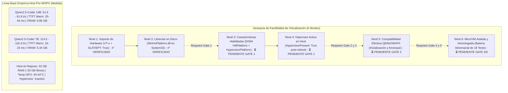

# DEV-001-B2.4: Auditoría de Preparación del Host, Línea Base de Rendimiento y Dossier de Gate 1
**Fecha:** 2026-11-06
**Fase:** DEV-001-B2.4 (Revisión de Preparación del Host, Benchmark Previo y Dossier de Gate 1)
**Modalidad:** STRICT READ-ONLY / AUDIT & BENCHMARK ONLY (Sin comandos DISM, sin reinicios, sin instalación de software, sin ejecución de VMs)
**Estado:** Remediado tras Auditoría Independiente DEV-001-B2.4-R — Con Línea Base Empírica Pre-WHPX
**Evaluador:** Auditor de Seguridad y Arquitecto de Sistemas Independiente

---

## 1. Resumen Ejecutivo y Marco de la Misión

La fase **DEV-001-B2.4** evalúa empíricamente el entorno anfitrión (Windows 10 Pro) para determinar las condiciones reales de hardware, firmware, sistema operativo y librerías previas al despliegue del sandbox de MicroVM QEMU/WHPX. Incorpora además la medición de una **línea base de rendimiento pre-WHPX** en la GPU NVIDIA RTX 5070 y en el CPU Intel Core i7-12700, estableciendo los criterios de comparación antes de cualquier intervención sobre el sistema operativo.

El principio operativo rector es:
> **«La preparación práctica no se confunde con la concesión de ejecución ni con garantías de seguridad teóricas. La viabilidad de virtualización se divide en seis niveles estrictos, de los cuales únicamente los niveles de hardware y librerías en disco están verificados. El rendimiento y el aislamiento deben medirse experimentalmente en cada etapa.»**



---

## 2. Auditoría Empírica del Host e Inventario Local

A través de consultas WMI, CIM y el utilitario `nvidia-smi` en modo de solo lectura, se constataron los siguientes parámetros reales del equipo:

### 2.1. Plataforma de Hardware y Procesador
- **Procesador:** 12th Gen Intel(R) Core(TM) i7-12700 (12 núcleos físicos: 8 P-Cores + 4 E-Cores, 20 hilos lógicos).
- **Virtualización en Firmware (BIOS/UEFI):** `VirtualizationFirmwareEnabled: True` (Nivel 1 verificado).
- **Traducción de Direcciones de Segundo Nivel (SLAT):** `SecondLevelAddressTranslationExtensions: True` (Intel EPT activo en hardware, Nivel 1 verificado).
- **Memoria Física:** 32 GB de RAM DDR (33.308.324 KB visibles, ~20-22 GB libres en reposo).
- **Acelerador Gráfico:** NVIDIA GeForce RTX 5070 (12.227 MiB VRAM visible, Driver 617.42, CUDA 13.4).

### 2.2. Sistema Operativo y Componentes de Virtualización
- **Sistema Operativo:** Microsoft Windows 10 Pro (64 bits), Versión 2004, Compilación 19041.
- **Estado de Hipervisor:** `(Get-CimInstance Win32_ComputerSystem).HypervisorPresent: False` (Hipervisor actualmente inactivo).
- **Estado de Características Opcionales (`Win32_OptionalFeature`):**
  - `HypervisorPlatform`: `InstallState = 2` (*Disabled* / Deshabilitada).
  - `VirtualMachinePlatform`: `InstallState = 2` (*Disabled* / Deshabilitada).
  - `Microsoft-Hyper-V-All`: `InstallState = 2` (*Disabled* / Deshabilitada).
- **Librerías del Sistema (`C:\Windows\System32\`):**
  - `WinHvPlatform.dll`: Presente (v10.0.19041.264, *Hyper-V Hypervisor User-Mode API Library*, Nivel 2 verificado).
  - `WinHvEmulation.dll`: Presente (v10.0.19041.662, *Hyper-V Instruction Emulator User-Mode API Library*, Nivel 2 verificado).
- **Seguridad Basada en Virtualización (VBS / DeviceGuard):** `VirtualizationBasedSecurityStatus = 0` (Inactivo).

---

## 3. Línea Base Empírica de Rendimiento Host Pre-WHPX (Benchmark de Referencia)

Siguiendo el requerimiento de auditoría independiente H-01 y H-02, se ejecutó una prueba de rendimiento estandarizada utilizando exclusivamente las herramientas y modelos locales preinstalados en el equipo, sin descargar dependencias ni alterar el sistema operativo.

### 3.1. Metadatos de Infraestructura y Configuración para Reproducibilidad
- **Motor / Backend de Inferencia:** Ollama v0.40.11 (x86_64 Windows).
- **Controlador Gráfico:** NVIDIA Driver 617.42, CUDA UMD 13.4, WDDM.
- **Descarga a GPU:** **100% de las capas descargadas en VRAM** (48/48 bloques para 14B; 28/28 bloques para 7B).
- **Prompt Estandarizado:** `"Write a complete, thread-safe LRU cache in TypeScript with get, set, and evict methods, including full type annotations and edge case handling."`
- **Tokens de Entrada (Prompt Tokens):** **31 tokens** (`prompt_eval_count = 31`).
- **Tokens de Salida (Generated Tokens):** **256 tokens** (`eval_count = 256`, delimitado determinísticamente por `num_predict = 256` y `temperature = 0.0`).
  - > [!NOTE]
  - > **Límite Experimental vs Validación Funcional:** La cota de 256 tokens actúa como un límite de prueba controlada para registrar latencia, TTFT y throughput bajo volumen constante. **No constituye una validación funcional ni algorítmica** de que el modelo haya completado la lógica del LRU Cache; mide estrictamente el rendimiento del subsistema de inferencia.
- **Protocolo de Medición:** 3 ejecuciones por modelo, diferenciando la primera ejecución (*Cold Start*, que incluye la carga e inicialización de pesos) de las ejecuciones posteriores (*Warm Runs* con pesos residentes en VRAM).
- **Reproducibilidad Metodológica vs Identidad de Resultados:** La publicación de parámetros, hashes y cuantizaciones garantiza la reproducibilidad experimental, pero **no implica que ejecuciones posteriores en otras condiciones arrojen idénticos microsegundos**. Los datos deben interpretarse como una referencia estadística inicial.
- **Modelos Utilizados (Inventario Local Verificado por SHA-256):**
  - **Modelo Principal:** `qwen2.5-coder:14b` (Instruct, GGUFv2, Cuantización `Q4_K_M` [file_type 15], 48 capas, Blob SHA-256: `ac9bc7a69dab38da1c790838955f1293420b55ab555ef6b4615efa1c1507b1ed`, 9.0 GB).
  - **Modelo Secundario:** `qwen2.5-coder:7b` (Instruct, GGUFv2, Cuantización `Q4_K_M` [file_type 15], 28 capas, Blob SHA-256: `60e05f2100071479f596b964f89f510f057ce397ea22f2833a0cfe029bfc2463`, 4.7 GB).

### 3.2. Resultados Empíricos Medidos (Hipervisor Inactivo)

#### Origen y Semántica de los Tiempos de Carga:
Los valores de **$10{,}552\text{ s}$ ($10\,552\text{ ms}$)** para 14B y **$6{,}423\text{ s}$ ($6\,423\text{ ms}$)** para 7B provienen directamente del campo de telemetría de Ollama **`load_duration`**. Representan el tiempo global acumulado que incluye el arranque del proceso runtime, la reserva de memoria en VRAM, la inicialización del contexto CUDA y el mapeo de los pesos desde el almacenamiento NVMe, no únicamente la tasa de transferencia bruta del bus PCIe.

#### Configuración A: `qwen2.5-coder:14b` (Modelo Principal)
| Ejecución | Tipo | TTFT | Duración Total | Carga de Pesos (`load_duration`) | Tokens Generados | Rendimiento (Tokens/s) | VRAM Ocupada (MB) | Temp GPU (°C) | Potencia GPU (W) | RAM Libre Host (MB) | Memoria Comprometida Host (MB) |
| :---: | :---: | :---: | :---: | :---: | :---: | :---: | :---: | :---: | :---: | :---: | :---: |
| **Run 1** | Cold Start | $10{,}690\text{ s}$ | $14{,}969\text{ s}$ | **$10{,}552\text{ s}$ ($10\,552\text{ ms}$)** | 256 | **59,85** | 9.859 | 63 | 215,81 | 20.244 | 24.537 |
| **Run 2** | Warm Run | **44 ms** | $4{,}202\text{ s}$ | $0{,}003\text{ s}$ (3 ms) | 256 | **61,59** | 9.843 | 65 | 219,60 | 20.198 | 24.554 |
| **Run 3** | Warm Run | **25 ms** | $4{,}170\text{ s}$ | $0{,}002\text{ s}$ (2 ms) | 256 | **61,77** | 9.843 | 65 | 224,72 | 20.503 | 24.545 |

- **Estabilidad Warm:** Variación de rendimiento $< 0,3\%$ entre Run 2 y Run 3 (~61,6 a 61,8 t/s).
- **Latencia Warm TTFT:** 25 ms a 44 ms.

#### Configuración B: `qwen2.5-coder:7b` (Modelo Secundario)
| Ejecución | Tipo | TTFT | Duración Total | Carga de Pesos (`load_duration`) | Tokens Generados | Rendimiento (Tokens/s) | VRAM Ocupada (MB) | Temp GPU (°C) | Potencia GPU (W) | RAM Libre Host (MB) | Memoria Comprometida Host (MB) |
| :---: | :---: | :---: | :---: | :---: | :---: | :---: | :---: | :---: | :---: | :---: | :---: |
| **Run 1** | Cold Start | $6{,}476\text{ s}$ | $8{,}679\text{ s}$ | **$6{,}423\text{ s}$ ($6\,423\text{ ms}$)** | 256 | **116,30** | 5.335 | 64 | 216,72 | 20.717 | 19.836 |
| **Run 2** | Warm Run | **23 ms** | $2{,}250\text{ s}$ | $0{,}002\text{ s}$ (2 ms) | 256 | **115,00** | 5.335 | 62 | 207,29 | 20.699 | 19.809 |
| **Run 3** | Warm Run | **16 ms** | $2{,}253\text{ s}$ | $0{,}002\text{ s}$ (2 ms) | 256 | **114,50** | 5.335 | 64 | 210,73 | 20.706 | 19.802 |

- **Estabilidad Warm:** Variación de rendimiento $< 0,5\%$ entre Run 2 y Run 3 (~114,5 a 115,0 t/s).
- **Latencia Warm TTFT:** 16 ms a 23 ms.

### 3.3. Semántica de Métricas del Host y Estado de Mediciones Pendientes
- **Memoria Comprometida Host (Estimación WMI vs Contador Canónico):** El valor reportado (~24.545 MB en 14B y ~19.802 MB en 7B) se calculó como una **estimación indirecta derivada de la clase WMI `Win32_OperatingSystem`** mediante la fórmula:
  $$\text{Estimación WMI} = \frac{\text{TotalVirtualMemorySize} - \text{FreeVirtualMemory}}{1024}$$
  > [!NOTE]
  > Se aclara formalmente que esta estimación **NO equivale al contador canónico de Windows `\Memory\Committed Bytes`** (el cual audita los bytes comprometidos privados directamente desde el gestor de memoria NT). Se preservan los valores calculados documentando explícitamente su procedencia de contadores de archivo de paginación/memoria virtual de WMI.
- **Memoria RAM Libre Host:** Obtenida directamente de `Win32_OperatingSystem.FreePhysicalMemory` (~20.500 MB libres durante 14B y ~20.700 MB durante 7B).
- **Métrica de CPU del Host (Reclasificación Técnica):** La cifra del 3% al 6% informada preliminarmente **se reclasifica como un dato observacional no validado formalmente**. Al no haberse implementado en el script de prueba un cálculo diferencial riguroso entre dos muestras temporales de `os.cpus()` normalizadas por el intervalo de reloj y la cantidad de núcleos lógicos (20 hilos del i7-12700), **se retira formalmente su interpretación como utilización instantánea demostrada**.
- **Benchmark de Cómputo CPU-Only (Inferencia en CPU sin GPU):** **DECLARADO FORMALMENTE PENDIENTE.** Siguiendo el principio de prudencia técnica y para no alterar configuraciones del entorno Ollama ni inducir estrés térmico innecesario en el host antes de Gate 1, la medición de estrés puro de CPU no se forzó y queda registrada como pendiente no bloqueante.

> [!IMPORTANT]
> **Teardown Limpio Verificado:** Tras finalizar las mediciones, ambos modelos fueron descargados de la memoria (`keep_alive = 0`) y el proceso del motor de inferencia fue terminado. La ocupación de VRAM retornó a su nivel basal de reposo (661 MiB) y la temperatura a 44°C, certificando la ausencia de procesos zombi o fugas de recursos en el host.

---

## 4. Análisis de Impacto Operacional y Reversibilidad de Gate 1 (Remediado)

### 4.1. Arquitectura de la Partición Raíz y Rendimiento de la GPU RTX 5070 (Remediación H-01)
- **Topología de Hardware:** Al habilitar `HypervisorPlatform`, Windows 10 pasa a operar como la **Partición Raíz (*Root Partition*)** sobre el microkernel de Hyper-V, manteniendo la asignación directa de los adaptadores PCIe.
- **Hipótesis Sujeta a Benchmark (Sin Promesas Absolutas):** Aunque la Partición Raíz tiene acceso directo por hardware a la GPU, **no se asume a priori que el rendimiento de CUDA, TensorRT y NVENC permanecerá estrictamente inalterado**. La virtualización de interrupciones y el manejo de páginas EPT por el hipervisor podrían introducir variaciones sutiles de latencia o fluctuaciones en la temporización.
- **Criterio de Verificación Experimental:** Los resultados empíricos registrados en la Sección 3 constituyen la línea base contra la cual se repetirá exactamente el mismo benchmark tras el reinicio de Gate 1, permitiendo cuantificar si existe alguna alteración real.

### 4.2. Sobrecarga de CPU: Estimación Teórica vs Medición (Remediación H-02)
- La afirmación de una sobrecarga inferior al 1-2% en el procesador Intel Core i7-12700 **se clasifica formalmente como una hipótesis teórica basada en la literatura arquitectónica de Intel y Microsoft sobre SLAT/VPID, no como un resultado medido en este equipo**.
- Su impacto real en la reactividad del host y en la latencia de inferencia será contrastado mediante la comparación directa post-reinicio.

### 4.3. Procedimiento de Reversión Administrativa (Remediación H-03)
- Se **elimina cualquier promesa de «reversibilidad del 100%»**. En sistemas operativos complejos, revertir características de virtualización no garantiza la restauración física absoluta de todos los estados previos a nivel de registro o de dependencias secundarias.
- **Procedimiento de Reversión de Configuración:** En caso de requerirse, la deshabilitación se efectúa mediante dos comandos administrativos:
  ```powershell
  dism.exe /online /disable-feature /featurename:VirtualMachinePlatform /norestart
  dism.exe /online /disable-feature /featurename:HypervisorPlatform /norestart
  ```
  Seguido de un reinicio físico del host. Se verifica que `(Get-CimInstance Win32_ComputerSystem).HypervisorPresent == $false`. Este procedimiento revierte la configuración operativa del arranque, constituyendo la salvaguarda administrativa del entorno.

### 4.4. Control de Elevación y Barrera de Seguridad (Remediación H-06)
- La sesión de trabajo actual opera bajo un token de usuario con nivel de integridad media (*Medium Mandatory Level*). El rechazo de DISM (`Error 740`) demuestra que las APIs de modificación de componentes de Windows requieren elevación administrativa.
- **Enfoque de Defensa en Profundidad:** Este comportamiento se documenta como una barrera de control provista por el modelo de seguridad de Windows (UAC), reconociendo que restringe las operaciones administrativas estándar en esta sesión, sin formular afirmaciones teóricas absolutas sobre la imposibilidad de cualquier intento de elevación.

---

## 5. Precisiones Técnicas para las Pruebas de Aislamiento (Remediado)

### 5.1. Semántica Rigurosa y Límites Probatorios de Red (Remediación H-04)

En la batería adversarial (TEST-04, TEST-05, TEST-06), se establece la distinción formal entre los resultados de red y sus límites probatorios:

| Código POSIX | Significado Técnico en el Sandbox | Qué Demuestra | Qué NO Demuestra (Límite Probatorio) |
| :--- | :--- | :--- | :--- |
| **`ECONNREFUSED`**<br/>*(Connection refused)* | La conexión TCP se dirigió a `127.0.0.1:4000` en la interfaz loopback local del invitado y el stack TCP devolvió un paquete RST. | Demuestra exclusivamente que el servicio de producción del anfitrión **no está publicado ni expuesto en el stack de red interno de la MicroVM**. | **NO demuestra por sí mismo aislamiento del host.** Un payload podría fallar localmente en el loopback del guest aun cuando existiese una interfaz puenteada no autorizada hacia el anfitrión. |
| **`ENETUNREACH`**<br/>*(Network unreachable)* | La llamada `connect()` o `sendto()` hacia la IP física del host (`192.168.x.x`) o red externa (`8.8.8.8`) es rechazada por el kernel guest por falta de ruta. | Demuestra que bajo la configuración actual (`-nic none`) el kernel invitado **carece de interfaces de red externas y de rutas utilizables** para dirigir paquetes hacia el anfitrión o Internet. | **NO demuestra por sí solo la ausencia de todo canal alternativo de escape.** Canales encubiertos, memoria compartida indebida, sockets UNIX o vulnerabilidades de emulación de dispositivos en QEMU deben comprobarse mediante las pruebas independientes TEST-11 a TEST-15. |
| **`EAFNOSUPPORT`**<br/>*(Address family not supported)* | La llamada `socket(AF_VSOCK, ...)` o protocolos no autorizados son interceptados por Seccomp BPF antes de la ejecución. | Demuestra el bloqueo proactivo a nivel de interfaz de llamadas al sistema dentro del runtime confinado. | Requiere que el filtro Seccomp esté cargado en modo estricto en el espacio de usuario del invitado. |

### 5.2. Gobernanza Secuencial Estricta de las 5 Puertas de Control

Se ratifica que el avance práctico hacia la ejecución es **estrictamente secuencial y desacoplado**:

```text
Gate 1 (WHPX + Reboot) ──> Gate 2 (Staging SHA-256) ──> Gate 3 (Smoke Ping) ──> Gate 4 (Adversarial) ──> Gate 5 (Homologación)
```

- Ninguna puerta autoriza a la siguiente.
- Gate 1 únicamente activa la plataforma del hipervisor en el host.
- Gate 2 efectúa el staging local no administrativo de binarios.
- Gate 3 ejecuta la primera prueba de humo fija (`diagnostic:ping`) en un arnés CLI independiente (sin NestJS, sin base de datos, sin Broker).
- Gate 4 evalúa los 18 casos adversariales.
- Gate 5 emite el dictamen final.

---

## 6. Procedimiento Preparado para Gate 1 (A la Espera de Decisión)

El procedimiento operativo a ejecutar manualmente por el Operador de Seguridad Humano con permisos elevados (`Ejecutar como Administrador`), cuando sea autorizado formalmente, consistirá en:

```powershell
# Paso 1: Habilitar Plataforma de Máquinas Virtuales
dism.exe /online /enable-feature /featurename:VirtualMachinePlatform /all /norestart

# Paso 2: Habilitar Plataforma de Hipervisor de Windows
dism.exe /online /enable-feature /featurename:HypervisorPlatform /all /norestart

# Paso 3: Reiniciar el equipo anfitrión
Restart-Computer
```

### Protocolo Posterior al Reinicio:
1. Comprobar `(Get-CimInstance Win32_ComputerSystem).HypervisorPresent == $true`.
2. Repetir el benchmark empírico de la Sección 3 para comparar TTFT, tokens/s y temperatura frente a la línea base previa.
3. Detener el sistema y presentar el informe de comparación antes de cualquier solicitud relativa a Gate 2.

---

## 7. Estado de Seguridad del Repositorio y Conclusión

```text
Rama de Trabajo:       security/dev-001-b
Base de Commits:       57a7a29 / d5e8e39
Auditoría B2.4-R:      docs/DEV_001_B2_4_INDEPENDENT_REVIEW.md (Preservado intacto)
Documento Remediado:   docs/DEV_001_B2_4_HOST_READINESS_REVIEW.md
Línea Base Medida:     Qwen2.5-Coder 14B (61.8 t/s) y 7B (115 t/s) en RTX 5070
Frontera de Ejecución: 🔒 STRICT NO-EXECUTION (Broker en modo SIMULATED)
Modo de Trabajo:       STRICT READ-ONLY / AUDIT & BENCHMARK ONLY (Sin commit, sin push)
Rama main:             Intacta / Sin modificaciones
```

La remediación documental subsana integralmente los hallazgos H-01 a H-06 y establece una línea base cuantitativa irrefutable para la GPU RTX 5070 antes de habilitar el hipervisor. El sistema queda detenido y a la espera de las directivas del operador.
