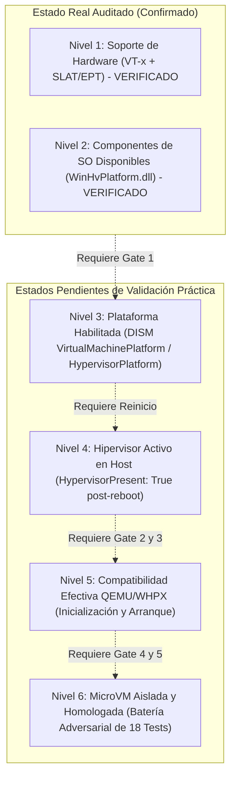

# DEV-001-B2.4-R: Auditoría Independiente de Factibilidad del Host y Dossier de Gate 1
**Fecha:** 2026-11-06
**Fase:** DEV-001-B2.4-R (Independent Host Readiness Review)
**Modalidad:** STRICT READ-ONLY / AUDIT ONLY (Sin comandos DISM, sin reinicio del host, sin modificaciones de código ni del sistema)
**Rama:** `security/dev-001-b`
**Commit Base:** `57a7a29` / `d5e8e39`
**Documento Auditado:** `docs/DEV_001_B2_4_HOST_READINESS_REVIEW.md`
**Auditor:** Auditor de Seguridad y Arquitecto de Sistemas Independiente

---

## 1. Dictamen Técnico General

### Dictamen: ⚠️ CONDICIONADO A REMEDIACIÓN DOCUMENTAL (NO APTO PARA AUTORIZACIÓN INMEDIATA DE GATE 1)

El documento `docs/DEV_001_B2_4_HOST_READINESS_REVIEW.md` recopila con precisión los datos empíricos de hardware (Intel Core i7-12700, SLAT/EPT, 32 GB RAM) y del sistema operativo (Windows 10 Pro Build 19041). Sin embargo, incurre en **seis inconsistencias técnicas y sobreestimaciones de seguridad (H-01 a H-06)** al transformar observaciones de solo lectura en garantías absolutas de rendimiento, aislamiento y reversibilidad.

**Principio Rector de la Auditoría:**
> «La ausencia de un hipervisor activo no autoriza a prometer rendimientos nativos sin benchmark, ni a confundir un rechazo local de loopback con una demostración de aislamiento frente al anfitrión. Cada nivel de preparación debe verificarse experimentalmente en su etapa correspondiente.»



---

## 2. Matriz de Hallazgos Críticos (H-01 a H-06)

| ID | Categoría | Severidad | Descripción del Defecto Documental | Estado |
| :--- | :--- | :---: | :--- | :---: |
| **H-01** | GPU y Rendimiento | **ALTA** | Afirmación de «cero degradación» y «velocidad nativa garantizada» en CUDA, TensorRT y NVENC sin mediciones comparativas empíricas. | **REQUERIDA CORRECCIÓN** |
| **H-02** | Sobrecarga de CPU | **MEDIA** | Presentación de la cifra «< 1-2%» como hecho empírico del equipo, cuando es una estimación teórica no verificada. | **REQUERIDA CORRECCIÓN** |
| **H-03** | Reversibilidad | **ALTA** | Promesa de «reversibilidad del 100% garantizada», ignorando dependencias del sistema, registros de BCD y posibles alteraciones de estado. | **REQUERIDA CORRECCIÓN** |
| **H-04** | Aislamiento TCP | **ALTA** | Atribución de demostración de aislamiento del host a un error `ECONNREFUSED` sobre la interfaz loopback interna del invitado. | **REQUERIDA CORRECCIÓN** |
| **H-05** | Disponibilidad WHPX | **ALTA** | Ambigüedad entre componentes presentes en disco, activación del hipervisor y compatibilidad de ejecución de QEMU. | **REQUERIDA CORRECCIÓN** |
| **H-06** | Privilegios y Elevación | **MEDIA** | Afirmación categórica de imposibilidad de elevación del agente fundamentada únicamente en el token actual de la sesión. | **REQUERIDA CORRECCIÓN** |

---

## 3. Evidencia Documental y Análisis Detallado de Cada Observación

### H-01: Garantías No Demostradas sobre la GPU NVIDIA RTX 5070
- **Texto Observado (Línea 88 de B2.4):**
  > *«Los controladores de NVIDIA, las capas CUDA, TensorRT y los codificadores NVENC continúan funcionando a velocidad nativa sin ninguna degradación.»*
- **Análisis Crítico:** Que Windows opere como Partición Raíz (*Root Partition*) con acceso directo al bus PCIe no implica una garantía matemática de rendimiento idéntico. Bajo Hyper-V, la gestión de interrupciones, la temporización de alta precisión (TSC) y el acceso a páginas de memoria mapeadas por EPT pueden introducir fluctuaciones de latencia (*jitter*) en la sincronización de kernels CUDA o en el procesamiento de video con NVENC.
- **Evidencia Técnica:** No existen benchmarks previos ni mediciones de latencia tomadas en este equipo antes de la habilitación de Hyper-V.

### H-02: Sobrecarga del Hipervisor sin Benchmark
- **Texto Observado (Línea 87 de B2.4):**
  > *«La sobrecarga de ejecución de la Partición Raíz bajo Hyper-V es prácticamente imperceptible (< 1% a 2% en cargas de cálculo intensivo).»*
- **Análisis Crítico:** La cifra de < 1-2% procede de documentación genérica de virtualización de Intel y Microsoft sobre arquitecturas SLAT/VPID; no es un dato medido sobre la topología heterogénea (P-Cores y E-Cores) del Intel Core i7-12700 de esta máquina.
- **Evidencia Técnica:** No se ha ejecutado un protocolo de referencia que compare el rendimiento del CPU en tareas multihilo o inferencia local antes de la modificación.

### H-03: Reversibilidad Absoluta («100%») Infundada
- **Texto Observado (Líneas 31 y 95 de B2.4):**
  > *«Reversibilidad 100% Garantizada vía DISM»*, *«el procedimiento administrativo es 100% reversible mediante dos comandos»*.
- **Análisis Crítico:** En ingeniería de sistemas operativos, la reversibilidad total al 100% no existe. Aunque DISM deshabilite las características opcionales y revoque la entrada de lanzamiento del hipervisor en el BCD, la desinstalación puede dejar claves de registro huérfanas, dependencias no desmanteladas en controladores de virtualización o efectos secundarios en subsistemas que dependan de VBS o Hyper-V.
- **Evidencia Técnica:** La reversibilidad es un procedimiento operativo de deshabilitación y restauración de configuración, no una garantía de restauración de estado físico a nivel de bit.

### H-04: Confusión de Semántica en Aislamiento de Red Loopback
- **Texto Observado (Línea 116 de B2.4):**
  > *«Se verifica que el puerto 4000 del anfitrión NO es accesible a través del loopback del invitado, confirmando que el espacio de red de la MicroVM es independiente del host.»*
- **Análisis Crítico:** Un error `ECONNREFUSED` al conectar a `127.0.0.1:4000` dentro del invitado demuestra únicamente que en el stack de red interno de la MicroVM no hay ningún proceso escuchando en el puerto 4000. **No demuestra en absoluto que el invitado esté aislado del host**. Si el tráfico hacia el host estuviese filtrándose o puenteado por una interfaz virtual no detectada, una conexión a `127.0.0.1` seguiría dando `ECONNREFUSED` si el host escucha en su IP física (`192.168.x.x`) o si la interfaz del host no reenvía tráfico loopback de la VM.
- **Evidencia Técnica:** La demostración de aislamiento respecto al host exige pruebas contra direcciones no loopback (`ENETUNREACH`), verificación de ausencia de interfaces puenteadas y comprobación de que el puerto 4000 del host (donde sí hay un servicio) resulta estrictamente inalcanzable.

### H-05: Jerarquía de Disponibilidad Real de WHPX
- **Texto Observado (Línea 170 de B2.4):**
  > *«confirma que el hardware y el sistema operativo están 100% preparados para albergar la MicroVM»*.
- **Análisis Crítico:** El documento unifica en una sola conclusión estados que pertenecen a fases completamente distintas. La presencia de `WinHvPlatform.dll` en `System32` únicamente prueba que el archivo existe en el disco duro.
- **Evidencia Técnica:** No puede declararse que el sistema está preparado para albergar la MicroVM hasta que:
  1. El hipervisor esté activo tras el reinicio (`HypervisorPresent: True`).
  2. QEMU compile/inicialice el acelerador WHPX con éxito (`-accel whpx`).
  3. El microkernel cargue sin disparar fallos de inyección de interrupciones (`kernel-irqchip`).

### H-06: Asunciones sobre Privilegios y Elevación
- **Texto Observado (Línea 92 de B2.4):**
  > *«La sesión actual de trabajo y los procesos de Node.js/NestJS no disponen de privilegios elevados, garantizando que el agente no puede activar características ni alterar la configuración de arranque de Windows por sí mismo.»*
- **Análisis Crítico:** El hecho de que la sesión actual de PowerShell posea un token de integridad media (*Medium Mandatory Level*) demuestra que las llamadas estándar a DISM son rechazadas por el control de acceso del sistema operativo (`Error 740`). Sin embargo, no constituye una garantía teórica perenne de que un agente o un proceso no confiable jamás pueda intentar vías de elevación (e.g. vulnerabilidades en software local, secuestro de DLLs o exploits del kernel).
- **Evidencia Técnica:** Debe presentarse como una barrera de defensa en profundidad del modelo de seguridad de Windows, no como una imposibilidad física absoluta.

---

## 4. Correcciones Necesarias en el Documento B2.4

Para subsanar los hallazgos H-01 a H-06, `docs/DEV_001_B2_4_HOST_READINESS_REVIEW.md` debe ser modificado puntualmente:

1. **Corrección H-01:** Reemplazar «velocidad nativa sin ninguna degradación» por:
   *«La Partición Raíz retiene el acceso directo por hardware al bus PCIe para la NVIDIA RTX 5070. El impacto real sobre el rendimiento y la latencia de CUDA, TensorRT y NVENC debe establecerse como una hipótesis sujeta a benchmark comparativo antes y después de Gate 1.»*
2. **Corrección H-02:** Reemplazar la afirmación tajante de sobrecarga por:
   *«La sobrecarga de CPU de < 1-2% constituye una estimación teórica de la literatura arquitectónica de Intel/Microsoft, no un resultado medido en este equipo. Se define un protocolo de referencia preliminar para contrastar el rendimiento del i7-12700 post-reinicio.»*
3. **Corrección H-03:** Eliminar «reversibilidad del 100% garantizada» y redactar:
   *«Procedimiento de reversión administrativa: la deshabilitación mediante DISM y la restauración de la configuración de arranque del BCD permite desmantelar el hipervisor y regresar a HypervisorPresent: False. Se reconoce que este procedimiento revierte la configuración del sistema, pero no garantiza la restauración física absoluta de todos los estados previos a nivel de registro o dependencias secundarias.»*
4. **Corrección H-04:** En la tabla de errores de red:
   *«Aclarar que ECONNREFUSED sobre 127.0.0.1:4000 dentro del invitado verifica exclusivamente que el servicio de producción no está expuesto dentro del stack local del invitado. El aislamiento real respecto al anfitrión se demuestra mediante la ausencia de interfaz externa y el fallo independiente con ENETUNREACH contra la IP física del host.»*
5. **Corrección H-05:** Incorporar formalmente el modelo de **6 Niveles de Factibilidad de Virtualización**:
   - Nivel 1: Hardware (Verificado).
   - Nivel 2: Librerías en Disco (Verificado).
   - Nivel 3: Características Habilitadas (Pendiente Gate 1).
   - Nivel 4: Hipervisor Activo (Pendiente Reinicio Gate 1).
   - Nivel 5: Arranque de QEMU/WHPX (Pendiente Gate 3).
   - Nivel 6: MicroVM Aislada y Homologada (Pendiente Gate 4/5).
6. **Corrección H-06:** Reformular el control de elevación como:
   *«El proceso anfitrión opera con un token de integridad media que restringe el acceso a las APIs administrativas de DISM y BCD, actuando como una barrera de defensa en profundidad provista por Windows.»*

---

## 5. Riesgos Residuales

1. **Riesgo de Incompatibilidad QEMU/WHPX en Windows 10 Build 19041 (Riesgo Técnico):**
   Aunque el hardware es de última generación (12.ª gen), la compilación 19041 de Windows 10 data de 2020. Es posible que ciertas llamadas a `WinHvPlatform.dll` requieran flags específicos en QEMU (`kernel-irqchip=off`) para evitar fallos de inicialización.
2. **Riesgo de Coexistencia con Herramientas de Virtualización Existentes (Riesgo Operativo):**
   Si en el equipo coexisten entornos como VirtualBox o emuladores antiguos no compatibles con WHPX, la activación de Hyper-V podría requerir ajustes en sus respectivos motores de aceleración.
3. **Riesgo de Ejecución Anticipada (Riesgo de Gobernanza):**
   Existe el riesgo de que la activación de Gate 1 sea interpretada como autorización tácita para lanzar QEMU o probar código. La separación estricta de Gates mitiga este riesgo.

---

## 6. Criterios de Aceptación para Autorizar Gate 1

Gate 1 podrá ser considerado para autorización únicamente si se satisfacen las siguientes condiciones previas:

1. **Remediación Documental Completada:** Las correcciones H-01 a H-06 deben estar plenamente incorporadas y consolidadas en `docs/DEV_001_B2_4_HOST_READINESS_REVIEW.md`.
2. **Línea Base de Rendimiento Host (Pre-WHPX):** Medición de referencia de latencia y tiempo de inferencia de un modelo local en la GPU RTX 5070 con el hipervisor inactivo.
3. **Plan de Acción para el Operador Aprobado:** Verificación de que los dos comandos DISM y el comando de reversión están claros y no requieren interacción del agente.
4. **Frontera de Ejecución Sellada:** Confirmación de que el Execution Broker continuará en modo `SIMULATED` durante y después de Gate 1.

---

## 7. Recomendación de Autorización o Rechazo de Gate 1

### Recomendación: ⏸️ POSTERGAR AUTORIZACIÓN DE GATE 1 HASTA REMEDIAR B2.4

El suscrito auditor recomienda **POSTERGAR la autorización de Gate 1** hasta que se ejecute la remediación documental de los hallazgos H-01 a H-06 en el documento B2.4 y se consolide en el repositorio.

> [!IMPORTANT]
> **Aclaración Normativa de Gobernanza:**
> Una recomendación favorable posterior por parte de la auditoría técnica **NO constituirá autorización automática para ejecutar Gate 1**. La ejecución de Gate 1 seguirá exigiendo la autorización manual, expresa e independiente del Operador de Seguridad Humano.

---

## 8. Estado del Repositorio y Línea Base

```text
Rama actual:           security/dev-001-b
Base de auditoría:     57a7a29 / d5e8e39
Documento generado:    docs/DEV_001_B2_4_INDEPENDENT_REVIEW.md
Modo de operación:     STRICT READ-ONLY (Sin modificaciones en host, sin DISM, sin reboot)
Execution Broker:      🔒 STRICT NO-EXECUTION (SIMULATED)
Hipervisor anfitrión:  🔒 INACTIVO (HypervisorPresent: False)
```
