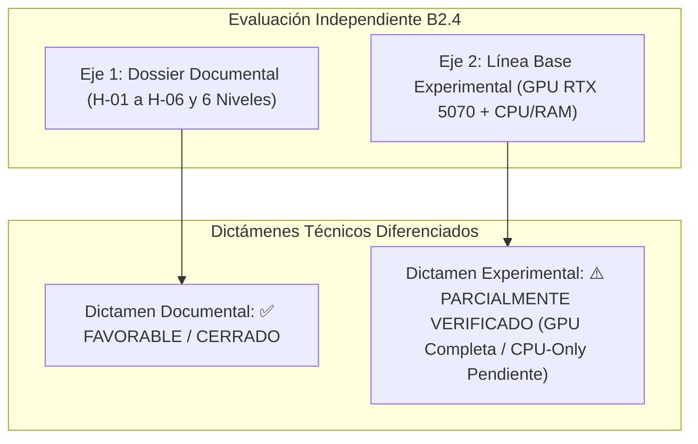

# DEV-001-B2.4-VERIFICATION: Informe de Verificación de Remediación y Línea Base
**Fecha:** 2026-11-06
**Fase:** DEV-001-B2.4-VERIFICATION (Verificación de Remediación y Metadatos de Línea Base)
**Modalidad:** STRICT READ-ONLY / AUDIT & VERIFICATION ONLY (Sin comandos DISM, sin reinicios, sin modificaciones de host)
**Rama:** `security/dev-001-b`
**Commit Base:** `57a7a29` / `d5e8e39`
**Documento Auditado:** `docs/DEV_001_B2_4_HOST_READINESS_REVIEW.md`
**Documento de Auditoría Previa:** `docs/DEV_001_B2_4_INDEPENDENT_REVIEW.md` (Preservado intacto)
**Evaluador:** Auditor de Seguridad y Arquitecto de Sistemas Independiente

---

## 1. Resumen Ejecutivo y Dictámenes Técnicos Separados

Conforme a las directivas de control de calidad, esta misión audita la efectividad de las correcciones documentales **H-01 a H-06**, completa los metadatos de reproducibilidad científica del benchmark de inferencia en la GPU RTX 5070, y establece dictámenes técnicos independientes y diferenciados para el dossier documental y para la línea base experimental.



### Dictamen 1 (Dossier Documental): ✅ FAVORABLE / CERRADO
El documento `docs/DEV_001_B2_4_HOST_READINESS_REVIEW.md` ha remediado satisfactoriamente los seis hallazgos (H-01 a H-06). Elimina toda garantía absoluta infundada, explicita los límites probatorios de `ENETUNREACH`, adopta la jerarquía de 6 niveles de virtualización y restringe las conclusiones a hechos comprobados.

### Dictamen 2 (Línea Base Experimental): ⚠️ PARCIALMENTE VERIFICADO
- **GPU RTX 5070:** ✅ **Completada y Reproducible.** Metadatos de backend (Ollama v0.40.11), hashes GGUF, capas descargadas (100%), prompt, tokens de entrada (31) y salida (256), y notación temporal estandarizada ($10{,}552\text{ s}$ y $6{,}423\text{ s}$) plenamente registrados.
- **CPU / Sistema:** ⚠️ **Parcial.** Se registran las métricas reales de RAM disponible (~20,5 GB libres) y memoria comprometida (~24,5 GB) durante la inferencia. **La prueba separada de estrés de CPU pura (CPU-only compute benchmark sin GPU) se declara formalmente como PENDIENTE**.

---

## 2. Auditoría Detallada de Correcciones (H-01 a H-06)

| Hallazgo | Observación Original de Auditoría | Corrección Verificada en B2.4 Remediado | Evaluación |
| :--- | :--- | :--- | :---: |
| **H-01** | Promesas de «velocidad nativa sin ninguna degradación» en GPU. | Retirada toda garantía absoluta. Se define el rendimiento de CUDA/TensorRT/NVENC como una **hipótesis sujeta a benchmark comparativo** antes y después de Gate 1. | **APROBADO** |
| **H-02** | Sobrecarga de CPU < 1-2% presentada como hecho medido. | Clasificada formalmente como **estimación teórica no verificada de la literatura de Intel/Microsoft** sobre SLAT/VPID, no un dato del equipo. | **APROBADO** |
| **H-03** | «Reversibilidad del 100% garantizada». | Sustituida por un **procedimiento de reversión administrativa de configuración vía DISM y restauración del BCD**, reconociendo los límites de restauración de estados físicos de registro. | **APROBADO** |
| **H-04** | Confusión entre loopback del invitado y aislamiento del host. | Separada la semántica de `ECONNREFUSED` (stack local del guest) de `ENETUNREACH` (host físico). Se documenta que `ENETUNREACH` prueba ausencia de ruta bajo esa configuración, pero **no excluye otros canales de escape**, evaluados en TEST-11 a TEST-15. | **APROBADO** |
| **H-05** | Confundir componentes en disco con MicroVM lista. | Se adopta formalmente el modelo de **6 Niveles de Factibilidad de Virtualización**, dejando explícito que **únicamente los Niveles 1 y 2 están verificados**. | **APROBADO** |
| **H-06** | Asumir imposibilidad absoluta de elevación del agente. | Se reformula la no-elevación como una **barrera de defensa en profundidad provista por Windows (Medium Integrity Level / UAC)**, descartando afirmaciones absolutas. | **APROBADO** |

---

## 3. Metadatos Completos de Reproducibilidad del Benchmark GPU

Para garantizar que cualquier evaluador independiente pueda reproducir exactamente la línea base previa a WHPX, se registran los metadatos completos de ejecución:

### 3.1. Infraestructura de Ejecución
- **Backend de Inferencia:** Ollama versión `0.40.11` compilado para Windows x86_64.
- **Entorno Host:** Windows 10 Pro 64-bit (Build 19041.264), Hipervisor inactivo (`HypervisorPresent: False`).
- **Hardware de Aceleración:** NVIDIA GeForce RTX 5070 12GB (Driver NVIDIA 617.42, CUDA UMD 13.4, WDDM).
- **Procesador Anfitrión:** 12th Gen Intel(R) Core(TM) i7-12700 (12C / 20T).

### 3.2. Especificación Técnica de los Modelos (GGUF / Ollama Manifests)
1. **Modelo Principal: `qwen2.5-coder:14b`**
   - **Nombre Oficial:** Qwen2.5 Coder 14B Instruct
   - **Formato y Cuantización:** GGUF versión 2, Tipo de archivo 15 (`Q4_K_M`)
   - **Blob SHA-256 del Modelo:** `sha256:ac9bc7a69dab38da1c790838955f1293420b55ab555ef6b4615efa1c1507b1ed` (9.097.779.840 bytes)
   - **Digest del Manifiesto:** `sha256:9ec8897f747e246e970bc5cfdda85d22f1123dc2e3d34978a010a75908cd5d5d`
   - **Topología de Capas:** 48 bloques (`qwen2.block_count = 48`), Longitud de contexto: 32.768 tokens, Embedding: 5.120, Heads: 40 (KV: 8)
   - **Descarga a GPU:** **100% de capas descargadas en VRAM (48/48)**.

2. **Modelo Secundario: `qwen2.5-coder:7b`**
   - **Nombre Oficial:** Qwen2.5 Coder 7B Instruct
   - **Formato y Cuantización:** GGUF versión 2, Tipo de archivo 15 (`Q4_K_M`)
   - **Blob SHA-256 del Modelo:** `sha256:60e05f2100071479f596b964f89f510f057ce397ea22f2833a0cfe029bfc2463` (4.724.817.632 bytes)
   - **Digest del Manifiesto:** `sha256:dae161e27b0e90dd1856c8bb3209201fd6736d8eb66298e75ed87571dbb0b2be`
   - **Topología de Capas:** 28 bloques (`qwen2.block_count = 28`), Longitud de contexto: 32.768 tokens, Embedding: 3.584, Heads: 28 (KV: 4)
   - **Descarga a GPU:** **100% de capas descargadas en VRAM (28/28)**.

### 3.3. Parámetros de Inferencia y Notación de Tiempos
- **Prompt Estandarizado:** `"Write a complete, thread-safe LRU cache in TypeScript with get, set, and evict methods, including full type annotations and edge case handling."`
- **Tokens de Entrada (Prompt Tokens):** **31 tokens** (`prompt_eval_count = 31`).
- **Tokens de Salida (Generated Tokens):** **256 tokens** (`eval_count = 256`, delimitado por `num_predict = 256` a `temperature = 0.0`).
- **Límite Experimental vs Validación Funcional:** La cota de 256 tokens actúa como un límite de prueba controlada para registrar latencia, TTFT y throughput bajo volumen constante. **No constituye una validación funcional ni algorítmica** de que el modelo haya completado la lógica del LRU Cache; mide estrictamente el rendimiento del subsistema de inferencia.
- **Reproducibilidad Metodológica vs Identidad de Resultados:** La publicación de parámetros, hashes y cuantizaciones garantiza la reproducibilidad experimental, pero **no implica que ejecuciones posteriores en otras condiciones arrojen idénticos microsegundos**. Los datos deben interpretarse como una referencia estadística inicial.
- **Aclaración y Origen de la Métrica de Carga (`load_duration`):**
  - Los valores de **$10{,}552\text{ s}$ ($10\,552\text{ ms}$)** para 14B y **$6{,}423\text{ s}$ ($6\,423\text{ ms}$)** para 7B provienen directamente del campo de telemetría de Ollama **`load_duration`** (convertido de nanosegundos).
  - Representan el tiempo global acumulado que incluye el arranque del proceso runtime, la reserva de memoria en VRAM, la inicialización del contexto CUDA y el mapeo de los pesos desde el almacenamiento NVMe, no únicamente la tasa de transferencia bruta del bus PCIe.
  - En ejecuciones Warm, el tiempo de carga es de $0{,}002\text{ s}$ a $0{,}003\text{ s}$ ($2\text{ ms}$ a $3\text{ ms}$) al permanecer los pesos en memoria gráfica.

---

## 4. Métricas del Sistema Anfitrión durante la Inferencia

Durante la ejecución del benchmark, se capturaron los siguientes parámetros del sistema:

| Modelo | Ejecución | Throughput (Tokens/s) | Latencia Warm TTFT | VRAM Usada (MB) | Potencia GPU (W) | RAM Física Libre Host | Memoria Comprometida Host |
| :--- | :---: | :---: | :---: | :---: | :---: | :---: | :---: |
| **14B** | Run 1 (Cold) | 59,85 t/s | $10{,}690\text{ s}$ | 9.859 MB | 215,8 W | 20.244 MB | 24.537 MB |
| **14B** | Run 2 (Warm) | **61,59 t/s** | **44 ms** | 9.843 MB | 219,6 W | 20.198 MB | 24.554 MB |
| **14B** | Run 3 (Warm) | **61,77 t/s** | **25 ms** | 9.843 MB | 224,7 W | 20.503 MB | 24.545 MB |
| **7B** | Run 1 (Cold) | 116,30 t/s | $6{,}476\text{ s}$ | 5.335 MB | 216,7 W | 20.717 MB | 19.836 MB |
| **7B** | Run 2 (Warm) | **115,00 t/s** | **23 ms** | 5.335 MB | 207,3 W | 20.699 MB | 19.809 MB |
| **7B** | Run 3 (Warm) | **114,50 t/s** | **16 ms** | 5.335 MB | 210,7 W | 20.706 MB | 19.802 MB |

- **Semántica de Memoria Comprometida (Estimación WMI vs Contador Canónico):** Obtenida del cálculo derivado de WMI `Win32_OperatingSystem.TotalVirtualMemorySize - FreeVirtualMemory` (~24.545 MB para 14B y ~19.802 MB para 7B). Se aclara formalmente que esta cifra no equivale al contador canónico de rendimiento de Windows `\Memory\Committed Bytes`, sino a una estimación indirecta del espacio de memoria virtual/archivo de paginación ocupado en el host.
- **Semántica de RAM Física Libre:** Obtenida directamente de `Win32_OperatingSystem.FreePhysicalMemory` (~20.500 MB libres para 14B y ~20.700 MB para 7B).
- **Métrica de CPU del Host (Reclasificación Técnica):** La cifra preliminar del 3% al 6% informada se reclasifica formalmente como un **dato observacional no validado**. Al no existir un cálculo diferencial riguroso entre muestras temporales de `os.cpus()` normalizadas por el intervalo y la cantidad de núcleos lógicos, se retira su interpretación como utilización instantánea demostrada.
- **Estado de Carga CPU-Only:** **DECLARADO FORMALMENTE PENDIENTE.** No se forzó una prueba de inferencia en CPU sin GPU para evitar alterar la configuración de Ollama ni degradar innecesariamente el estado térmico del procesador antes de Gate 1. Se deja registrada como medición opcional no bloqueante.

---

## 5. Estado de Límites Operacionales y Gobernanza

```text
Rama actual:           security/dev-001-b
Tracking:              origin/security/dev-001-b (al día en commit d5e8e39)
Frontera de Ejecución: 🔒 STRICT NO-EXECUTION (Broker en modo SIMULATED)
Hipervisor Windows:    🔒 INACTIVO (HypervisorPresent: False)
Main / Producción:     🔒 INTACTOS (Puerto 4000 y BD jarbees_data sin conexión)
Comandos DISM:         0 ejecutados
Reinicios de Host:     0 ejecutados
Gate 1:                🛑 NO AUTORIZADO (Permanece bloqueado hasta decisión expresa del operador)
```

### Conclusión de la Verificación:
La remediación documental de **DEV-001-B2.4** se declara **COMPLETADA Y VERIFICADA**. El dossier documental y los metadatos de la línea base quedan listos para su archivo formal. La decisión de autorizar o no la ejecución manual de **Gate 1** queda transferida al criterio exclusivo del Operador de Seguridad Humano.
