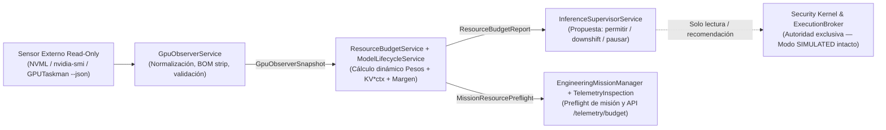

# DEV-001-B2.6 — Especificación de Conciencia de Recursos y Observabilidad GPU (`Resource Awareness & GPU Observability`)

**Misión:** `DEV-001-B2.6` *(numerada como B2.6 para no colisionar con [`DEV_001_B2_5_GATE_1_REPORT.md`](./DEV_001_B2_5_GATE_1_REPORT.md))*  
**Fecha:** 2026-11-10  
**Modo:** `EXPERIMENTS EXECUTED + BOUNDED IMPLEMENTATION COMPLETED` (`ExecutionBrokerService` intacto en `STRICT NO-EXECUTION / SIMULATED`)  
**Rama de Referencia:** `security/dev-001-b` (sobre commit `15b2b4f`)  
**Documento Base Experimental:** [`docs/GPUTASKMAN_RTX5070_LAB_REPORT.md`](./GPUTASKMAN_RTX5070_LAB_REPORT.md)  
**Hardware Objetivo:** NVIDIA GeForce RTX 5070 (Blackwell CC `12.0`, `12,227 MiB` totales / `11,942 MiB` utilizables WDDM)  

---

## 1. Diagnóstico Inicial: Estado Real del Código vs. Oportunidad

Antes de diseñar la extensión, la auditoría directa sobre el código fuente actual de `productos_crud_bkd` revela cuatro hechos fundamentales:

1. **Varios componentes de supervisión ya existen hoy en producción**, aunque sin visibilidad por proceso:
   * [`InferenceSupervisorService`](../src/jarvis/llm/inference-supervisor.service.ts) ya existe y expone [`getGpuTelemetry()`](../src/jarvis/llm/inference-supervisor.service.ts#L403-L427) mediante `nvidia-smi` (únicamente totales globales de placa: `vramUsedMiB`, `vramFreeMiB`, `vramTotalMiB`, `gpuTempC`, `gpuUtilPercent`).
   * [`TelemetryInspectionService`](../src/jarvis/llm/telemetry-inspection.service.ts) ya expone `GET /api/jarbees/telemetry/tokens` y `GET /api/jarbees/telemetry/budget` en [`JarvisController`](../src/jarvis/jarvis.controller.ts#L184-L222), midiendo consumo de tokens, latencia y límites de misión, pero **sin dimensión de memoria GPU ni proceso activo**.
   * [`EngineeringMissionManagerService`](../src/jarvis/verification/engineering-mission-manager.service.ts) ya inyecta `InferenceSupervisorService`, pero solo captura `record.gpuTelemetry = this.supervisor?.getGpuTelemetry()` al **finalizar** la misión (*post-flight* en líneas 287 y 371), sin realizar un **`pre-flight` de presupuesto** antes de despachar una carga pesada.
   * [`ExecutionBrokerService`](../src/jarvis/execution/execution-broker.service.ts) continúa estrictamente congelado en modo `SIMULATED` (`STRICT NO-EXECUTION`) conforme a `DEV-001-B2.1`..`B2.5`.

2. **Descalibración verificada en `ModelLifecycleService` y fragmentación de `ctx-size`:**
   * [`ModelLifecycleService`](../src/jarvis/llm/model-lifecycle.service.ts#L57-L95) estima la VRAM mediante un escalar único estático por modelo (`VRAM_PROFILES`) sin multiplicar el costo de caché KV por longitud de contexto:
     * Hoy declara `qwen3:8b` = `5,500 MB` con `contextLimit: 16384`. Nuestra medición empírica en `snapshot_04_qwen3_8b.json` demuestra que a `ctx=16384` (`ctk/ctv=q8_0`, `78,336 B/token`) el proceso `llama-server.exe` ocupa **`6,165 MiB`** (`665 MiB` por encima del perfil estático) y la placa total llega a **`7,299 MiB`**.
   * Coexisten **cuatro definiciones divergentes** del tamaño de contexto por defecto en el proyecto:
     1. [`models_presets.ini`](../src/jarvis/llm/models_presets.ini#L1-L16): `qwen3:8b` en `8192`, `qwen2.5-coder:7b` en `8192`, `qwen2.5-coder:14b` en `6144`.
     2. [`.env`](../.env#L93): `LLAMACPP_CTX_SIZE=16384`.
     3. [`ModelLifecycleService.buildOptimizedArgs()`](../src/jarvis/llm/model-lifecycle.service.ts#L283-L284): hardcodea `'-c', '16384'`.
     4. [`TelemetryInspectionService`](../src/jarvis/llm/telemetry-inspection.service.ts#L86): fallback `process.env.LLAMACPP_CTX_SIZE || '6144'`.

3. **Distinción estricta de seguridad (`VRAM Awareness != GPU Isolation`):**
   * `GPUTaskman` y cualquier sensor WDDM aportan **observabilidad de solo lectura** para planificación y prevención de saturación (`OOM` / paginación a RAM DDR5), **nunca** límites duros de seguridad ni aislamiento de procesos del SO. El confinamiento y la autorización continúan siendo responsabilidad exclusiva del [`ExecutionBrokerService`](../src/jarvis/execution/execution-broker.service.ts), [`SafeExecService`](../src/jarvis/security/safe-exec.service.ts), Job Objects y la futura MicroVM WHPX (`DEV-001-B2.5` Gate 1+).

4. **Ambigüedad empírica detectada en `shared_bytes` bajo WDDM:**
   * En nuestras tres capturas con carga (`snapshot_02`, `03`, `04`), `llama-server.exe` mostró entre **`102 MiB`** y **`114 MiB`** en `shared_bytes` incluso teniendo entre `1.98 GiB` y `6.30 GiB` de VRAM dedicada libre. Por ello, **`shared_bytes > 0` no equivale por sí solo a desborde destructivo**, y debe validarse un umbral empírico bajo estrés antes de automatizar decisiones agresivas.

---

## 2. Separación Arquitectónica de Planos (Sin Delegación de Autoridad)



**Invariantes arquitectónicos obligatorios:**
1. **El Observer informa, nunca manda:** `GpuObserverService` es puramente de solo lectura y no puede iniciar, matar ni alterar procesos ni políticas de seguridad.
2. **Desacoplamiento del binario externo:** El contrato interno `GpuObserverSnapshot` no expone rutas de herramientas portables (`tools/gputaskman/`) ni detalles de WDDM crudos a clientes o módulos de negocio; soporta múltiples proveedores (`nvml_nvidia_smi`, `gputaskman_json`, `static_fallback`).
3. **Cero acoplamiento con el Broker en B2.6:** Ni [`ExecutionBrokerService`](../src/jarvis/execution/execution-broker.service.ts) ni [`ActionGatekeeperService`](../src/jarvis/security/action-gatekeeper.service.ts) cambian su frontera `STRICT NO-EXECUTION`.
4. **Higiene frente a `check_security_patterns.js`:** Cualquier ejecución futura del binario o adaptador de telemetría no deberá dispersar nuevos `execSync`/`spawn` fuera de los módulos supervisados y con `shell: false`.

---

## 3. Contrato Formal `GpuObserverSnapshot`

El siguiente contrato TypeScript normaliza la telemetría heterogénea (`nvidia-smi` + `gputaskman --json --no-system`), eliminando el riesgo de fallos de parseo por BOM UTF-8 (`\uFEFF`) en Windows PowerShell y preservando los niveles de evidencia:

```typescript
export type TelemetrySourceKind =
  | 'gputaskman_json'
  | 'nvidia_smi_fallback'
  | 'static_estimate';

export type GpuPressureLevel =
  | 'LOW'        // Margen libre >= 3,500 MiB y sin contención 3D/CUDA externa
  | 'MODERATE'   // Margen libre entre 1,500 y 3,499 MiB (ej. 14B @ 6k)
  | 'HIGH'       // Margen libre < 1,500 MiB o contención externa relevante
  | 'CRITICAL';  // Riesgo inminente de paginación/OOM WDDM (margen < 600 MiB o spill anómalo confirmado)

export type LlmEvidenceLevel =
  | 'confirmed_api_mapped_cmdline'
  | 'inferred_process'
  | 'none';

export interface CompetingGpuProcessInfo {
  pid: number;
  name: string;
  kind: 'browser' | 'game' | 'compute' | 'app' | 'compositor' | 'system' | 'other';
  dedicatedVramMiB: number;
  sharedSystemMiB: number;
  pagedOutMiB: number;
  gpuPercent: number;
  activeEngines: string[]; // ej. ['3d', 'compute', 'video_enc']
}

export interface LlmRuntimeAllocationBreakdown {
  pid: number;
  processName: string;
  modelName?: string;
  modelPath?: string;
  quantization?: string;
  layers?: number;
  configuredCtx?: number;
  kvCacheTypeK?: string;
  kvCacheTypeV?: string;
  kvBytesPerToken?: number;
  slotsTotal?: number;
  slotsBusy?: number;
  totalProcessVramMiB: number;
  sharedMiB: number;
  pagedOutMiB: number;
  segmentsExact: boolean; // En GPUTaskman v0.3.5 es false (estimación analítica)
  weightsMiB?: number;
  kvCacheMiB?: number;
  computeRuntimeMiB?: number;
  evidence: LlmEvidenceLevel;
}

export interface GpuObserverSnapshot {
  schemaVersion: '1.0.0';
  capturedAt: string; // ISO-8601
  source: TelemetrySourceKind;
  staleMs: number;
  adapter: {
    name: string;               // ej. "NVIDIA GeForce RTX 5070"
    driverVersion?: string;     // ej. "617.42"
    cudaVersion?: string;       // ej. "13.4"
    driverModel: 'WDDM' | 'TCC' | 'UNKNOWN';
    computeCap?: string;        // ej. "12.0"
  };
  boardMemory: {
    physicalTotalMiB: number;   // 12,227 MiB observados
    wddmUsableMiB: number;      // 11,942 MiB utilizables dedicados
    usedMiB: number;
    freeMiB: number;
    sharedUsedMiB: number;
    reservedDriverMiB?: number;
    sharedIsSpillHeuristic: boolean;
  };
  thermalAndClocks?: {
    tempC: number;
    powerWatts?: number;
    powerLimitWatts?: number;
    pState?: number;
    gpuUtilPercent: number;
  };
  llmAllocation?: LlmRuntimeAllocationBreakdown;
  competingProcesses: CompetingGpuProcessInfo[]; // Ej. blender.exe, hl.exe, msedge.exe WebGL
  pressureLevel: GpuPressureLevel;
  warnings: string[];
}
```

---

## 4. Calibración Empírica de Perfiles para `ModelLifecycleService`

### 4.1. Fórmula Dinámica (Pesos + Buffers CUDA + KV por Contexto)

Sustituir el escalar único `estimatedVramMb` por un descriptor paramétrico basado en las mediciones reales de `snapshot_02`, `03` y `04` con KV Cache cuantizada (`ctk/ctv = q8_0`, `ngl = 99`):

$$\text{ProcessVramMiB}(\text{model}, N_{\text{ctx}}, N_{\text{slots}}) = \text{WeightsMiB} + \text{RuntimeBuffersMiB} + \left(\frac{\text{kvBytesPerToken} \times N_{\text{ctx}} \times N_{\text{slots}}}{1{,}048{,}576}\right)$$

Y sumando la reserva empírica mínima de escritorio Windows bajo presión WDDM (`OS_HEADROOM_FLOOR_MIB`):
* En reposo Windows + IDE + navegador consume `~668 MiB`.
* Bajo presión del modelo `14B`, WDDM comprime navegador/IDE paginando a RAM y deja el piso del SO en **`~896 MiB`**.
* Para evitar entrar en zona de paginación forzada y dejar aire para `bge-m3` (`Ollama` embeddings, `~700–1,000 MiB` si corre en paralelo), el techo seguro operativo en una RTX 5070 de `11,942 MiB` utilizables se fija en **`10,800 MiB`** (`MAX_CEILING_MB`), descontando además los procesos competidores activos no comprimibles (`3D`/`CUDA`/`Blender`).

### 4.2. Tabla Calibrada desde Evidencia Real (`GPUTaskman v0.3.5`)

| Alias en `ModelLifecycleService` | Pesos Medidos (`MiB`) | Runtime CUDA (`MiB`) | Costo KV Medido (`B/tok`) | Total a `ctx=4096` | Total a `ctx=6144` | Total a `ctx=8192` | Total a `ctx=16384` | Contexto Máx. Seguro en RTX 5070 (`<= 9,900 MiB` proceso) |
| :--- | :---: | :---: | :---: | :---: | :---: | :---: | :---: | :---: |
| `qwen2.5-coder:7b` (`28L`, `q8_0`) | `4,168` (`4.07 GiB`) | `323` | **`30,464`** (`29.75 KiB`) | `4,610 MiB` | `4,670 MiB` | **`4,729 MiB`** *(medido)* | `4,967 MiB` | **`32,768`** (`~5,443 MiB`) |
| `qwen3:8b` (`36L`, `q8_0`) | `4,639` (`4.53 GiB`) | `297` | **`78,336`** (`76.50 KiB`) | `5,242 MiB` | `5,395 MiB` | `5,548 MiB` | **`6,165 MiB`** *(medido)* | **`32,768`** (`~7,384 MiB`) |
| `qwen2.5-coder:14b` (`48L`, `q8_0`) | `8,148` (`7.96 GiB`) | `304` | **`104,448`** (`102.00 KiB`) | `8,860 MiB` | **`9,065 MiB`** *(medido)* | `9,268 MiB` | `10,084 MiB` *(justo)* | **`12,288`** (`~9,685 MiB`; recomendado **`6,144`**–**`8,192`**) |
| `llama3.2:3b` *(Ollama, `fp16` KV)* | **`1,918`** | `255` | **`114,688`** (`112.00 KiB`) | **`2,621 MiB`** *(medido)* | `2,845 MiB` | `3,069 MiB` | `3,965 MiB` | **`16,384`** (`~3,965 MiB`) |
| `RogerBen/hy-mt1.5-1.8b:latest` *(Ollama)* | **`1,815`** | `232` | **`65,536`** (`64.00 KiB`) | **`2,303 MiB`** *(medido)* | `2,431 MiB` | `2,559 MiB` | `3,071 MiB` | **`16,384`** (`~3,071 MiB`) |
| `yemifo/qwen25-vl-3b-q4km:latest` *(Ollama)* | **`1,835`** | `264` | **`36,864`** (`36.00 KiB`) | **`2,243 MiB`** *(medido)* | `2,315 MiB` | `2,387 MiB` | `2,675 MiB` | **`16,384`** (`~2,675 MiB`) |
| `bge-m3:latest` *(Ollama embeddings)* | **`834`** | `0` | `0` | **`834 MiB`** *(medido)* | **`834 MiB`** | **`834 MiB`** | `—` | Coexiste con `14B @ 6k` (`10,395 / 11,942 MiB`) |
| `qwen3:4b` *(no descargado en disco)* | `~2,350` | `~250` | *Baseline 12,288* | `~2,650 MiB` | `~2,700 MiB` | `~2,750 MiB` | `~2,800 MiB` | Se mantiene `2,800 MB` base hasta pull local |
| `gemma3:4b` *(no descargado en disco)* | `~2,550` | `~250` | *Baseline 12,288* | `~2,850 MiB` | `~2,900 MiB` | `~2,950 MiB` | `~3,000 MiB` | Se mantiene `3,000 MB` base hasta pull local |

*(Nota de inventario en disco: al inspeccionar `%USERPROFILE%\.ollama\models\manifests`, se confirmó que `qwen3:4b` y `gemma3:4b` no están descargados actualmente en el almacén local de Ollama; sí lo están `bge-m3:latest`, `llama3.2:3b`, `RogerBen/hy-mt1.5-1.8b:latest`, `yemifo/qwen25-vl-3b-q4km:latest`, `moondream:latest` y `sematre/orpheus:it_es-3b`.)*

**Acciones de alineación identificadas para la futura fase de implementación (`DEV-001-B2.6-IMPL`):**
1. Alinear [`ModelLifecycleService.buildOptimizedArgs()`](../src/jarvis/llm/model-lifecycle.service.ts#L279-L295) para usar el `recommendedCtx` del perfil de modelo en lugar de hardcodear `'16384'` (lo cual protegerá automáticamente a `qwen2.5-coder:14b` en `6144`–`8192`).
2. Alinear el fallback de contexto de [`TelemetryInspectionService`](../src/jarvis/llm/telemetry-inspection.service.ts#L86) para consultar el límite efectivo del modelo cargado en [`ModelLifecycleService`](../src/jarvis/llm/model-lifecycle.service.ts) en vez de mezclar `'6144'` vs `.env` `'16384'`.

---

## 5. Integración Propuesta con el Editor y Misiones de Ingeniería

En el ecosistema actual de JarBees, el rol del «editor / ejecutor de misiones» recae sobre [`EngineeringMissionManagerService`](../src/jarvis/verification/engineering-mission-manager.service.ts) y sus consumidores HTTP a través de [`JarvisController`](../src/jarvis/jarvis.controller.ts). La comunicación debe realizarse en **dos momentos claros sin bloquear lectura de telemetría**:

### 5.1. Extensión de `GET /api/jarbees/telemetry/budget` (`TelemetryInspectionService`)

Además de `defaultLimits`, `activeEvaluation` y `missions`, el reporte de presupuesto incorporará una sección opcional `resourceBudget`:

```typescript
export interface ResourceBudgetReport {
  timestamp: string;
  gpuSnapshotSource: TelemetrySourceKind;
  pressureLevel: GpuPressureLevel;
  usableVramMiB: number;
  usedVramMiB: number;
  availableHeadroomMiB: number; // usableVramMiB - osFloor - competingProcessesVram
  activeLlmModel?: string;
  activeLlmCtx?: number;
  allowedModels: Array<{
    model: string;
    maxSafeCtxTokens: number;
    estimatedProcessMiBAtRecommendedCtx: number;
    fitStatus: 'OPTIMAL' | 'TIGHT' | 'DENIED_BY_VRAM_BUDGET';
  }>;
  competingGpuProcesses: Array<{
    name: string;
    kind: string;
    vramMiB: number;
  }>;
  recommendedAction:
    | 'PROCEED_NORMAL'
    | 'DOWNSHIFT_TO_8B_OR_7B'
    | 'REDUCE_CONTEXT_WINDOW'
    | 'DEFER_HEAVY_TASK_COMPETING_3D';
  reasons: string[];
}
```

### 5.2. Preflight en `EngineeringMissionManagerService` (`pre-flight`, no solo `post-flight`)

Hoy [`EngineeringMissionManagerService.executeManagedMission()`](../src/jarvis/verification/engineering-mission-manager.service.ts#L287) guarda `record.gpuTelemetry` recién al terminar la misión. Con B2.6:
1. Antes de iniciar el arnés (`runMission`), invoca `evaluateMissionResourcePreflight(requestedModel, requestedCtx)` en modo **consultivo o restrictivo configurable** (`OBSERVE_ONLY` inicialmente):
   * Si hay un proceso competidor pesado (`kind === 'game'` o app 3D/Render > `1,500 MiB` en engine `3d`/`compute`), marca recomendación `DEFER_HEAVY_TASK_COMPETING_3D`.
   * Si se solicita `qwen2.5-coder:14b` y el margen libre real bajo el techo de `10,800 MiB` es menor al requerido (`< 9,065 MiB` considerando otros procesos), sugiere automáticamente **downshift** a `qwen3:8b` (`6,165 MiB` a `16k`) o `qwen2.5-coder:7b` (`4,729 MiB` a `8k`), o recorte de contexto.
2. Persiste tanto `preflightResourceBudget` (antes) como `gpuTelemetry` (después) dentro de [`ManagedMissionRecord`](../src/jarvis/verification/engineering-mission-manager.service.ts#L59-L85), dejando evidencia auditable de si hubo degradación térmica o contención durante la misión.

---

## 6. Resultados de Validación Experimental en RTX 5070 (Experimentos A y B Ejecutados)

Se ejecutaron ambos experimentos del protocolo en vivo el **2026-11-10**; todas las capturas estructuradas permanecen almacenadas en `tools/gputaskman/captures/`.

### 6.1. Experimento A — Barrido de Estrés WDDM en `qwen2.5-coder:14b` (`ctx=6144..32768`)

| Contexto (`ctk/ctv=q8_0`) | VRAM Placa (`Free MiB`) | VRAM Proceso `llama-server` | `SEG_KV` | `PROC_SHARED` (`Spill`) | Prompt (`tok/s`) | Gen (`tok/s`) | Diagnóstico Empírico |
| :---: | :---: | :---: | :---: | :---: | :---: | :---: | :--- |
| `6,144` | `10,114` (`1,828`) | `9,067 MiB` | `612 MiB` | `112 MiB` | `211.17` | `57.28` | ✅ Baseline óptimo |
| `12,288` | `10,495` (`1,447`) | `9,685 MiB` | `1,224 MiB` | `118 MiB` | `313.24` | `59.85` | ✅ Residente, margen saludable |
| `16,384` | `11,096` (`846`) | `10,097 MiB` | `1,632 MiB` | `122 MiB` | `310.30` | `58.36` | ⚠️ Margen ajustado |
| `24,576` | `11,818` (`124`) | `10,947 MiB` | `2,448 MiB` | `130 MiB` | `312.57` | `58.50` | ⚠️ Al borde físico del WDDM |
| **`32,768`** | **`11,909` (`33`)** | **`11,479 MiB`** | **`3,264 MiB`** | **`462 MiB`** (**3.5x**) | **`189.44` (`-39.4%`)** | **`43.69` (`-25.3%`)** | ❌ **Spill destructivo a RAM DDR5** |

**Conclusión clave del Experimento A:** `paged_out_bytes` se mantuvo en `0` incluso en saturación, mientras que `shared_bytes` saltó abruptamente de `130 MiB` a **`462 MiB`** y `SEG_RUNTIME_MIB` cayó de `350` a `67 MiB`, demostrando que `llama-server` desborda buffers de runtime hacia DDR5 sobre PCIe ni bien `BOARD_FREE < ~100 MiB`.

### 6.2. Experimento B — Perfilado de Flota Ollama y Coexistencia `14B + bge-m3`

| Modelo / Carga (`num_ctx=4096`) | VRAM Placa (`Free MiB`) | VRAM Proceso | `PROC_SHARED` | Costo KV Medido (`B/tok`) | Evidencia `GPUTaskman` |
| :--- | :---: | :---: | :---: | :---: | :--- |
| `bge-m3:latest` (Embeddings) | `1,319` (`10,623`) | **`834 MiB`** | **`636 MiB`** | `N/A` | `cmdline+api` |
| `llama3.2:3b` (Intent router) | `3,105` (`8,837`) | **`2,621 MiB`** | **`404 MiB`** | **`114,688`** (`fp16`) | `cmdline+api` |
| `RogerBen/hy-mt1.5-1.8b:latest` | `2,777` (`9,165`) | **`2,303 MiB`** | **`338 MiB`** | **`65,536`** | `cmdline+api` |
| `yemifo/qwen25-vl-3b-q4km:latest` | `2,737` (`9,205`) | **`2,243 MiB`** | **`330 MiB`** | **`36,864`** | `cmdline+api` |
| **Coexistencia: `14B (ctx=6144)` + `bge-m3`** | **`10,395` (`1,547`)** | `9,065` + `834 MiB` | `112` + `636 MiB` | `104,448` (`14B`) | **100% residente en GDDR7** |

**Descubrimiento crítico que evitó falsos positivos:** El runner interno de Ollama v0.40.11 asigna **`330–636 MiB` en `shared_bytes` incluso con `>10 GiB` libres**, a diferencia de `llama-server.exe` standalone (`102–130 MiB`). Por ello, [`GpuObserverService`](../src/jarvis/llm/gpu-observer.service.ts) evalúa `DESTRUCTIVE_SPILL_RISK` diferenciando `isOllamaRunner` y exigiendo correlación con baja holgura (`boardFreeMiB < 500 MiB`).

---

## 7. Estado de Implementación Acotada (`DEV-001-B2.6-IMPL` — Completada)

Con base empírica validada y manteniendo [`ExecutionBrokerService`](../src/jarvis/execution/execution-broker.service.ts) estrictamente intacto en modo `SIMULATED`, se ejecutó la implementación acotada aprobada:

1. **Contratos y Observer GPU de Solo Lectura:**
   * [`src/jarvis/llm/gpu-observer.types.ts`](../src/jarvis/llm/gpu-observer.types.ts) y [`src/jarvis/llm/gpu-observer.service.ts`](../src/jarvis/llm/gpu-observer.service.ts): Parser JSON tolerante a BOM UTF-8 (`\uFEFF`), fallback limpio NVML/estático sin invocar `child_process`, evaluación `ResourceBudgetReport` y `evaluateMissionPreflight()` en modo `OBSERVE_ONLY`.
2. **Calibración Dinámica en [`ModelLifecycleService`](../src/jarvis/llm/model-lifecycle.service.ts):**
   * Perfiles calibrados con `weightsMiB`, `runtimeBuffersMiB` y `kvBytesPerToken` reales, cálculo dinámico `estimateVramForModel(model, ctx, slots)` y protección automática `-c 6144` en `buildOptimizedArgs()` para `14B`.
3. **Telemetría, Diagnóstico y Preflight de Misiones:**
   * [`TelemetryInspectionService`](../src/jarvis/llm/telemetry-inspection.service.ts) (`getBudgetTelemetryReport` incluye `resourceBudget` y alinea `effectiveMaxCtx`).
   * [`EngineeringMissionManagerService`](../src/jarvis/verification/engineering-mission-manager.service.ts) (persiste `preflightResourceBudget` consultivo previo a `runMission()`).
   * [`InferenceDiagnosticsService`](../src/jarvis/llm/inference-diagnostics.service.ts) (expone `resourceBudgetSummary`).
   * [`JarvisController`](../src/jarvis/jarvis.controller.ts) (`GET /api/jarbees/telemetry/gpu` con scope `jarbees:read` y `POST /api/jarbees/telemetry/gpu/snapshot` con scope `jarbees:mutate`).
4. **Cobertura de Pruebas Unitarias (`--runInBand`):**
   * [`src/jarvis/llm/gpu-observer.service.spec.ts`](../src/jarvis/llm/gpu-observer.service.spec.ts), [`model-lifecycle.service.spec.ts`](../src/jarvis/llm/model-lifecycle.service.spec.ts), [`jarbees-dsh-capabilities.spec.ts`](../src/jarvis/memory/jarbees-dsh-capabilities.spec.ts) y [`execution-broker.spec.ts`](../src/jarvis/execution/execution-broker.spec.ts): 4/4 suites y 37/37 tests aprobados.
