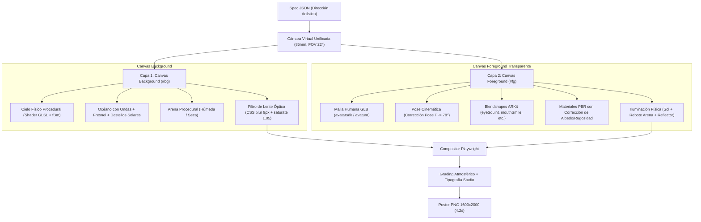

# Arquitectura de Escenas Humanas 3D y Retratos Anatómicos (JarBees 3D Engine)

Este documento detalla la arquitectura, principios matemáticos, pipeline de shaders y estructura de dirección del **Motor de Escenas y Retratos sobre Mallas Humanas Continuas** en JarBees Graphic Studio.

---

## 1. Principio Fundamental: Gráfica Computacional Pura vs. IA Generativa

> [!IMPORTANT]
> **CERO DIFUSIÓN / CERO REDES GENERATIVAS (GAN / STABLE DIFFUSION / MIDJOURNEY)**:
> Las imágenes producidas por este subsistema (`human_scene_portrait.png`, `angelina_human_mesh_portrait.png`) son **100% fruto de gráfica computacional determinista, álgebra lineal, shaders GLSL y renderizado WebGL/PBR en Three.js acelerado por hardware (GPU)**.
>
> La Inteligencia Artificial (LLM) interviene **únicamente como Director Artístico de alto nivel**, traduciendo un prompt en lenguaje natural a un archivo de especificación paramétrica JSON (`spec.json`). El motor gráfico ejecuta ese archivo de forma determinista y reproducible al 100%.

### Comparativa: Motor JarBees 3D vs. Modelos Generativos de Difusión

| Dimensión | Generación por Difusión (Midjourney, DALL-E, SD) | Motor JarBees Human Mesh 3D |
| :--- | :--- | :--- |
| **Naturaleza técnica** | Inferencia probabilística / eliminación de ruido de píxeles | Geometría euclidiana, cálculo de vectores, shaders y rasterización física |
| **Consistencia anatómica** | Frecuente alucinación en dedos, dientes, simetría ocular y pupilas | Malla anatómica continua fija con topología top-tier e inmunidad a deformaciones |
| **Control paramétrico** | "Prompt roulette" (cambiar una palabra altera todo el sujeto) | Control granular por grados de pose, coordenadas de luz y pesos ARKit (0.0 a 1.0) |
| **Latencia de render** | 15 - 45 segundos (cloud GPU) | **4.2 segundos** (local en GPU con WebGL ANGLE D3D11) |
| **Costo operacional** | Alto costo por token/crédito en APIs externas | **$0 costo marginal** (ejecución local en el servidor) |
| **Resolución** | 1024x1024 nativo con pérdida en upscale | **1600x2000** nativo con supersampling antialiasing 2x |

---

## 2. Regla de Oro: Mallas Anatómicas Continuas

En versiones tempranas de experimentación procedural, los rostros se aproximaban ensamblando primitivas geométricas (esferas para mejillas, tubos para cuello, elipses). Esto produce el efecto "Uncanny Valley" o aspecto de muñeco sintético.

La **Regla de Oro de JarBees** establece:
* **Nunca construir geometría facial con primitivas.**
* **Dirigir mallas anatómicas humanas completas (`.glb` con rig esquelético y blendshapes ARKit):**
  * `avatarsdk.glb`: Sujeto masculino realista con barba, pecas, topología facial continua y vestimenta paramétrica.
  * `avaturn.glb`: Sujeto femenino realista con topología facial continua, cabello y vestimenta formal.

---

## 3. Pipeline de Escena en Dos Planos Coincidentes

Para lograr el desenfoque de bokeh fotográfico característico de un lente **85mm f/1.8** sin recurrir a costosos pases de *depth-of-field* en shaders pesados de post-procesamiento:



Ambos canvas (`#bg` y `#fg`) comparten **exactamente la misma cámara de perspectiva**, garantizando que el punto de fuga, el ángulo cenital y la relación de escala coincidan con precisión matemática.

---

## 4. Shaders Procedurales de Entorno (`scene: 'beach'`)

### 4.1 Cielo Físico y Nubes (fBm)
El shader del domo celeste modela la dispersión atmosférica:
* **Zenith y Horizonte:** Interpolación suave entre azul zenital (`vec3(0.02, 0.16, 0.55)`) y azul horizonte (`vec3(0.42, 0.66, 0.92)`).
* **Disco Solar:** Gradiente de alta potencia sobre el producto escalar del vector solar (`s = max(dot(d, sunDir), 0.0)`).
* **Cúmulos Procedurales:** Ruido fractal browniano (*Fractional Brownian Motion*, fBm) proyectado en la semiesfera superior para generar nubes con volumen y sombreado solar intrínseco.

### 4.2 Océano en GLSL con Fresnel
El plano de agua evalúa gradientes de altura dinámicos mediante derivadas finitas de ruido 2D:
* **Cálculo de Normales:** Genera vectores normales perturbados por el oleaje.
* **Aproximación de Schlick para Fresnel:** 
  $$\text{Fresnel} = 0.02 + 0.98 \times (1 - \max(-\vec{v} \cdot \vec{n}, 0))^5$$
* **Colorimetría:** Gradiente desde turquesa poco profundo (`shallow: vec3(0.10, 0.62, 0.62)`) hasta azul marino profundo (`deep: vec3(0.01, 0.16, 0.32)`), con espuma procedural cerca de la línea costera (`SHORE_Z`).
* **Destellos especulares:** Reflexión solar afilada con exponente especular 350.

### 4.3 Arena Procedural y Humedad Costera
* **Zona seca:** Tonalidad dorada cálida con micro-rugosidad de ruido continuo.
* **Zona húmeda:** Tonalidad más oscura y menor albedo, calculada en función de la proximidad a la línea de marea con transición suave (`smoothstep`).

---

## 5. Cinemática de Pose y Expresión Anatómica

### 5.1 Desactivación de la Pose en T/A
Los modelos humanos vienen comúnmente en T-Pose (brazos a 90° horizontales) o A-Pose (a 45°). El motor calcula el ángulo actual en el espacio del mundo y aplica una rotación relativa en cuaterniones en el hueso `LeftArm` y `RightArm`:
```javascript
const cur = Math.atan2(-d.y, Math.abs(d.x));
const delta = THREE.MathUtils.degToRad(S.pose.armDownDeg) - cur;
const q = new THREE.Quaternion().setFromAxisAngle(new THREE.Vector3(0,0,1), sign * delta);
// Se multiplica la rotación en espacio de mundo manteniendo la jerarquía del rig
```

### 5.2 Expresiones ARKit Adaptadas a la Escena
Los blendshapes faciales reaccionan a la luz física:
* `eyeSquintLeft: 0.32`, `eyeSquintRight: 0.32`: Reflejo fisiológico natural ante la intensidad de la luz solar directa.
* `mouthSmileLeft: 0.32`, `mouthSmileRight: 0.26`: Sonrisa levemente asimétrica, otorgando calidez y realismo humano sin congelamiento gestual.
* `cheekSquintLeft: 0.20`, `cheekSquintRight: 0.20`: Elevación de pómulos coordinada con la sonrisa.

---

## 6. Iluminación Basada en Física (IBL) y PBR

1. **Entorno IBL (Image-Based Lighting):**
   * El generador `PMREMGenerator` de Three.js procesa la escena completa de fondo (cielo, mar y arena) para generar un mapa de radiancia y reflexión ambiental omnidireccional. La piel y la ropa del sujeto reciben los mismos tonos celestes y dorados de la atmósfera.
2. **Sol Direccional:**
   * `DirectionalLight` sincronizada con las coordenadas esféricas del disco solar (`azimuthDeg` y `elevationDeg`).
   * Sombras suaves de contacto (*PCFSoftShadowMap*) con sesgo normal (`normalBias: 0.02`) para evitar artefactos de *shadow acne* en los polígonos del rostro.
3. **Rebote de Arena y Reflector Frontal:**
   * Luz tenue de relleno cálida desde abajo-frente simulando un reflector fotográfico 5-en-1 estándar de sesión de exteriores.

---

## 7. Estructura de la Especificación JSON (`spec.json`)

Cualquier renderizado puede dispararse pasando un JSON estructurado a `scripts/render_human_scene.js`:

```json
{
  "model": "avatarsdk.glb",
  "scene": "beach",
  "pose": {
    "armDownDeg": 78,
    "headYaw": 0.16,
    "headPitch": 0.02,
    "headTilt": -0.04,
    "neckYaw": 0.06
  },
  "morphs": {
    "mouthSmileLeft": 0.32,
    "mouthSmileRight": 0.26,
    "cheekSquintLeft": 0.2,
    "cheekSquintRight": 0.2,
    "eyeSquintLeft": 0.32,
    "eyeSquintRight": 0.32,
    "browInnerUp": 0.06
  },
  "materials": {
    "hairTint": null,
    "skinTint": 16773346,
    "topTint": 15920352,
    "topStripTexture": true
  },
  "camera": {
    "distance": 1.8,
    "offsetX": -0.14,
    "targetDrop": 0.42,
    "fov": 22
  },
  "sun": {
    "azimuthDeg": 125,
    "elevationDeg": 38
  },
  "text": {
    "badge": "JARBEES PORTRAIT STUDIO",
    "title": "SUMMER",
    "subtitle": "SUNNY BEACH • 85MM f/1.8 • NATURAL LIGHT"
  },
  "output": "human_scene_portrait.png",
  "width": 1600,
  "height": 2000
}
```

---

## 8. Ejecución y Comandos

Para generar una escena:
```bash
# Ejecutar con el spec por defecto (Playa Soleada Masculina)
node scripts/render_human_scene.js

# Ejecutar con un archivo de spec personalizado
node scripts/render_human_scene.js ruta/a/mi_spec.json
```
Output:
* Archivo de imagen: `storage/posters/<output>.png` (resolución 1600x2000).
* Archivo de especificación: `storage/posters/<output>.spec.json`.
* Latencia: **~4.2 segundos**.
