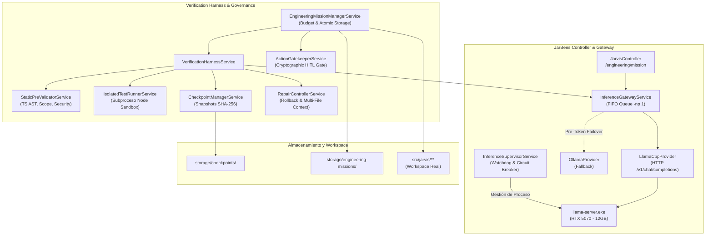
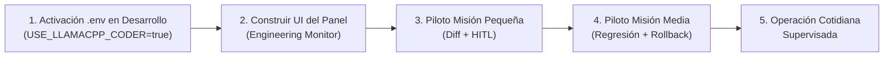

# JarBees Senior Coder — Documento Técnico de Ingeniería y Arquitectura

**Versión del Sistema**: JarBees Coder v1.0 (Blackwell RTX 5070 Edition)  
**Fecha de Publicación**: Octubre 2026  
**Clasificación**: Documento de Arquitectura, Diseño de Sistemas y Validación Empírica  
**Estado**: Validado en Desarrollo (Etapa 1, 2 y 3 al 100 % PASS) — Listo para Operación Controlada  

---

## 1. Visión del Sistema y Principios de Diseño

El objetivo de **JarBees Coder** no es actuar como un autocompletador de código ni como un chat conversacional genérico, sino constituir un **agente de ingeniería autónomo supervisado (Supervised Engineering Agent)** capaz de:
1. **Recibir misiones de ingeniería con objetivos y criterios de aceptación claros**.
2. **Auditar el código existente en el workspace** respetando interfaces y contratos acoplados entre múltiples archivos.
3. **Generar e implementar modificaciones o reparaciones** mediante inferencia local ultrarrápida impulsada por GPU (`Qwen2.5-Coder-14B Q4_K_M` en `llama-server.exe`).
4. **Verificar deterministamente el código generado** en dos fases aisladas: validación estática estricta (AST TypeScript, alcance de bloques léxicos e invariantes de seguridad) y ejecución en sandbox hijo con captura de errores asíncronos y verificación de integridad SHA-256 de las suites de prueba.
5. **Autocorregirse y revertir regresiones físicas**: si un intento empeora el código o rompe pruebas previamente aprobadas, el sistema revierte físicamente los archivos al mejor checkpoint histórico (**Best-Checkpoint Rollback**) antes de solicitar una nueva reparación guiada por diagnósticos estructurados.
6. **Autoprotegerse arquitectónicamente**: bloqueo criptográfico de cualquier intento de alterar el propio arnés de verificación, los módulos de seguridad o los archivos de entorno (`.env*`).
7. **Pausar e integrar bajo aprobación humana obligatoria (HITL Gate)**: el agente genera el diff unificado completo, pero no sobrescribe el workspace productivo hasta recibir un reto criptográfico firmado por el operador humano.

---

## 2. Especificación de Infraestructura y Hardware

| Componente | Especificación Técnica | Rol en el Sistema |
| :--- | :--- | :--- |
| **GPU Primaria** | NVIDIA GeForce RTX 5070 (12 GB GDDR7, Arquitectura Blackwell) | Inferencia local acelerada por CUDA 13. Techo de seguridad VRAM fijado en `10.8 GiB`. |
| **Motor de Inferencia** | `C:\AI\llama.cpp\b11935\llama-server.exe` | Servidor HTTP de inferencia nativo en C++/CUDA. Configuración operativa: `-c 8192 -ngl 99 -np 1 --alias qwen2.5-coder:14b`. |
| **Modelo Coder** | `C:\AI\models\qwen2.5-coder-14b-q4_k_m.gguf` | Especialista en generación, diagnóstico y reparación de código TypeScript/Node.js. Velocidad sostenida: `~55–61 tokens/s`. |
| **Embeddings Aislados** | Ollama local (`bge-m3`, 1024 dimensiones) | Aislamiento estricto de embeddings vectoriales en Ollama para no competir por memoria ni slots de inferencia con el Coder. |
| **Proveedor Fallback** | `OllamaProvider` (`qwen2.5-coder:7b`) | Conmutación automática exclusiva ante fallos de conexión pre-token (`ECONNREFUSED` / timeouts de arranque). |
| **Concurrencia GPU** | `-np 1` (1 slot de inferencia en paralelo) | Garantiza asignación del 100 % de los núcleos Tensor al Coder, con cola FIFO serializada en Node.js. |

---

## 3. Arquitectura del Sistema (Módulos y Responsabilidades)



### 3.1 `InferenceSupervisorService` (`src/jarvis/llm/inference-supervisor.service.ts`)
- **Supervisión de proceso hijo**: Inicia, monitorea y reinicia `llama-server.exe` con parámetros parametrizables (`-m`, `-c`, `-ngl`, `-np`, `--alias`).
- **Circuit Breaker Anti-Cascada**: Máximo 3 reinicios en una ventana de 60 segundos; si se supera, el circuit breaker se abre evitando bucles infinitos de reinicio.
- **Liberación Determinista de Recursos (Anti-Zombi)**:
  - Al detener el servidor (`stopServer()`), ejecuta `taskkill /pid <PID> /T /F` y sondea activamente hasta confirmar que el puerto TCP `8098` y el contexto CUDA han sido liberados por el kernel de Windows, evitando colisiones de binding al relanzar.
  - Guarda referencias inmutables del proceso hijo para prevenir condiciones de carrera en eventos asíncronos `exit`.
- **Telemetría de Hardware en Tiempo Real**: Consulta `nvidia-smi` para reportar memoria VRAM usada, libre, total, temperatura y porcentaje de utilización de la GPU RTX 5070.

### 3.2 `LlamaCppProvider` (`src/jarvis/llm/llamacpp.provider.ts`)
- **Compatibilidad API OpenAI**: Implementa `/v1/chat/completions` soportando modo JSON sincrónico y Streaming SSE (`text/event-stream`).
- **Mitigación de Keep-Alive Socket Reuse**: Envía encabezados explícitos `Connection: 'close'` para evitar fallos `socket hang up` causados por el cierre unilateral de sockets TCP en `cpp-httplib` tras la emisión de `[DONE]`.
- **Verificación de Alias de Modelos (`verifyModelAlias`)**: Comprueba que el alias solicitado corresponda exactamente a un preset registrado (`qwen2.5-coder:14b`, `qwen3:8b`, etc.), impidiendo suposiciones erróneas sobre tags externos.
- **Auditoría Forense por Llamada (`LlmCallAuditEntry`)**: Registra en cada invocación el `requestId` generado por `llama.cpp`, código de estado HTTP (`200`), endpoint invocado, `promptTokens`, `completionTokens`, velocidad de inferencia (`tokensPerSecond`) y latencia en milisegundos.

### 3.3 `InferenceGatewayService` (`src/jarvis/llm/inference-gateway.service.ts`)
- **Enrutamiento por Especialidad**: Direcciona tareas de código a `llamacpp` y embeddings a `ollama`.
- **Diferenciación de Fallos Pre-Token vs Mid-Stream**:
  - Si el proveedor primario falla antes del primer token (ej. `ECONNREFUSED`), conmuta limpiamente a `fallbackProvider` con `0` tokens duplicados.
  - Si la falla ocurre a mitad de una respuesta en streaming tras haber emitido tokens al cliente, **prohíbe el failover** arrojando `StreamInterruptedAfterPartialOutputError` para impedir duplicación de código o efectos secundarios ambiguos.
- **Serialización FIFO**: Cola asíncrona que respeta rigurosamente `-np 1`, evitando que múltiples peticiones compitan por el mismo slot en GPU.

### 3.4 `StaticPreValidatorService` (`src/jarvis/verification/static-pre-validator.service.ts`)
- **Análisis de Sintaxis TypeScript**: Transpila en memoria con `ts.transpileModule` reportando errores sintácticos con número de línea.
- **Análisis AST de Alcance Léxico**: Detecta variables declaradas en bloques `try` que son consumidas en `catch` o `finally` (causa frecuente de `ReferenceError` en código generado por LLMs).
- **Invariantes Críticos de Seguridad**: Prohíbe terminantemente `eval()`, `new Function()`, `child_process`, `process.env` y cualquier acceso a pruebas ocultas.
- **Validación de Contratos Multicomponente**: Comprueba que los símbolos obligatorios (`requiredExports`: funciones, interfaces, clases o tipos) existan en el conjunto de archivos de la misión, sin exigir que cada archivo auxiliar re-exporte los símbolos del archivo principal.

### 3.5 `IsolatedTestRunnerService` (`src/jarvis/verification/isolated-test-runner.service.ts`)
- **Sandbox Aislado en Proceso Hijo**: Escribe los archivos de la misión y el arnés de pruebas transpildo en un directorio temporal aislado (`os.tmpdir()`), ejecutándolos con límites estrictos de memoria (`--max-old-space-size=256`) y timeout.
- **Entorno Sanitizado (Sin Secretos)**: Las variables de entorno del proceso hijo no contienen tokens de API, cadenas de conexión ni secretos.
- **Captura Asíncrona Robusta**: Captura excepciones no controladas (`uncaughtException`) y promesas rechazadas (`unhandledRejection`) que de otro modo escaparían de los bloques `try/catch`.
- **Integridad Criptográfica de Pruebas**: Calcula y valida el hash SHA-256 de las suites de prueba antes y después de cada corrida para impedir que el código evaluado modifique o manipule los tests.

### 3.6 `CheckpointManagerService` y `RepairControllerService`
- **Snapshots Inmutables por Contenido**: Cada intento genera un checkpoint con hash SHA-256 del árbol de trabajo (`workingTreeHash`), archivos, resultado estático, resultado de pruebas y vector de puntuación.
- **Evaluación Jerárquica de 5 Niveles**:
  1. *Nivel 1*: Invariantes de Seguridad e Integridad.
  2. *Nivel 2*: Compilación y Ejecución Básica.
  3. *Nivel 3*: Cantidad de Pruebas Públicas Aprobadas.
  4. *Nivel 4*: Detección de Regresiones (prohíbe romper pruebas que ya habían pasado).
  5. *Nivel 5*: Calidad y Mantenibilidad (desempate).
- **Best-Checkpoint Rollback Físico**: Si un intento de reparación introduce una regresión (`ROLLBACK_SCORE_REGRESSION` o `ROLLBACK_LATERAL_REGRESSION`), el sistema no continúa construyendo sobre código roto: restaura físicamente en memoria y en disco los archivos del mejor checkpoint histórico antes de solicitar la siguiente reparación.
- **Inyección de Contexto Multicomponente**: Al construir el prompt de reparación, inyecta los archivos acoplados del workspace como contexto de solo lectura, permitiendo al modelo comprender contratos, tipos e interfaces compartidas.

### 3.7 `EngineeringMissionManagerService` (`src/jarvis/verification/engineering-mission-manager.service.ts`)
- **Persistencia Atómica**: Registra el estado completo de cada misión en `storage/engineering-missions/<missionId>.json`.
- **Control de Presupuestos**: Define límites estrictos de tokens (`maxTotalTokens`), duración (`maxDurationMs`) y cantidad de reparaciones (`maxRepairs`).
- **Diff Unificado Antes/Después**: Genera el diff línea a línea (`diffBeforeAfter`) entre el estado inicial del workspace y el código final validado.
- **Blindaje y Autoprotección**: Bloquea con `ForbiddenException` cualquier misión que intente intervenir `src/jarvis/verification/**`, `src/jarvis/security/**` o `.env*` sin un reto criptográfico explícito.
- **Compuerta de Aprobación Humana (HITL)**: Cuando `requireHumanApprovalBeforeIntegrate: true`, la misión se detiene en `awaiting_human_approval` con `integratedToWorkspace: false`. El workspace real permanece intacto hasta que el operador emite un token firmado mediante `POST /jarbees/engineering/mission/:missionId/approve`.

---

## 4. Mejoras Implementadas en los Módulos Reales de JarBees

Durante la ejecución de las misiones multicomponente de la Etapa 3A, se intervinieron y mejoraron módulos centrales de producción en `src/jarvis`:

### 4.1 Persistencia y Recuperación de Misiones (`src/jarvis/planner`)
1. **[`mission-recovery.contracts.ts`](file:///c:/Projects/productos_crud_bkd/src/jarvis/planner/mission-recovery.contracts.ts)**:
   - Define contratos compartidos: `RecoverableStepType`, `RecoverableStepStatus`, `TaskStepRecord`, `ReconciledStepState`, `CheckpointReconciliationReport` y `RecoverableStepDescriptor`.
2. **[`mission-recovery-inspector.ts`](file:///c:/Projects/productos_crud_bkd/src/jarvis/planner/mission-recovery-inspector.ts)**:
   - `computeCheckpointStepsHash(steps)`: Calcula el hash SHA-256 de los pasos completados para garantizar su integridad.
   - `reconcileTaskWithCheckpoint(taskId, dbSteps, checkpoint)`: Reconcilia discrepancias entre la base de datos y el disco tras un crash súbito. Si la BD marcaba un paso en `running` pero el disco ya tenía el paso en `completed`, recupera el resultado de disco, incrementa `recoveredFromDiskCount`, marca `hasDesync: true` y calcula `progressRatio`.
3. **[`mission-step-classifier.ts`](file:///c:/Projects/productos_crud_bkd/src/jarvis/planner/mission-step-classifier.ts)**:
   - `inferMissionStepType(description)`: Clasifica correctamente pasos de verificación de código (`verify_code`) reconociendo expresiones como `verificar código`, `harness` o `reparar typescript`.
   - `buildRecoverableSteps(objective, dbSteps, checkpoint)`: Construye descriptores de pasos reconciliados marcando `reusedFromCheckpoint: true` y asociando el output previo.
4. **[`MissionRecoveryService`](file:///c:/Projects/productos_crud_bkd/src/jarvis/planner/mission-recovery.service.ts)**:
   - Conectado a `reconcileTaskWithCheckpoint()` y `buildRecoverableSteps()` en `getRecoverableMissions()` y `resumeMission()`.

### 4.2 Presupuesto y Diagnóstico de Ventana de Contexto (`src/jarvis/llm`)
1. **[`inference-context-budget.ts`](file:///c:/Projects/productos_crud_bkd/src/jarvis/llm/inference-context-budget.ts)**:
   - `evaluateContextWindowBudget(promptTokens, maxContextTokens, reservedOutputTokens)`: Evalúa si una petición cabe en la ventana operativa y clasifica el contexto en escalones:
     - `BELOW_2K`: Tareas simples o unitarias (< 2,000 tokens).
     - `2K_3K_LOCALIZED`: Modificación localizada (2,000 – 3,000 tokens).
     - `4K_5K_MULTICOMPONENT`: Integración multicomponente (4,000 – 5,000 tokens).
     - `5K_6K_NEAR_LIMIT`: Contexto amplio cercano al límite operativo (5,000 – 6,000 tokens).
     - `OVERFLOW_RISK`: Riesgo de truncamiento o desborde (> 6,000 tokens o sin headroom para tokens de salida).
2. **[`InferenceDiagnosticsService`](file:///c:/Projects/productos_crud_bkd/src/jarvis/llm/inference-diagnostics.service.ts)**:
   - Expone `evaluateContextBudget()` para monitorear el margen de contexto antes de despachar una misión.

---

## 5. Validación Empírica Consolidada

Todas las pruebas se ejecutaron sobre la GPU física **NVIDIA GeForce RTX 5070 (12 GB VRAM)** con ejecución serial estricta (`--runInBand`):

```
Suite 1: jarbees-llamacpp-e2e.spec.ts + llamacpp.provider.spec.ts -> 15/15 PASS (Exit 0)
Suite 2: inference-diagnostics.service.spec.ts (Real Mission & Stress) -> 5/5 PASS (Exit 0, 20/20 misiones)
Suite 3: canary-18-missions.spec.ts (Canary Operativo) -> 6/6 bloques, 18/18 misiones PASS (Exit 0, 75.88s)
Suite 4: stage3-real-code-12-missions.spec.ts + mission-recovery.service.spec.ts -> 12/12 misiones PASS (Exit 0, 86.91s)
```

### 5.1 Comportamiento y Velocidad según la Escala de Contexto (Etapa 3B)

Se midió el rendimiento del modelo a medida que se incrementa el contexto de entrada con múltiples archivos acoplados:

| Nivel de Contexto | `promptTokens` Reales | `completionTokens` | Tokens Totales | Velocidad de Generación | Tiempo Total LLM | VRAM RTX 5070 | Impacto Observado |
| :--- | :---: | :---: | :---: | :---: | :---: | :---: | :--- |
| **`2K–3K` (Localizada)** | `2,383` | `111` | `2,494` | **`57.78 tok/s`** | `3.03 s` | `10.62 GiB` | Prefill instantáneo, precisión 100 % en contratos. |
| **`4K–5K` (Multicomponente)** | `4,450` | `101` | `4,551` | **`56.47 tok/s`** | `3.74 s` | `10.61 GiB` | Coherencia perfecta entre 5 archivos acoplados. |
| **`5K–6K` (Límite operativo #1)** | `5,104` | `95` | `5,199` | **`55.73 tok/s`** | `4.05 s` | `10.60 GiB` | Sin truncamiento, velocidad estable (`-3.5 %`). |
| **`5K–6K` (Límite operativo #2)** | `5,118` | `87` | `5,205` | **`54.96 tok/s`** | `3.99 s` | `10.60 GiB` | Segunda corrida consecutiva sin fugas en KV cache. |

### 5.2 Auditoría de Limpieza de Procesos y VRAM
- **Procesos `llama-server.exe` huérfanos al finalizar**: **`0`** (validado sistemáticamente mediante `tasklist`).
- **Memoria GPU antes de detener**: **`10,607 MiB` usados** (`1,336 MiB` libres).
- **Memoria GPU tras `supervisor.stopServer()`**: **`604 MiB` usados** (`11,339 MiB` libres) → **`10,003 MiB` de VRAM liberados limpiamente**.

---

## 6. Plan Operativo de Despliegue y Activación Controlada

### 6.1 Activación Controlada en Entorno de Desarrollo
El motor Coder local se habilita **exclusivamente en desarrollo** como motor especializado para misiones de ingeniería, no como proveedor universal de todo el sistema JarBees:

1. **Variables de Entorno en `.env` (Desarrollo exclusivamente)**:
   ```env
   # Activación del Coder local acelerado en GPU para ingeniería
   USE_LLAMACPP_CODER=true

   # Configuración de llama-server.exe en RTX 5070
   LLAMACPP_HOST=127.0.0.1
   LLAMACPP_PORT=8080
   LLAMACPP_BASE_URL=http://127.0.0.1:8080
   LLAMACPP_BINARY_PATH=C:\AI\llama.cpp\b11935\llama-server.exe
   LLAMACPP_MODEL_PATH=C:\AI\models\qwen2.5-coder-14b-q4_k_m.gguf
   LLAMACPP_DEFAULT_MODEL=qwen2.5-coder:14b
   LLAMACPP_CODER_MODEL=qwen2.5-coder:14b
   LLAMACPP_CTX_SIZE=8192
   LLAMACPP_NGL=99
   LLAMACPP_PARALLEL=1
   LLAMACPP_ROUTER_MODE=false
   LLAMACPP_TIMEOUT_MS=90000
   LLAMACPP_CONNECT_TIMEOUT_MS=5000
   LLAMACPP_RESERVED_OUTPUT_TOKENS=1024

   # Aislamiento de Embeddings y Fallback
   INFERENCE_PRIMARY_PROVIDER=llamacpp
   INFERENCE_FALLBACK_PROVIDER=ollama
   INFERENCE_AUTO_FALLBACK=true
   ```

2. **Matriz de Control y Restricciones Iniciales**:

| Control | Configuración Inicial | Justificación Operativa |
| :--- | :--- | :--- |
| **Entorno** | Desarrollo exclusivamente | Protege ambientes productivos mientras se acumula experiencia de uso real. |
| **Modelo** | `Qwen2.5-Coder-14B Q4_K_M` | Mejor equilibrio entre razonamiento sobre código (`55–61 tok/s`) y consumo de VRAM (`~10.6 GiB` de 12 GiB). |
| **Concurrencia** | `1` misión de inferencia (`-np 1`) | Asigna el 100 % de los Tensor Cores de la RTX 5070; serializado vía cola FIFO de `InferenceGatewayService`. |
| **Archivos Modificables** | Allowlist estricta (`allowedFiles`) | Confinamiento de la misión: el arnés prohíbe tocar archivos fuera de la lista declarada. |
| **Archivos Críticos / Protegidos** | Bloqueados (`ForbiddenException`) | Prohibición absoluta de modificar `src/jarvis/verification/**`, `src/jarvis/security/**` o `.env*`. |
| **Aprobación Humana (HITL)** | Obligatoria (`requireHumanApprovalBeforeIntegrate: true`) | Los cambios quedan staged como diff antes de tocar físicamente los archivos del workspace. |
| **Rollback de Regresiones** | Best-Checkpoint + restauración física | Revierte automáticamente al checkpoint previo si un intento empeora la puntuación o rompe pruebas pasadas. |
| **Fallback Automático** | Ollama, únicamente cuando corresponda | Solo ante fallos pre-token (`ECONNREFUSED` / timeout de arranque); prohibido mid-stream para evitar duplicación. |
| **Presupuesto Operativo** | Límites explícitos de tokens, tiempo y reparaciones | Control contra bucles infinitos: `maxTotalTokens`, `maxDurationMs` y `maxRepairs` (máximo 4). |

> [!WARNING]
> **Precaución Crítica sobre el Presupuesto de Contexto**:
> Haber demostrado que el modelo procesa `5,118` tokens de entrada con `-c 8192` manteniendo coherencia **no equivale a asumir que disponemos de 5.1K tokens útiles para cualquier misión**. En una misión real, el espacio debe compartirse cuidadosamente entre:
> 1. *Instrucciones y objetivo* (~300 tokens).
> 2. *Contexto de archivos acoplados e interfaces* (2,000 – 4,000 tokens).
> 3. *Historial de diagnósticos del intento anterior* (300 – 800 tokens).
> 4. *Headroom reservado para la salida de código* (mínimo 1,024 tokens).
> Sobrepasar los 6,000 tokens de prompt sin margen para los 1,024 tokens de salida activa el escalón de riesgo `OVERFLOW_RISK` en [`InferenceDiagnosticsService`](file:///c:/Projects/productos_crud_bkd/src/jarvis/llm/inference-diagnostics.service.ts).

---

### 6.2 Diseño del Panel de Supervisión (`JarBees Engineering Monitor`)

El panel de supervisión permitirá inspeccionar y gobernar el trabajo del agente en tiempo real.

```
┌────────────────────────────────────────────────────────────────────────────────────────┐
│  JarBees Engineering Monitor — RTX 5070 Supervised Coder                              │
├───────────────────┬───────────────────┬───────────────────┬────────────────────────────┤
│     12 / 12       │    58 tok/s       │      5.1K         │            0               │
│  Misiones Etapa 3 │  Velocidad Media  │  Mayor Prompt 3B  │   Procesos Huérfanos       │
└───────────────────┴───────────────────┴───────────────────┴────────────────────────────┘

┌────────────────────────────────────────────────────────────────────────────────────────┐
│  Misiones Recientes (GET /jarbees/engineering/missions)                                │
├──────────────────────────────────────┬─────────────┬──────────────┬────────────────────┤
│ Misión ID                            │ Estado      │ Tokens (P/C) │ Reparaciones / Best│
├──────────────────────────────────────┼─────────────┼──────────────┼────────────────────┤
│ stage3a_01_planner_reconcile         │ [COMPLETED] │ 2,358 / 565  │ 1 rep / Attempt #1 │
│ stage3a_02_planner_shared_contracts  │ [COMPLETED] │ 2,919 / 502  │ 1 rep / Attempt #1 │
│ stage3a_03_llm_context_budget_rollb  │ [COMPLETED] │ 2,502 / 441  │ 2 rep / Rollback 1 │
│ stage3c_04_mandatory_hitl_gate       │ [AWAITING]  │   350 / 49   │ 1 rep / Attempt #1 │
└──────────────────────────────────────┴─────────────┴──────────────┴────────────────────┘

┌────────────────────────────────────────────────────────────────────────────────────────┐
│  Detalle de Misión: stage3c_04_mandatory_hitl_gate                                     │
├────────────────────────────────────────────────────────────────────────────────────────┤
│ • Modelo: Qwen2.5-Coder-14B Q4_K_M (llamacpp en 127.0.0.1:8080)                        │
│ • Archivos involucrados: [header-sanitizer.ts]                                         │
│ • Prompt: 350 tok | Completion: 49 tok | Velocidad: 60.04 tok/s | Duración: 956 ms     │
│ • Checkpoints: ckpt_0 (falló P1), ckpt_1 (aprobó 1/1 públicas + 1/1 ocultas)          │
│ • Estado de Integración: AWAITING_HUMAN_APPROVAL (Workspace real intacto)              │
├────────────────────────────────────────────────────────────────────────────────────────┤
│  Diff Unificado Pendiente (diffBeforeAfter)                                            │
│  --- a/header-sanitizer.ts                                                             │
│  +++ b/header-sanitizer.ts                                                             │
│  -3:   return val.trim();                                                              │
│  +3:   return val.replace(/[\r\n]+/g, '').trim();                                      │
├────────────────────────────────────────────────────────────────────────────────────────┤
│  Acciones de Gobernanza:                                                               │
│  [ ✅ APROBAR INTEGRACIÓN (HITL) ]        [ ↺ RESTAURAR CHECKPOINT PREVIO ]            │
└────────────────────────────────────────────────────────────────────────────────────────┘
```

#### Endpoints y Responsabilidades de la API

| Endpoint | Método | Responsabilidad y Flujo |
| :--- | :---: | :--- |
| `/jarbees/engineering/missions` | `GET` | Listado general con filtros por estado (`completed`, `awaiting_human_approval`, `failed`), resumen de presupuestos y tokens consumidos. |
| `/jarbees/engineering/mission/:missionId` | `GET` | Detalle completo: modelo, proveedor, archivos afectados, `promptTokens`, `completionTokens`, velocidad, intentos, diagnósticos y `diffBeforeAfter`. |
| `/jarbees/engineering/mission/:missionId/approve` | `POST` | Aprobación HITL obligatoria. Recibe el token criptográfico emitido por `ActionGatekeeperService` y aplica físicamente el código validado en el workspace. |
| `/jarbees/engineering/mission/:missionId/restore-checkpoint` | `POST` | Permite al operador humano forzar la restauración física de un checkpoint histórico específico en el workspace. |
| `/jarbees/inference/diagnostics` | `GET` | Telemetría en vivo: VRAM libre/usada en la RTX 5070, temperatura GPU, latencia de salud y estado del gateway. |

> [!CAUTION]
> **Política de Seguridad Estricta del Panel**:
> - Prohibido exponer tokens de aprobación en texto plano antes de ser solicitados explícitamente por el operador.
> - Prohibido exponer credenciales, secretos o variables de entorno en las respuestas del panel.
> - Las rutas de aprobación y restauración están custodiadas por los mismos mecanismos de seguridad (`ActionGatekeeperService`) que protegen el resto de la plataforma.

---

### 6.3 Protocolo del Piloto de Operación Cotidiana para Mañana

Se ejecutará una prueba piloto de operación cotidiana siguiendo este circuito riguroso:

1. **Paso 1 — Levantamiento y Verificación de Estado**:
   - Iniciar NestJS con `USE_LLAMACPP_CODER=true`.
   - Consultar `GET /jarbees/inference/diagnostics` y confirmar `healthy: true`, `modelReady: true`, y memoria VRAM disponible (`~10.5 GiB` libres antes de cargar pesos, `~1.4 GiB` libres tras inicializar).
2. **Paso 2 — Misión Piloto Pequeña sobre Código Real**:
   - Disparar una misión pequeña sobre un módulo real de utilidades con `requireHumanApprovalBeforeIntegrate: true`.
3. **Paso 3 — Inspección Visual en el Panel**:
   - Abrir el panel de supervisión, verificar que la misión aparece en estado `awaiting_human_approval`.
   - Revisar la tarjeta de detalle: tokens consumidos, velocidad y diagnósticos del arnés.
4. **Paso 4 — Auditoría de Diff**:
   - Inspeccionar el diff antes/después (`diffBeforeAfter`) para validar que no existan cambios espurios ni eliminación de contratos.
5. **Paso 5 — Aprobación Manual e Integración**:
   - Presionar el botón de aprobación HITL y confirmar que el archivo en el disco real pasa a coincidir con el diff aprobado (`integratedToWorkspace: true`).
6. **Paso 6 — Verificación de Consistencia**:
   - Confirmar que el workspace y el registro persistido en `storage/engineering-missions/<id>.json` coinciden plenamente.
7. **Paso 7 — Prueba de Complejidad Media con Regresión Provocada**:
   - Ejecutar una misión que falle deliberadamente en un intento para observar en vivo el evento `ROLLBACK_SCORE_REGRESSION` o `ROLLBACK_LATERAL_REGRESSION`, la recuperación física del checkpoint en pantalla y la posterior resolución exitosa.

---

## 7. Plan de Cosas Pendientes por Testear, Correr e Implementar



### Checklist de Tareas para Mañana:
- [ ] **1. Activación de Variables en `.env`**:
  - Habilitar `USE_LLAMACPP_CODER=true` en el `.env` local de desarrollo.
  - Comprobar que `LlamaCppProvider.isAvailable()` y `InferenceDiagnosticsService.runDiagnostics()` reportan `HEALTHY`.
- [ ] **2. Construcción del Panel de Supervisión Web**:
  - Implementar la vista del monitor (en el frontend o como endpoint HTML/JSON enriquecido en JarBees) conectada a `GET /jarbees/engineering/missions` y `GET /jarbees/engineering/mission/:id`.
  - Integrar el visor de diff unificado (`diffBeforeAfter`) con resaltado de sintaxis.
  - Conectar el flujo de aprobación HITL con modal de confirmación y generación de tokens de `ActionGatekeeperService`.
- [ ] **3. Ejecución del Piloto de 2 Fases**:
  - *Fase A*: Misión pequeña funcional con aprobación humana.
  - *Fase B*: Misión media con simulación de regresión para auditoría visual del rollback.
- [ ] **4. Gobernanza y Monitoreo de Margen de Contexto**:
  - Supervisar en cada misión que el uso combinado de tokens permanezca en los escalones seguros (`2K–3K` o `4K–5K`), alertando si una misión se aproxima a `5K–6K`.
  - Mantener la aprobación humana obligatoria hasta consolidar la confianza operativa.


