# JarBees Scientific Lab — Historical Media Restoration Pipeline

Este documento establece la arquitectura, algoritmos matemáticos y procedimientos operativos para la restauración digital integral de material fílmico histórico monocromo en el ecosistema **JarBees**.

---

## 1. Contexto Histórico y Misión Técnica

En la investigación científica, psicológica e histórica (como en el caso de las grabaciones de Carl Gustav Jung, Nikola Tesla o Michael Faraday), gran parte del acervo audiovisual primario existe únicamente en soportes analógicos monocromos (película de 16mm/35mm kinescopiada o cintas magnéticas de baja resolución).

La misión de JarBees en este dominio es cuádruple:
1. **Recuperación acústica forense:** Limpiar la señal de voz analógica suprimiendo zumbidos de red de 50/60 Hz y soplidos de cinta sin alterar el timbre vocal natural.
2. **Colorización neuronal calibrada:** Generar crominancia históricamente precisa mediante redes neuronales convolucionales profundas, aplicando un control matemático estricto en el espacio **CIELAB** para evitar sobre-saturaciones plásticas.
3. **Restauración de acutancia y rango dinámico:** Devolver a la imagen el relieve, microcontraste y negros profundos que se pierden en digitalizaciones baratas ("efecto lavado").
4. **Integración semántica RAG:** Incorporar el texto transcrito y traducido incrementalmente a la base de datos de conocimiento PostgreSQL con búsqueda vectorial (bge-m3).

---

## 2. Diagrama de la Arquitectura del Pipeline

```mermaid
flowchart LR
    subgraph Entrada
        A["Archivo Fílmico B&W (Kinescopio 1959)"]
    end

    subgraph Audio ["Pipeline de Audio"]
        B["Filtro Notch 50/100 Hz"] --> C["Denoise FFT Adaptativo"] --> D["EQ Presencia Vocal"] --> E["AAC 192 kbps"]
    end

    subgraph Video ["Pipeline Visual (JarBees Cinema Grade)"]
        F["Lanczos-4 Upscaling (960x720 HD)"]
        F --> G["Separación Luminancia L & Red Caffe"]
        G --> H["Predicción Crominancia (a*, b*)"]
        H --> I["Calibración CIELAB a Referencia Objetiva"]
        I --> J["Anclaje de Blancos Puros (L > 195)"]
        J --> K["CLAHE + S-Curve Dynamic Punch"]
        K --> L["Unsharp Mask Acutance"]
        L --> M["Subtítulos Incrustados con Sombra"]
    end

    subgraph Muxing ["Entrega Final"]
        E --> N["Fusión FFmpeg H.264 / NVENC"]
        M --> N
        N --> O["Master Fílmico Restaurado HD (.mp4)"]
    end

    A --> B
    A --> F
```

---

## 3. Especificación Matemática del Algoritmo de Color

### 3.1 Espacio de Color CIELAB
Se opera en el espacio CIE $L^*a^*b^*$ debido a que separa de forma ortogonal la luminancia perceptual ($L^*$) de los componentes cromáticos verde-rojo ($a^*$) y azul-amarillo ($b^*$).

### 3.2 Mapeo de Momentos Estadísticos
Dado el vector predicho por la red convolucional $\mathbf{ab}_{\text{pred}}$, se reescala utilizando los momentos estadísticos de la referencia estética calibrada:

$$\hat{a}_{x,y} = (a_{x,y} - \mu_a) \cdot \frac{\sigma_{a,\text{target}}}{\sigma_a + \varepsilon} + \mu_{a,\text{target}}$$
$$\hat{b}_{x,y} = (b_{x,y} - \mu_b) \cdot \frac{\sigma_{b,\text{target}}}{\sigma_b + \varepsilon} + \mu_{b,\text{target}}$$

**Valores objetivo probados y validados:**
* $\mu_{a,\text{target}} = 132.5 \quad (\sigma_{a,\text{target}} = 5.7)$
* $\mu_{b,\text{target}} = 133.3 \quad (\sigma_{b,\text{target}} = 8.4)$

### 3.3 Anclaje de Blancos Puros
Previene el viraje de altas luces (cabello blanco, cuellos de camisas y reflejos especulares) hacia tonos amarillos o magenta:

$$w(L) = \text{clip}\left(\frac{L - 195}{60}, 0, 1\right)$$
$$a_{\text{final}} = \hat{a} \cdot (1 - 0.85 \cdot w(L)) + 128 \cdot (0.85 \cdot w(L))$$
$$b_{\text{final}} = \hat{b} \cdot (1 - 0.85 \cdot w(L)) + 128 \cdot (0.85 \cdot w(L))$$

---

## 4. Preset "Cinema Punch & Acutance"

| Etapa | Operación Matemática | Propósito Visual |
| :--- | :--- | :--- |
| **Punto Negro (Black Level)** | $L_{\text{punch}} = \text{clip}((L/255)^{1.30} \times 255)$ | Elimina el velo lechoso analógico; expande el contraste a $> 110:1$. |
| **Microcontraste Local** | CLAHE (`clipLimit=2.2`, `grid=8x8`) | Resalta arrugas faciales, ojos, monturas de gafas y texturas de telas. |
| **Acutancia** | $\text{Out} = 1.40 \cdot I - 0.40 \cdot \text{Gaussian}(I, \sigma=2.5)$ | Da filo nítido a los bordes sin generar artefactos plásticos ni halos. |
| **Vibrancia** | Escalado no lineal de $(a^* - 128) \times 1.35$ | Otorga color denso y rico en sombras y tonos medios sin quemar la piel. |
| **Denoise de Croma** | Filtro bilateral en plano UV / Croma | Elimina el parpadeo de color analógico entre fotogramas. |

---

## 5. Integración con el Motor RAG de JarBees

1. **Alineación Bilingüe:** Cada video procesado genera transcripción nativa en inglés y traducción estructurada en español.
2. **Subtítulos ANSI Windows-1252:** Garantiza compatibilidad universal con reproductores de video sin corromper caracteres españoles (ñ, acentos, apertura de signos `¿` y `¡`).
3. **Indexación Vectorial:** Los bloques de diálogo se fragmentan e ingestan en PostgreSQL (`Document` y `Chunk`) mediante embeddings vectoriales de 1024 dimensiones (`bge-m3:latest`), vinculando la versión en español con su original en inglés (`translatedFromId`).

