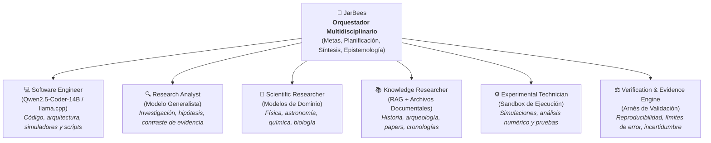
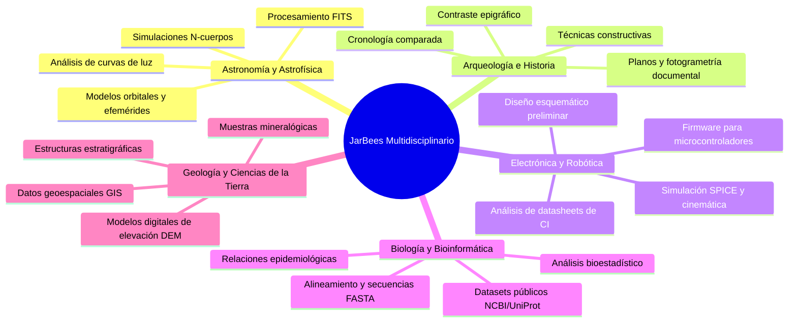
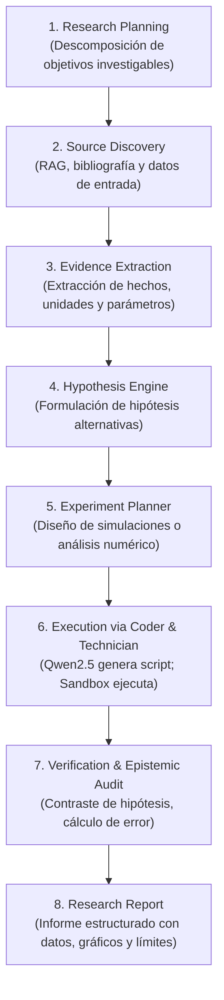
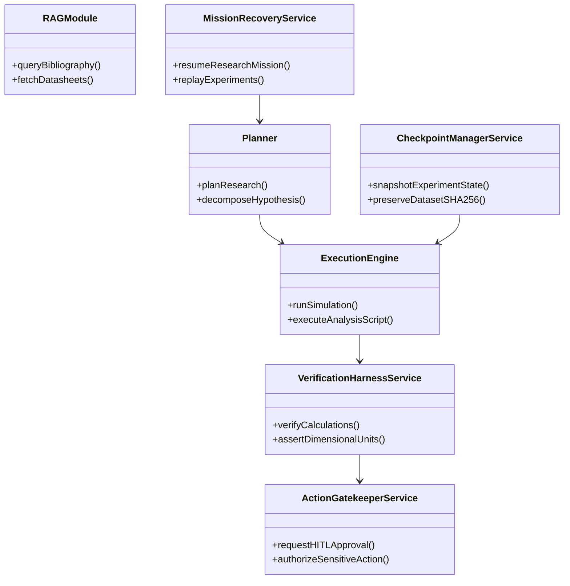
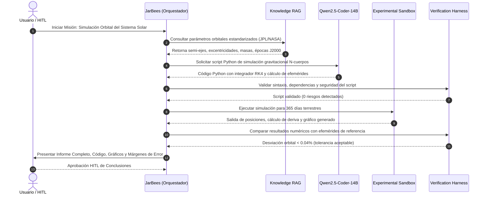

# JarBees: Visión de Investigación Técnica Multidisciplinaria y Motor Científico

> **Estado del Documento**: 🟡 **PENDIENTE / BACKLOG ARQUITECTÓNICO REGISTRADO**  
> **Fecha de Registro**: 2026-10-29  
> **Área**: Arquitectura Avanzada de JarBees / Extensión Cognitiva y Científica  
> **Documento de Referencia de Ingeniería**: [`docs/JARBEES_CODER_ENGINEERING_AND_DESIGN.md`](file:///c:/Projects/productos_crud_bkd/docs/JARBEES_CODER_ENGINEERING_AND_DESIGN.md)

---

## 1. Tesis Fundamental y Separación de Roles

Sería un error estratégico reducir el alcance arquitectónico de JarBees exclusivamente a un asistente de programación o generación de código. 

La ingeniería de software es solo una dimensión estructurada del razonamiento técnico. La visión a largo plazo para JarBees es consolidarlo como un **Investigador Técnico Multidisciplinario**: un sistema autónomo capaz de recibir una misión sobre un dominio desconocido, investigar cómo abordarla, formular hipótesis, diseñar y construir las herramientas computacionales necesarias, experimentar en entornos controlados, evaluar los resultados y producir conclusiones respaldadas por evidencia empírica.

### La Distinción Clave: Orquestador vs. Especialista de Código

| Entidad | Rol Primario | Alcance y Función |
| :--- | :--- | :--- |
| **JarBees** | **Orquestador Multidisciplinario** | Interpreta metas de alto nivel, planifica investigaciones, formula hipótesis, coordina herramientas, supervisa experimentos y sintetiza evidencia. |
| **Qwen2.5-Coder-14B** | **Especialista en Software e Instrumentación** | Motor de código, arquitectura de software, debugging, testing y **constructor de herramientas computacionales, scripts de análisis y simuladores científicos** para otras disciplinas. |

JarBees no necesita poseer conocimiento enciclopédico rígido de todas las ciencias de antemano. Su fortaleza radica en **saber cómo investigar, qué herramientas computacionales desarrollar o invocar, cómo cuantificar la incertidumbre y cuándo delegar en un especialista**.

---

## 2. Arquitectura de Especialistas

En lugar de un modelo monolítico que intente resolver todas las ramas del saber, JarBees operará mediante una federación coordinada de agentes y motores especializados:

### Funciones de los Componentes:

1. **JarBees (Orquestador Multidisciplinario)**:
   - Descompone directivas complejas en programas de investigación estructurados.
   - Asigna presupuestos de tiempo, tokens y cómputo.
   - Pesa la evidencia empírica frente a fuentes teóricas y decide cuándo una hipótesis está falsada o confirmada.

2. **Software Engineer (`Qwen2.5-Coder-14B`)**:
   - Construye software bajo demanda para la investigación: scripts en Python, modelos matemáticos, pipelines de ETL científico, algoritmos de visión o procesamiento de señales.
   - Opera bajo las compuertas de seguridad del `VerificationHarnessService` (validación estática AST, ejecución aislada y rollback).

3. **Research Analyst (Modelo Generalista / Razonamiento)**:
   - Modela árboles de inferencia, detecta sesgos metodológicos, contrasta fuentes contradictorias y redacta resúmenes ejecutivos.

4. **Scientific Researcher (Especialistas de Dominio)**:
   - Modelos afinados o prompts de sistema con ontologías formales en física, química, mecánica orbital o bioestadística.

5. **Knowledge Researcher (RAG y Documentación Externa)**:
   - Recuperación contextual profunda sobre bibliotecas científicas, bases de datos arqueológicas, planos arquitectónicos, patentes y datasheets.

6. **Experimental Technician (Técnico de Laboratorio Computacional)**:
   - Ejecuta código de simulación generado por el Coder en entornos aislados (Docker, WebAssembly, microvms o subprocesos sanitizados).
   - Registra parámetros de entrada, semillas aleatorias, telemetría y artefactos de salida (gráficos, tablas CSV, matrices).

7. **Verification & Evidence Engine (Motor Epistémico de Verificación)**:
   - Cuantifica márgenes de error, analiza consistencia dimensional de unidades físicas, evalúa significancia estadística y valida que las conclusiones no excedan los datos observados.

---

## 3. Disciplinas Aplicadas y Tipología de Misiones

JarBees se centrará en dominios donde la investigación teórica se complementa de forma inmediata con herramientas computacionales, datos estructurados o análisis documental:

### Matriz de Viabilidad Operativa:

| Disciplina | Tipo de Misión | Herramientas Utilizadas | Límite / Salvaguarda |
| :--- | :--- | :--- | :--- |
| **Astronomía** | Cálculo orbital, gravitación, comparación de efemérides | Python (`scipy`, `astropy`), JPL Horizons API | No sustituye telescopios; trabaja sobre datos observacionales públicos. |
| **Arqueología** | Contraste de cronologías, análisis de técnicas de construcción | RAG documental, visión por computadora para fotogrametría | Requiere confirmación de excavación en sitio; no emite dogmas. |
| **Electrónica** | Síntesis de firmware, análisis de timing, verificación de patillaje | Python, ngspice, compiladores cruzados C/C++ | Simulación previa obligatoria antes de energizar prototipos físicos. |
| **Biología** | Análisis estadístico de expresión génica, clustering | R, Python (`biopython`, `pandas`) | Validación de bioestadística estricta; sin extrapolación clínica directa. |
| **Geología** | Mapeo de fallas, cálculo de perfiles topográficos | GDAL, QGIS headless, scripts raster | Depende de la precisión del levantamiento de campo original. |

> [!IMPORTANT]
> **Límite Físico vs. Computacional**: Ciertas disciplinas requieren muestras físicas, laboratorios húmedos o instrumentación de campo. La misión de JarBees en estas áreas se enfoca en el modelado computacional, el análisis de datos preexistentes, la síntesis bibliográfica y la preparación de protocolos empíricos reproducibles.

---

## 4. `ScientificResearchEngine`: Ciclo de Vida de Investigación

Así como las tareas de código están gobernadas por `EngineeringMissionManagerService`, las misiones de investigación se orquestarán mediante un nuevo motor: **`ScientificResearchEngine`**.

### Reutilización Directa de Módulos Existentes de JarBees

No es necesario construir un nuevo sistema desde cero. La infraestructura implementada en las Etapas 1, 2 y 3 se traduce de forma natural al dominio científico:

1. **`Planner`**: Descompone preguntas científicas abiertas en hitos específicos y falsables.
2. **`ExecutionEngine`**: Ejecuta scripts de análisis de datos y simuladores en sandbox sin tocar el entorno host.
3. **`RAG`**: Recupera papers científicos, normas técnicas, cronologías históricas y documentación especializada.
4. **`CheckpointManagerService`**: Crea snapshots inmutables por contenido (SHA-256) de los datos, scripts y resultados de cada experimento.
5. **`VerificationHarnessService`**: Verifica que las simulaciones compilen, que los cálculos no diverjan numéricamente y que se cumplan las leyes físicas del modelo.
6. **`MissionRecoveryService`**: Permite reanudar investigaciones largas que tomen horas o días tras caídas de proceso sin perder el progreso.
7. **`ActionGatekeeperService` (HITL)**: Exige confirmación humana antes de aceptar conclusiones controvertidas o ejecutar comandos de alto consumo.

---

## 5. El Rol de `Qwen2.5-Coder-14B`: Creador de Herramientas Computacionales

Un punto fundamental del diseño es que **el modelo de código no necesita ser astrónomo, arqueólogo ni biólogo**. Su papel es el de un **desarrollador de instrumentación computacional**.

Dado un conjunto de especificaciones matemáticas, ecuaciones de movimiento o esquemas de datos:
- **En Astronomía**: `Qwen2.5-Coder-14B` implementa un integrador simpléctico Verlet o Runge-Kutta 4 en Python para propagar trayectorias orbitales.
- **En Arqueología**: Implementa un script de procesamiento de imágenes con OpenCV para detectar anomalías geométricas en planos aéreos.
- **En Electrónica**: Genera un archivo de netlist SPICE o firmware en C/C++ para STM32/ESP32 a partir de las especificaciones del datasheet.
- **En Bioinformática**: Escribe un script optimizado de parsing de archivos FASTQ/VCF con filtros de calidad específicos.

La interpretación teórica de los resultados de esas herramientas recae en el **Investigador Analítico (modelo generalista)** y en las métricas cuantitativas del **Verification Harness**.

---

## 6. Misión Piloto Propuesta: Simulación Orbital del Sistema Solar

Para certificar la transición de JarBees hacia la investigación técnica multidisciplinaria cuando se active esta etapa, se diseñará la siguiente misión piloto empírica:

### Especificaciones de la Misión Piloto:
- **Objetivo**: Investigar, simular numéricamente y validar las órbitas de los planetas interiores del Sistema Solar (Mercurio, Venus, Tierra, Marte) y Júpiter.
- **Criterios de Aceptación Cuantitativos**:
  1. *Trazabilidad*: Parámetros iniciales referenciados a fuentes de efemérides oficiales (NASA/JPL Horizons).
  2. *Reproducibilidad*: Código Python 100% reproducible y autocontenido con semilla determinista.
  3. *Cuantificación de Error*: Comparación numérica contra datos tabulados; cálculo de error relativo porcentual.
  4. *Honestidad Epistémica*: Declaración explícita de supuestos simplificadores (e.g., gravitación newtoniana clásica sin relatividad general o perturbaciones no esféricas).

---

## 7. Hoja de Ruta de Variables de Capacidad

Para preservar la estabilidad actual de software engineering sin interferir con las pruebas cotidianas, se adoptará un esquema modular de activación conceptual:

| Variable de Configuración | Propósito | Estado Actual |
| :--- | :--- | :--- |
| `USE_LLAMACPP_CODER` | Motor especializado en ingeniería de software (`Qwen2.5-Coder-14B`). | **Activo para Desarrollo / Canary** |
| `USE_SCIENTIFIC_RESEARCH` | Motor transversal de investigación técnica multidisciplinaria (`ScientificResearchEngine`). | **🟡 Pendiente en Backlog** |
| `USE_EXPERIMENTAL_TOOLS` | Runtimes y sandboxes controlados para simulaciones científicas (Python, SPICE, etc.). | **🟡 Pendiente en Backlog** |

---

## 8. Conclusión

JarBees evoluciona desde un asistente de código hacia una **mente técnica generalista con capacidad de orquestación de especialistas**. 

Al dotar al sistema de rigor metodológico, verificación empírica y la habilidad de generar su propio software instrumental, se transforma en una herramienta de investigación de amplio espectro, manteniendo intactos los principios de contención, seguridad y supervisión humana (HITL) que constituyen el núcleo de su arquitectura.

