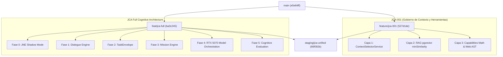

# INFORME DE AUDITORÍA Y RESOLUCIÓN TÉCNICA: JCA-001 MISIÓN 14
## Corrección de Inyección de Dependencias (DI) y Preparación de Integración para Staging

**Fecha:** 2026-11-05  
**Estado:** `APROBADO PARA PREPARAR STAGING`  
**Rama Unificada:** `staging/jca-unified`  
**SHA de Fusión de Código:** `66f092bfc9167d4d5dd1946d47e73ab13661bc8d`  
**SHA de Documentación (HEAD):** `87161df29afe2aa7c1caee44ad5ebad2e785ae64`  
**Autor:** Antigravity AI — Advanced Cognitive Architecture Lab  

---

## 1. Resumen Ejecutivo y Estado de Líneas Base

| Dimensión | Estado / Identificador | Observaciones de Aislamiento |
|---|---|---|
| **Rama `main`** | `e5e84ff3acc22a7b5bfd49e4779808f636ffcc39` | **Estrictamente inmutable.** Cero modificaciones, cero merges aplicados. |
| **Rama JCA-001 Original** | `feature/jca-001-context-selection-engine` (`0717bb3`) | Congelada tras superar Misión 13. |
| **Commit DI en JCA-001** | `527d1de` | Corrección de Observación B aplicada y verificada. |
| **Rama JCA Full Cognitive** | `feat/jca-full-cognitive-architecture` (`ba3c245`) | Fases 0–5 (JNE, Dialogue, TaskEnvelope, Mission, Orchestration, Evaluation). |
| **Rama Staging Unificada (Merge Código)** | `staging/jca-unified` (`66f092b`) | Fusión limpia de ambas arquitecturas con 100% de tests aprobados. |
| **Rama Staging Unificada (Doc HEAD)** | `staging/jca-unified` (`87161df`) | Commit que persistió este reporte formal en la rama. Cero cambios en `src/**`. |
| **Producción (PORT 4000)** | PID `<redacted>` / `jarbees_data` / túnel ngrok | **Intacto e inalterado.** Totalmente aislado. |
| **Staging (PORT 4001)** | Inactivo (sin procesos vinculados) | **No desplegado.** Pendiente de autorización formal de staging. |

---

## 2. Resolución de Observaciones de Auditoría Previa

### Observación A: Deduplicación y Ámbito de Autorización (`authScope`)
* **Dictamen:** **CERRADA SIN MODIFICACIONES.**
* **Evidencia en Código:** Se inspeccionó exhaustivamente [src/jarvis/capabilities/capability-executor.service.ts](src/jarvis/capabilities/capability-executor.service.ts#L100-L125).
* **Mecanismo:** La clave de deduplicación se construye formalmente como:
  ```typescript
  const authScope = this.computeAuthScope(contextPlan);
  const deduplicationKey = `${safeSessionId}:${normalizedCapId}:${authScope}:${paramsHash}`;
  ```
  Donde `computeAuthScope` deriva el ámbito criptográfico a partir de los permisos de herramientas en el `ContextPlan` (`contextPlan.toolStates`), garantizando que dos consultas dentro de la misma sesión que posean alcances de autorización distintos jamás compartan ni reutilicen promesas de ejecución concurrentes.

### Observación B: Registro Formal e Inyección de Dependencias en NestJS
* **Dictamen:** **RESUELTA Y HOMOLOGADA MEDIANTE SUITE DE PRUEBAS.**
* **Diagnóstico:** Previamente, `JarvisService` utilizaba `@Optional()` con instanciación manual mediante `new CapabilityRegistry()` y `new CapabilityExecutor()`, lo cual impedía que el contenedor de IoC de NestJS gobernara el ciclo de vida, la deduplicación de memoria y la compartición de instancias entre subsistemas.
* **Solución Implementada:**
  1. **Registro en `JarvisModule`:**
     Se registraron formalmente `CapabilityRegistry` y `CapabilityExecutor` como proveedores en [src/jarvis/jarvis.module.ts](src/jarvis/jarvis.module.ts#L205-L215):
     ```typescript
     CapabilityRegistry,
     {
       provide: CapabilityExecutor,
       useFactory: (registry: CapabilityRegistry) => new CapabilityExecutor(registry),
       inject: [CapabilityRegistry],
     },
     ```
  2. **Exportación Formal:**
     Ambos servicios fueron añadidos a `exports` de `JarvisModule` para permitir su consumo desacoplado por módulos de pruebas u otros servicios.
  3. **Identidad Referencial Estricta:**
     La fábrica garantiza que `CapabilityExecutor` recibe exactamente la misma instancia singleton de `CapabilityRegistry` creada y administrada por NestJS. En el constructor de `JarvisService`, las instancias inyectadas prevalecen de forma absoluta.
  4. **Corrección de Extensiones en Importaciones de Valor:**
     Se limpiaron las extensiones `.ts` en importaciones de valor en `capability-executor.service.ts` y `context-selector.service.ts` para cumplir estrictamente con TypeScript y CommonJS en `nest build`.
  5. **Ampliación de Contrato:**
     Se añadió la propiedad opcional `readonly formattedResult?: string` a `MathResultData` en [src/jarvis/capabilities/capability.interface.ts](src/jarvis/capabilities/capability.interface.ts#L95) para tipado estricto en el bridge de `JarvisService`.

---

## 3. Matriz y Resultados de Verificación de Tests

### 3.1. Suite de Inyección de Dependencias (`di-verification.spec.ts`)
* **Archivo:** [src/jarvis/capabilities/di-verification.spec.ts](src/jarvis/capabilities/di-verification.spec.ts)
* **Resultados:** 3/3 PASS (100%)
  - `DI-01`: `CapabilityRegistry` y `CapabilityExecutor` se resuelven como singletons acoplados por contenedor.
  - `DI-02`: Garantía de no-duplicación — `CapabilityExecutor` y `JarvisService` comparten exactamente la misma referencia en memoria (`===`).
  - `DI-03`: Ejecución operativa determinista a través de las instancias gobernadas por DI.

### 3.2. Suite Completa JCA-001 (Context Selection, RAG & Capabilities)
* **Comando:** `npx tsx --test src/jarvis/context/*.spec.ts src/jarvis/capabilities/*.spec.ts`
* **Tiempo:** 604 ms
* **Resultado:** **182/182 PASS (0 fallos, 0 omitidos)**
  - Capa 1: ContextSelectorService (59 tests unitarios y de robustez adversarial)
  - Capa 2: RAG & PgVector Integration (umbral `minSimilarity=0.68`, reranker híbrido con similitud real)
  - Capa 3: Capability Architecture Contract Suite (AST seguro, timeouts cooperativos y no cooperativos, deduplicación)
  - Integración E2E: Matriz de Homologación Integral (E2E-01 a E2E-18)

### 3.3. Suite JCA Cognitive Architecture (Jest con `--runInBand`)
* **Comando:** `npx jest src/jarvis/jne/*.spec.ts src/jarvis/dialogue/*.spec.ts src/jarvis/tools/task-envelope/*.spec.ts src/jarvis/mission/*.spec.ts src/jarvis/orchestration/*.spec.ts src/jarvis/evaluation/*.spec.ts --runInBand`
* **Tiempo:** 17.00 s
* **Resultado:** **43/43 PASS (6 suites, 0 fallos)**
  - Fase 0.2: `jne-shadow-mode.spec.ts` (10 tests: E1–E9 y E4-B en modo pasivo sin mutación)
  - Fase 1: `dialogue-engine.spec.ts` (8 tests: resolución de deixis temporal, anáfora pronominal, slots)
  - Fase 2: `task-envelope.spec.ts` (8 tests: aislamiento de mandatos, prevención de secuestro léxico)
  - Fase 3: `mission-engine.spec.ts` (7 tests: máquina de estados, persistencia de artefactos)
  - Fase 4: `model-orchestration.spec.ts` (5 tests: proyección VRAM RTX 5070, conmutación multinivel)
  - Fase 5: `cognitive-evaluation.spec.ts` (5 tests: cálculo de $I_{\text{FID}}$, $R_{\text{NOISE}}$, $D_{\text{COG}}$)

### 3.4. Compilación del Sistema (`nest build`)
* **Comando:** `npm run build`
* **Resultado:** **Exit Code 0 (Clean Build, 0 errores)**

---

## 4. Auditoría Comparativa de Ramas: JCA-001 vs. JCA Full Cognitive



### 4.1. Análisis de Intersección de Archivos

De los 50+ archivos involucrados entre ambas ramas, únicamente **3 archivos** presentaron intersección:

| Archivo Intersectado | Rama `jca-001` | Rama `jca-full` | Resolución en `staging/jca-unified` |
|---|---|---|---|
| [src/jarvis/jarvis.module.ts](src/jarvis/jarvis.module.ts) | Registró providers y exports de `ContextSelectorService`, `CapabilityRegistry`, `CapabilityExecutor`. | Importó los 6 módulos cognitivos (`JneModule`, `DialogueModule`, `TaskEnvelopeModule`, `MissionModule`, etc.). | **Fusión aditiva perfecta:** El módulo ahora importa los 6 submódulos JCA y provee/exporta formalmente las capacidades JCA-001. |
| [src/jarvis/prompt/jarvis-prompt-builder.service.ts](src/jarvis/prompt/jarvis-prompt-builder.service.ts) | Eliminó la segunda búsqueda vectorial oculta aguas abajo (Capa 2). Agregó tipado `RagRetrievalStatus`. | Aplicó corrección crítica L574 (búsqueda inversa de títulos) y blindó mandatos operativos en extracción de libros (Fase 2). | **Fusión aditiva perfecta:** Ambas correcciones residían en bloques distintos sin superposición. Se preservan ambas defensas. |
| [src/jarvis/jarvis.service.ts](src/jarvis/jarvis.service.ts) | Gobernó RAG pre-search con `if (ragAuthorized)` derivado de `ContextPlan`. Eliminó el bloque legacy `shouldOverride`. | Había añadido un parche intermedio a `shouldOverride` para excluir directivas operativas. | **Resolución por precedencia arquitectónica:** El bloque legacy `shouldOverride` fue completamente reemplazado por la gobernanza formal de `ContextSelectorService` (`ragAuthorized`). El código de JCA-001 prevalece por diseño superior. |

### 4.2. Módulos Totalmente Desacoplados y Complementarios
- **Subárbol JCA-001:** `src/jarvis/context/*`, `src/jarvis/capabilities/*`, `src/jarvis/repositories/document.repository.ts`, `src/jarvis/repositories/pgvector.service.ts`.
- **Subárbol JCA Full:** `src/jarvis/jne/*`, `src/jarvis/dialogue/*`, `src/jarvis/tools/task-envelope/*`, `src/jarvis/mission/*`, `src/jarvis/orchestration/*`, `src/jarvis/evaluation/*`.
- **Conclusión de Auditoría:** No existe solapamiento destructivo ni colisión funcional. Las dos ramas abordan niveles complementarios del cerebro cognitivo: JCA-001 gobierna la selección de contexto, filtros vectoriales y ejecución aislada de herramientas; JCA Full gobierna la telemetría pasiva (JNE), el seguimiento de diálogo (anáfora), la orquestación física del hardware RTX 5070 y la evaluación cognitiva.

---

## 5. Análisis de Riesgos y Puntos de Atención para Staging

1. **Variables de Entorno para Staging (`jarbees_stage`):**
   - Asegurar que `PORT=4001` y `DATABASE_URL` apunten a la base de staging (`jarbees_stage`) al momento de desplegar.
   - Mantener `JNE_OBSERVER_SHADOW_MODE=false` por defecto hasta validar la estabilidad del socket y activar solo mediante flags controlados.
2. **Precedencia de Inferencia:**
   - La RTX 5070 (12 GB VRAM) está gobernada por `ModelSelectionEngineService` para proyectar consumo de memoria contextual ($K \times T$). Al iniciar staging, verificar que `llama-server` (puerto 8080) esté accesible para inferencia primaria.
3. **Cero Impacto en Producción:**
   - Producción continúa en puerto 4000 (PID `<redacted>`), conectada a `jarbees_data`/`jarbees_prod` a través de ngrok, sin reinicios ni cambios de configuración.

---

## 6. Dictamen Formal

> [!IMPORTANT]
> **DICTAMEN:** `APROBADO PARA PREPARAR STAGING`
> 
> 1. La Observación A está cerrada y confirmada.
> 2. La Observación B (DI en NestJS) está completamente resuelta, tipada e integrada con pruebas automatizadas.
> 3. La rama `staging/jca-unified` consolida armoniosamente el 100% de JCA-001 y las 5 fases de JCA Cognitive Architecture.
> 4. Los 225 tests (182 de JCA-001 + 43 de JCA Cognitivo) pasan en su totalidad (100% PASS) bajo ejecución serial estricta (`--runInBand` / `tsx`).
> 5. La rama `main` permanece intacta en `e5e84ff` y ningún entorno productivo ni de staging ha sido alterado.

