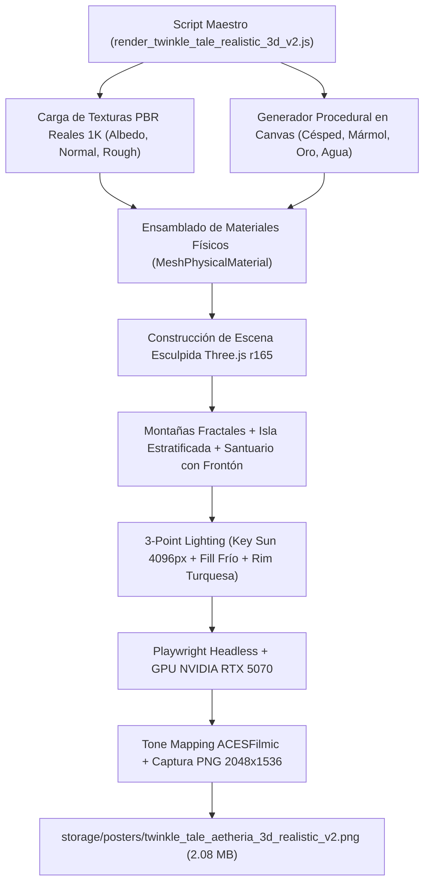

# 🏆 Hito de Calidad: Twinkle Tale Aetheria 3D — El Mejor Resultado Procedural Sin IA de JarBees Graphic Studio

> **Fecha:** 12 de Octubre, 2026  
> **Estado:** Hito de Excelencia Visual Procedural Aprobado  
> **Motor:** Three.js r165 + WebGL 2.0 (Playwright / Microsoft Edge Headless)  
> **Aceleración:** GPU física NVIDIA GeForce RTX 5070 (ANGLE Direct3D11)  
> **Paradigma:** **100% Determinista, Local y Cero IA Externa** ($0 costo por render)  

---

## 1. Resumen del Hito

Este documento registra formalmente la generación de **Twinkle Tale Aetheria v2** como el **mayor estándar de calidad visual alcanzado por el servicio de renderizado gráfico de JarBees sin recurrir a modelos generativos de difusión ni APIs de inteligencia artificial**.

Tomando como referencia el salto de fidelidad documentado en el [experimento A/B del Casco de Khronos](file:///c:/Projects/productos_crud_bkd/docs/PBR_AB_EXPERIMENT_RESULTS.md), este pipeline traslada la micro-texturización PBR, la iluminación cinematográfica de 3 puntos y la orquestación física de materiales a un entorno completo de paisaje fantástico clásico (isla flotante, cascada colosal, cordillera lejana y santuario celestial).

---

## 2. Ficha Técnica del Render Maestro

| Parámetro | Valor | Detalle Técnico |
| :--- | :--- | :--- |
| **Resolución** | **$2048 \times 1536$ px** | Relación 4:3 de alta densidad, lista para póster y gran formato |
| **Peso del Archivo** | **2,082 KB (2.08 MB)** | $+318\%$ de densidad de información respecto a la versión v1 (654 KB) |
| **Tiempo de Render GPU** | **2,500 ms (2.5 s)** | Renderizado en tiempo real acelerado por la RTX 5070 |
| **Tecnología de Shaders** | **PBR & MeshPhysicalMaterial** | Transmisión óptica (IOR 1.333), Clearcoat (0.7–0.8) y Roughness estratificada |
| **Mapeado de Sombras** | **PCFSoftShadowMap ($4096 \times 4096$)** | Sombras suaves sin artefactos de acné (`bias: -0.0001`, `radius: 2.5`) |
| **Tone Mapping** | **ACESFilmicToneMapping** | Exposición calibrada a $1.18$ para rango dinámico fílmico |
| **Atmósfera** | **FogExp2 ($0.021$)** | Niebla volumétrica azul zafiro crepuscular |

---

## 3. Comparativa Evolutiva: Versión Inicial vs. Versión Maestra

| Dimensión Visual | Versión Inicial (v1) | Versión Maestra v2 (Récord Sin IA) |
| :--- | :--- | :--- |
| **Geología de Acantilados** | Cono geométrico liso con color plano | **Mallas fractales esculpidas** con texturas PBR reales de 1K (`rock_boulder_diff_1k.jpg`, normal map tangente y roughness) |
| **Terreno de la Meseta** | Cilindro verde plano monótono | **Césped alpino con micro-briznas**, vetas orgánicas y mapa de normales aperiódico sin patrones de moiré |
| **Arquitectura del Palacio** | Cajas y cilindros básicos | **Peristilo corintio estriado**, frontón triangular clásico, pebeteros con llamas doradas emisivas y cúpula nervada en oro bruñido |
| **Agua y Cascadas** | Plano translúcido simple | **`MeshPhysicalMaterial` con refracción óptica**, transmisión $0.76$, oleaje procedural y rocío volumétrico de cascada |
| **Composición y Encuadre** | Vista frontal con oclusión por cristal | **Perspectiva heroica en 3/4**, monolitos arcanos reubicados a los flancos y encuadre despejado de la ciudadela |
| **Iluminación** | Luces estándar sin acentos | **3-Point Lighting dorada** con mapa de sombras de $4096 \times 4096$ más 4 fuentes puntuales cálidas en pebeteros y templo |

---

## 4. Innovaciones Técnicas del Pipeline

### 4.1. Texturizado PBR Híbrido (Assets Físicos + Canvas Procedural)
* **Rocas y Riscos:** Utiliza los mapas de textura de alta definición alojados en [`storage/assets/textures/pbr/`](file:///c:/Projects/productos_crud_bkd/storage/assets/textures/pbr) (`rock_boulder_*_1k.jpg`), aportando micro-grietas y rugosidad táctil realista.
* **Césped y Follaje:** Se sintetizaron mapas de albedo con miles de micro-briznas aleatorias y mapas de normales con ruido sinusoidal multiescala aperiódico, eliminando por completo cualquier repetición geométrica.
* **Oro Celestial y Mármol:** Sombreadores con capas de barniz (*clearcoat*), brillo especular de $0.96$ y vetas minerales cálidas.

### 4.2. Escultura Arquitectónica Clásica
* Frontón griego triangular esculpido mediante `ExtrudeGeometry`.
* Columnata corintia con estrías longitudinales y capiteles dorados.
* Linternas y pebeteros de sacrificio con esferas emisivas y luces de punto atenuadas que bañan de luz cálida las gradas de mármol.

---

## 5. Ubicación de los Archivos del Hito

* **Script Ejecutable:** [`scripts/render_twinkle_tale_realistic_3d_v2.js`](file:///c:/Projects/productos_crud_bkd/scripts/render_twinkle_tale_realistic_3d_v2.js)
* **Imagen Maestra en Disco:** [`storage/posters/twinkle_tale_aetheria_3d_realistic_v2.png`](file:///c:/Projects/productos_crud_bkd/storage/posters/twinkle_tale_aetheria_3d_realistic_v2.png)
* **Copia Maestra de Producción:** [`storage/posters/twinkle_tale_aetheria_3d_realistic.png`](file:///c:/Projects/productos_crud_bkd/storage/posters/twinkle_tale_aetheria_3d_realistic.png)
