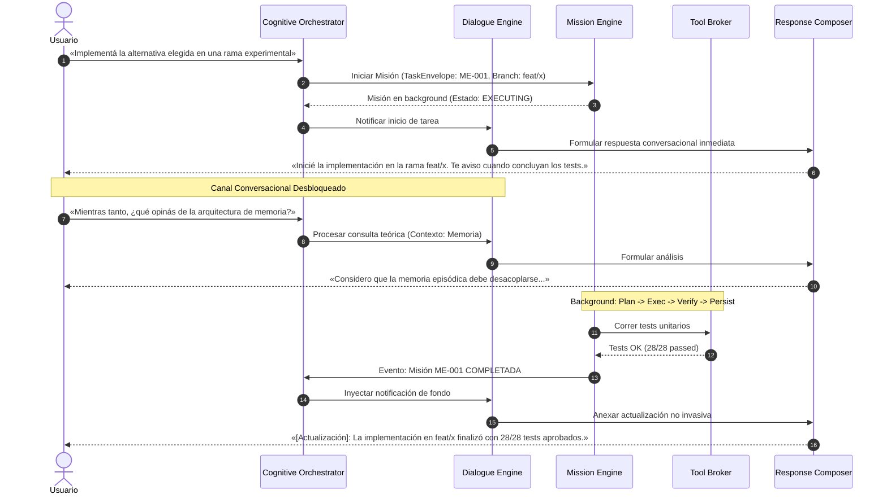
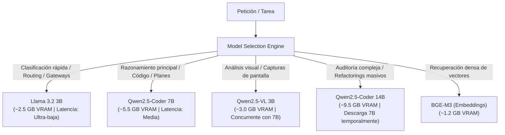
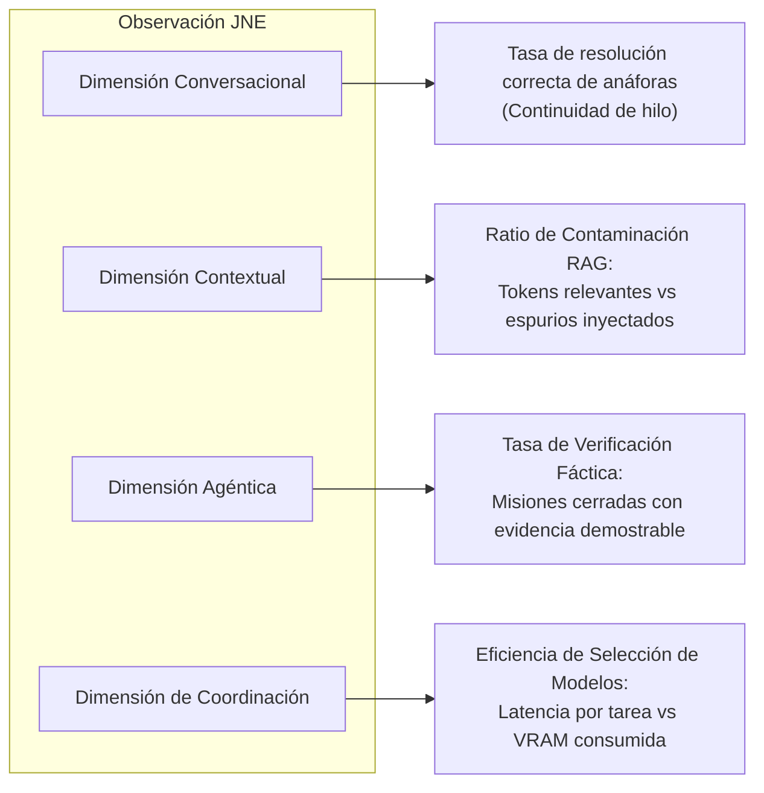
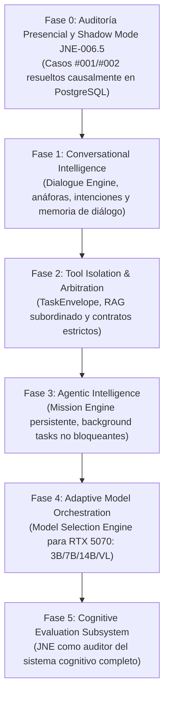

# JarBees Cognitive Architecture (JCA)
### Sistema Cognitivo Modular, Coordinación Asíncrona y Aislamiento por Contratos

> [!IMPORTANT]
> **Principio Rector Fundamental:**
> *«Cada capacidad debe poder amplificar a las demás, pero ninguna debe tener autoridad para desorganizar el sistema.»*
> La inteligencia de un asistente no reside únicamente en los pesos del modelo, sino en la arquitectura de coordinación que interpreta intenciones, preserva el estado, aísla herramientas y verifica evidencias.

---

## 1. Visión y Topología del Sistema

JarBees evoluciona de un «pipeline conversacional con herramientas» hacia un **Sistema Cognitivo Modular**. Esta arquitectura desacopla estrictamente la interacción conversacional en tiempo real de la ejecución agéntica prolongada.

```mermaid
graph TD
    subgraph Entrada / Salida
        USR["Usuario (Texto / Voz)"]
        UI["Interfaz Conversacional (Web / CLI)"]
        USR <--> UI
    end

    subgraph Capa de Orquestación Cognitiva
        CO["Cognitive Orchestrator<br/>(Clasificación de Intención y Estado del Hilo)"]
        UI --> CO
        
        DE["Dialogue Engine<br/>(Conversación, Continuidad y Anáforas)"]
        ME["Mission Engine<br/>(Planificación, Ejecución y Checkpoints)"]
        CM["Context Manager<br/>(Memoria Semántica y Episódica Acotada)"]
        TB["Tool Broker<br/>(TaskEnvelope y Control de Permisos)"]

        CO <--> DE
        CO <--> ME
        CO <--> CM
        CO <--> TB
    end

    subgraph Especialistas y Capacidades (Aislados)
        RAG["RAG / CorpusSelector<br/>(Propuesta Contextual)"]
        COD["Coding Specialist<br/>(Generación y Parches)"]
        RES["Research Specialist<br/>(Búsqueda e Inspección)"]
        VIS["Vision Specialist<br/>(Qwen2.5-VL)"]
        BRW["Browser / Web<br/>(Extracción Externa)"]
    end

    subgraph Infraestructura de Inferencia (RTX 5070 12GB)
        MSO["Model Selection Engine<br/>(VRAM, Latencia y Especialidad)"]
        LLM_SMALL["Llama 3.2 3B<br/>(Routing / Fast Checks)"]
        LLM_MED["Qwen2.5-Coder 7B<br/>(Razonamiento / Código)"]
        LLM_LARGE["Qwen2.5-Coder 14B<br/>(Auditoría Compleja - Bajo Demanda)"]
    end

    subgraph Síntesis y Verificación
        VRC["Verification & Response Composer<br/>(Chequeo de Evidencia y Ensamblado Final)"]
        VRC --> UI
    end

    subgraph Observabilidad Pasiva
        JNE["JNE Observer (Shadow Mode)<br/>(Fronteras, Telemetría y Causalidad)"]
    end

    TB --> RAG
    TB --> COD
    TB --> RES
    TB --> VIS
    TB --> BRW

    RAG & COD & RES & VIS & BRW --> VRC
    DE --> VRC
    ME --> VRC

    DE -.-> MSO
    ME -.-> MSO
    MSO --> LLM_SMALL & LLM_MED & LLM_LARGE

    CO -.->|Eventos de Frontera| JNE
    TB -.->|Llamadas y Permisos| JNE
    MSO -.->|Latencias y Tokens| JNE
    VRC -.->|Salida Cruda vs Final| JNE
```

---

## 2. Los Dos Motores Principales: Diálogo vs Misión

La arquitectura rechaza formalmente la idea de que la conversación y la acción agéntica sean modos que compiten por el mismo bucle de ejecución:



### A. Dialogue Engine (Potencia Conversacional)
* **Resolución de Anáforas y Deixis:** Interpreta con precisión antecedentes referenciales (*«eso»*, *«la segunda opción»*, *«lo que dijiste antes»*).
* **Seguimiento del Estado Conversacional:** Diferencia de manera inequívoca:
  1. *Pregunta nueva:* Abre un nuevo subtema.
  2. *Aclaración:* Modula la respuesta previa sin reiniciar el contexto.
  3. *Corrección:* Invalida premisas anteriores erróneas.
  4. *Instrucción operativa:* Deriva al Tool Broker o Mission Engine.
  5. *Charla reflexiva / conceptual:* Razona sin activar herramientas de persistencia o búsqueda.
* **Autocontrol y Consistencia:** Comprueba que la respuesta generada responda estrictamente a lo consultado, sin silencios evasivos, contradicciones internas ni cambios de tema injustificados.

### B. Mission Engine (Potencia Agéntica)
Opera como una máquina de estados determinista y persistente:
1. **Planificar:** Desglosa la meta en sub-tareas atómicas con dependencias y precondiciones explícitas.
2. **Ejecutar:** Despacha acciones mediante especialistas acotados (sandboxed).
3. **Observar:** Recoge telemetría real (código de salida, stdout/stderr, diffs de Git).
4. **Verificar:** Valida contra criterios objetivos (no acepta afirmaciones textuales sin evidencia).
5. **Persistir:** Graba el progreso en PostgreSQL (`AgentRun` / `MissionCheckpoint`) para permitir reanudación tras reinicios.
6. **Informar:** Entrega resultados consolidados al `Verification & Response Composer` para que el `Dialogue Engine` los comunique en el tono y momento apropiados.

---

## 3. Contratos de Aislamiento: El `TaskEnvelope`

Para erradicar definitivamente incidentes de secuestro como los Casos #001 y #002, ninguna herramienta puede intervenir en el sistema sin un sobre de ejecución formal:

```typescript
export interface TaskEnvelope {
  /** Identificador de la sesión de diálogo activa */
  readonly conversationId: string;
  
  /** Identificador único de la tarea específica */
  readonly taskId: string;
  
  /** Intención clasificada por el Cognitive Orchestrator */
  readonly intent: 'CONVERSATION' | 'EXPLANATION' | 'RESEARCH' | 'CODE_EXECUTION' | 'SYSTEM_ADMIN';
  
  /** Modo de ejecución */
  readonly mode: 'DIALOGUE' | 'MISSION';
  
  /** Lista blanca estricta de herramientas autorizadas para esta tarea */
  readonly allowedTools: readonly string[];
  
  /** Ámbito de contexto permitido (evita inyecciones de corpus no relacionados) */
  readonly contextScope: readonly string[];
  
  /** Esquema o tipo de datos esperado en la salida del especialista */
  readonly outputContract: 'JSON_SCHEMA' | 'DIFF_PATCH' | 'TEXT_EVIDENCE' | 'STATUS_FLAG';
  
  /** Si la ejecución requiere confirmación humana explícita */
  readonly requiresApproval: boolean;
}
```

### Las Cinco Reglas Estructurales de Aislamiento:
1. **Separación Estricta de Canales:** Una búsqueda RAG opera exclusivamente como proveedora de fragmentos informativos; tiene **estrictamente prohibido** redefinir la directiva de sistema o la intención del prompt.
2. **Permisos Mínimos por Tarea:** Si la tarea es `SYSTEM_ADMIN` (como registrar una misión), el `ToolBroker` bloquea las herramientas de RAG bibliográfico.
3. **Contextos Estancos:** Una misión agéntica en segundo plano corre en su propio espacio de memoria y directorio de trabajo; no inyecta su estado intermedio en la conversación actual a menos que concluya.
4. **Salidas Estructuradas con Evidencia:** Los especialistas no generan prosa final dirigida al usuario. Devuelven objetos tipados con evidencias (archivos leídos, líneas modificadas, hashes, salida de compilador).
5. **Composición Centralizada:** Únicamente el `Verification & Response Composer` decide qué fragmentos se incorporan al mensaje final que leerá el usuario.

---

## 4. Distribución y Orquestación de Modelos (RTX 5070 - 12 GB VRAM)

Para maximizar el rendimiento del hardware local sin incurrir en desbordamientos de memoria (*out-of-memory*) ni latencias excesivas, el `Model Selection Engine` aplica una política adaptativa:



### Matriz de Selección Dinámica:

| Modelo Local | Cuantización | Huella VRAM | Rol Cognitivo | Criterio de Selección |
| :--- | :--- | :--- | :--- | :--- |
| **Llama 3.2 3B** | Q4_K_M | $\approx 2.2\text{ GB}$ | Gatekeeper, clasificación de intención, detector de anáforas. | Toda petición entrante pasa primero por este modelo para clasificar intención en $<200\text{ ms}$. |
| **Qwen2.5-Coder 7B** | Q4_K_M | $\approx 5.2\text{ GB}$ | Núcleo de razonamiento conversacional, lógica de código, síntesis. | Tareas de diálogo general, respuestas técnicas y generación de funciones. |
| **Qwen2.5-Coder 14B** | Q4_K_M | $\approx 9.2\text{ GB}$ | Auditorías de arquitectura, diseño de pruebas causales complejas. | Exclusivamente bajo demanda para misiones complejas. Requiere pausar temporalmente el modelo de 7B. |
| **Qwen2.5-VL 3B** | Q4_K_M | $\approx 2.8\text{ GB}$ | Comprensión multimodal, análisis de diagramas e interfaces. | Activado únicamente cuando la petición incluye imágenes o capturas. |
| **BGE-M3** | FP16 | $\approx 1.2\text{ GB}$ | Generación de embeddings semánticos para RAG contextual. | Concurrente con 3B y 7B ($\text{Total VRAM} \approx 2.2 + 5.2 + 1.2 = 8.6\text{ GB} \le 12\text{ GB}$). |

$$\text{Presupuesto VRAM Base: } 8.6\text{ GB} \implies \mathbf{3.4\text{ GB de margen libre}}\text{ para KV-Cache contextual prolongado (32k tokens)}.$$

---

## 5. El Rol de JNE en la Evolución Cognitiva

JNE trasciende la detección de anomalías locales y se consolida como el **Sistema de Telemetría y Evaluación Forense Integral de JarBees**:



### Métricas Cognitivas Formales:

1. **Índice de Fidelidad a la Intención ($I_{\text{FID}}$):**
   $$I_{\text{FID}} = 1 - \frac{\text{Intervenciones espurias de herramientas}}{\text{Total de peticiones procesadas}}$$
2. **Ratio de Ruido Contextual ($R_{\text{NOISE}}$):**
   $$R_{\text{NOISE}} = \frac{\text{Tokens de contexto inyectados no citados en la respuesta}}{\text{Tokens totales de contexto inyectados}}$$
3. **Tasa de Conclusión con Evidencia ($T_{\text{VERIF}}$):**
   $$T_{\text{VERIF}} = \frac{\text{Tareas completadas con hash/diff/código de salida verificado}}{\text{Tareas marcadas como 'DONE' por el agente}}$$

---

## 6. Hoja de Ruta de Desarrollo en Cinco Fases



### Descripción de Fases:

* **Fase 0 — Cierre Forense Presencial (Inmediato):** Auditoría en PostgreSQL de los casos #001 y #002. Activación de Shadow Mode JNE v0.6.5 sobre la rama aislada `feat/jne-shadow-mode`. Cero interferencia productiva.
* **Fase 1 — Conversational Intelligence:** Implementación del `DialogueEngine` en JarBees. Incorporación del resolvedor de deixis y anáforas. Desacoplamiento de la memoria conversacional de los filtros documentales.
* **Fase 2 — Tool Isolation & Arbitration:** Introducción del `TaskEnvelope` en `JarvisService`. Confinamiento de `CorpusSelectorService` a un servicio de propuesta pasiva subordinado al `IntentRouter`.
* **Fase 3 — Agentic Intelligence:** Construcción del `MissionEngine` desacoplado del ciclo HTTP de la UI. Soporte para misiones asíncronas persistentes en background con reporte conversacional no intrusivo.
* **Fase 4 — Adaptive Model Orchestration:** Integración del selector dinámico de modelos aprovechando la VRAM de la RTX 5070 (enrutando clasificación rápida a Llama 3.2 3B y razonamiento a Qwen 7B/14B).
* **Fase 5 — Cognitive Evaluation:** Ampliación de JNE para auditar las métricas $I_{\text{FID}}$, $R_{\text{NOISE}}$ y $T_{\text{VERIF}}$, convirtiendo a JarBees en una plataforma que mide científicamente su propia evolución.
