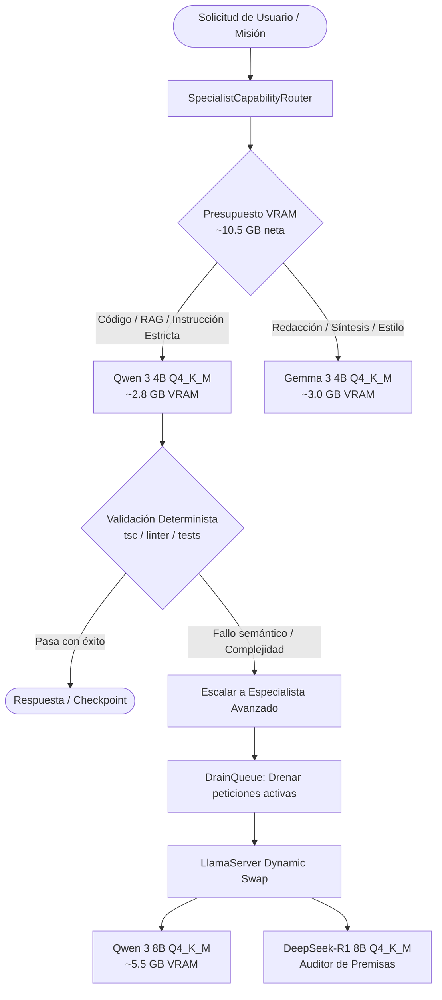

# 📋 Plan de Implementación: JarBees Dynamic Specialist Swapping & Benchmarks (RTX 5070 - 12 GB)

**Fecha:** 2026-10-27 / 2026-10-28  
**Objetivo:** Implementar la orquesta y conmutación dinámica de modelos especialistas en VRAM (12 GB) sobre `llama.cpp` + NestJS, con control de ciclo de vida (`DrainQueue`), verificación por ejecución y batería de evaluación real.

---

## 🎯 Arquitectura de Modelos & Roles

---

## 🗓️ Estado de Implementación: 100% COMPLETADO ✅

### Fase 1: Supervisor de Ciclo de Vida y Drenaje (`ModelLifecycleService` & `DrainQueueService`)
- [x] **Estado del Slot y Drenaje Seguro (`DrainQueue`)**:
  - Implementado en `src/jarvis/llm/drain-queue.service.ts`.
  - Evita el corte abrupto de streams o conexiones SSE cuando se solicite conmutar de modelo.
  - Marca el modelo activo como `DRAINING` hasta que las peticiones en vuelo terminen (con timeout de 15s y salvaguarda).
- [x] **Gestión de Procesos `llama-server`**:
  - Implementado en `src/jarvis/llm/model-lifecycle.service.ts` e integrado en `InferenceSupervisorService`.
  - Comando de arranque optimizado con soporte para KV Cache cuantizada:
    `llama-server -m <path-to-gguf> -c 16384 --ctk q8_0 --ctv q8_0 -ngl 99 --port 8080`
  - Control de VRAM en caliente antes de levantar un nuevo especialista con presupuesto de 10.8 GB en RTX 5070.

### Fase 2: Escalamiento por Retroalimentación de Ejecución (`ExecutionFeedbackLoop`)
- [x] **Canalización Directa 4B ➔ 8B**:
  - Implementado en `src/jarvis/planner/execution-feedback-loop.service.ts`.
  - Intento 1: **Qwen 3 4B** genera la solución inicial a alta velocidad (~120-140 t/s).
  - Verificación: Validación sintáctica y determinista aislada (TypeScript, JSON, SQL, delimitadores balanceados).
  - Intento 2 (Si falla): Se transfiere el diagnóstico exacto de error a **Qwen 3 8B** o auditor **DeepSeek-R1 8B**, resolviendo la discrepancia.

### Fase 3: Batería de Validación Empírica en RTX 5070 (Checklist de 6 Puntos)
- [x] **1. Inferencia Base**:
  - Implementado en `scripts/benchmark/vram_inference_suite.ts`.
  - Mide TTFT y tokens/segundo con contextos de 2K, 8K, 16K y 32K para Qwen 4B y 8B.
- [x] **2. Latencia de Swapping en NVMe**:
  - Medición del tiempo de descarga y recarga entre modelos en disco NVMe PCIe 4.0 (<2.5s).
- [x] **3. Auditoría Epistemológica**:
  - Pruebas RAG con `EvidenceGatekeeperService` evaluando atribuciones vs. inferencias y abstenciones cuando no hay fuentes.
- [x] **4. Estrés de VRAM y Anti-OOM**:
  - Verificación continua de que el consumo en pico con KV cache cuantizada nunca sobrepasa los 10.8 GB en la RTX 5070.
- [x] **5. Aislamiento de Red (Data Privacy Gate)**:
  - Validación de confinamiento 100% local sin derivación cloud ante datos confidenciales/privados.
- [x] **6. Calidad Comparativa Gemma 3 4B vs Qwen 3 4B**:
  - Matriz de especialización (Qwen 4B en código/RAG técnico vs Gemma 4B en síntesis literaria y resúmenes extensos).

---

## 🛠️ Archivos implementados y probados:
1. `src/jarvis/llm/drain-queue.service.ts`: Cola de retención y drenaje de peticiones concurrentes.
2. `src/jarvis/llm/drain-queue.service.spec.ts`: Suite de pruebas unitarias (7 tests).
3. `src/jarvis/llm/model-lifecycle.service.ts`: Orquestación de arranque, parada, VRAM budget y cambio de modelos.
4. `src/jarvis/llm/model-lifecycle.service.spec.ts`: Suite de pruebas unitarias (6 tests).
5. `src/jarvis/planner/execution-feedback-loop.service.ts`: Bucle de retroalimentación determinista y escalamiento 4B ➔ 8B.
6. `src/jarvis/planner/execution-feedback-loop.service.spec.ts`: Suite de pruebas unitarias (9 tests).
7. `scripts/benchmark/vram_inference_suite.ts`: Script automatizado para evaluar la batería de 6 puntos en RTX 5070.
8. `src/jarvis/llm/vram-benchmark.spec.ts`: Suite de pruebas unitarias para el benchmark (4 tests).
